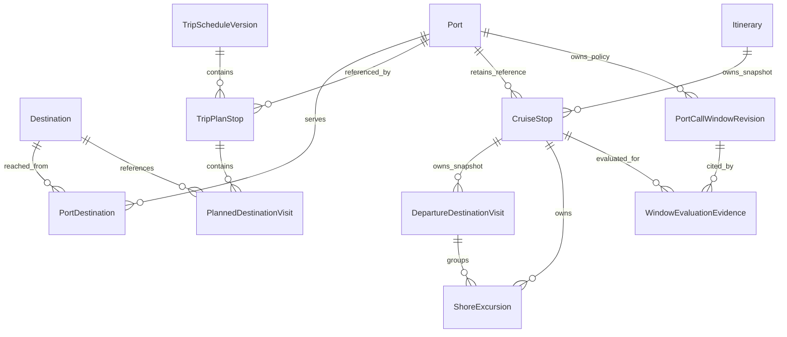
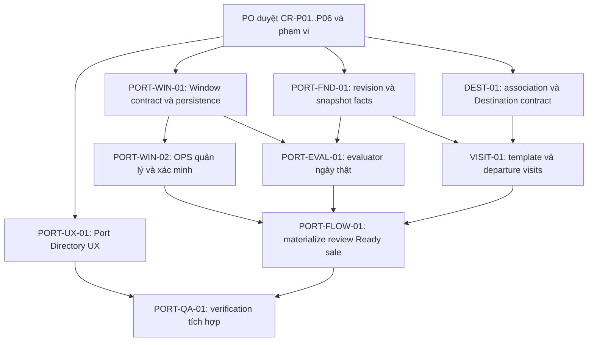

# PORT_DOMAIN_UX_REDESIGN_01

Ngày: 01/11/2026 · Trạng thái: **DESIGN PROPOSED — chờ Product Owner duyệt**.

## 1. Executive Summary

Khuyến nghị một kiến trúc thống nhất: **Port Directory nội bộ → PortCall theo lịch trình → DestinationVisit nằm dưới PortCall → snapshot độc lập khi tạo Departure**. PortCallWindow là chính sách đến/rời của Port, được kiểm tra bằng ngày thực tế; không phải nội dung mẫu hay thời lượng ghé cảng.

Giữ phần local đã đúng: UUID cảng nội bộ; tên cảng tách địa danh; timezone do nghiệp vụ chọn; provenance riêng; PATCH thông tin khác giữ nguyên tọa độ lịch sử; planned/actual riêng; CRM finalize mẫu khác OPS duyệt kế hoạch. Không viết lại các phần này chỉ để đổi giao diện.

Ba thiếu hụt chính: chưa có DestinationVisit; snapshot đọc lại tên/quốc gia/timezone từ Port Master; chưa có PortCallWindow persistence/API/evaluator nên tạo Departure từ mẫu hiện bị chặn. Quan hệ nhiều–nhiều Port–Destination là **đề xuất**, chưa phải quyết định PO. Không thể coi PORT-01 hay build xanh là hoàn tất toàn bộ domain.

Baseline kiểm tra trực tiếp local, gồm thay đổi chưa commit:

| Repository | Branch | HEAD | Working tree tại kiểm kê |
|---|---|---|---|
| CASMS_Backend | `codex/be-dur-01` | `fa8eeaf1b5b578e954ccecb2c64d8e3e8e3e49ba` | 131 dòng `git status --short`, trước báo cáo này |
| CASMS_Frontend | `main` | `b72ae568032db98fe81169c8a9b2792a45068304` | 153 dòng `git status --short` |

Các SHA không đại diện đầy đủ code đang phân tích vì cả hai tree có thay đổi local. Task chỉ tạo báo cáo này; không sửa source, V77 hoặc dữ liệu. DB/API runtime/permission thực tế: **NOT VERIFIED**. Test/build/lint/typecheck/E2E/browser/screenshot/migration: **NOT RUN theo giới hạn PO**. Không kết luận UX đã nghiệm thu.

## 2. Approved Business Baseline

Nguồn quyết định: prompt PORT-REDESIGN-01 được PO đính kèm; quy tắc địa lý đối chiếu code DEC-PORT-02 đang có, không suy ra tính đúng từ báo cáo cũ.

| Đã duyệt | Hệ quả thiết kế bắt buộc |
|---|---|
| Port là cảng thực tế, CASMS quản lý | Dùng local Port ID; không tạo Port tự động từ Geocoding; ETA/ETD không nằm trong master |
| Địa danh là thành phố/đảo | `externalLocationId` khác Port ID; không ghi đè tên/múi giờ cảng; tọa độ không chứng minh vị trí cầu cảng/bến neo |
| Destination là điểm khách tham quan | Tách khỏi Port; một Destination có thể liên quan nhiều Port; không sao chép coordinateSource |
| PortCall là một lần tàu ghé | Có identity, thứ tự, ngày đến/rời; planned/actual độc lập; tour thuộc đúng lần ghé |
| PortCallWindow thuộc Port | ARRIVAL/DEPARTURE riêng, giờ địa phương, hiệu lực/đóng cảng và verification theo contract được duyệt; không suy ra 24/7 |
| Template khác Departure | Không đưa SERVING_WINDOW hoặc chọn Window vào mẫu; không tự cập nhật snapshot từ master; không suy cảng đầu/cuối từ Destination |
| Mainflow giữ các cổng riêng | Finalize mẫu → tạo Departure → OPS review Cruise Plan → Ready → Open Sale; không gộp phê duyệt |

Trong báo cáo, OPS/CRM là viết tắt kỹ thuật của OPERATIONS_MANAGER/CRUISE_MANAGER. UI dùng đầy đủ **Quản lý vận hành / Quản lý lịch trình**. PortCall dùng thuật ngữ **Lần ghé cảng** theo glossary hiện có [E20]. Các tên entity/field mới bên dưới đều là đề xuất contract, chưa được tạo hoặc duyệt.

## 3. Current FE/BE Architecture

### 3.1 Bản đồ bằng chứng source

Mỗi E-ID chỉ bằng chứng tĩnh ở local tại baseline trên. Link trỏ dòng bắt đầu liên quan; nội dung service/controller/consumer đã được đối chiếu, không chỉ tên file.

| ID | File và bằng chứng chính |
|---|---|
| E01 | [Port.java:21](C:/Users/USER/OneDrive/Documents/GitHub/CASMS_Backend/src/main/java/com/casms/ship/entity/Port.java:21): UUID, mã duy nhất, tên/quốc gia/timezone, JSON provenance, tọa độ, status, FK Destination; không có revision/@Version |
| E02 | [Destination.java:23](C:/Users/USER/OneDrive/Documents/GitHub/CASMS_Backend/src/main/java/com/casms/ship/entity/Destination.java:23): tên/quốc gia/description/domesticRegion/status; `ports` one-to-many, cascade ALL/orphanRemoval |
| E03 | [PortCreateRequest.java:17](C:/Users/USER/OneDrive/Documents/GitHub/CASMS_Backend/src/main/java/com/casms/ship/dto/request/PortCreateRequest.java:17), [PortUpdateRequest.java:15](C:/Users/USER/OneDrive/Documents/GitHub/CASMS_Backend/src/main/java/com/casms/ship/dto/request/PortUpdateRequest.java:15), [PortService.java:38](C:/Users/USER/OneDrive/Documents/GitHub/CASMS_Backend/src/main/java/com/casms/ship/service/PortService.java:38): create bắt buộc tọa độ/source/timezone; PATCH geo đủ bộ, code/country bất biến; source recordedAt do server ghi; audit before/after ở dòng 276 |
| E04 | [PortController.java:55](C:/Users/USER/OneDrive/Documents/GitHub/CASMS_Backend/src/main/java/com/casms/ship/controller/PortController.java:55): OPS + action authority khi ghi; list hỗ trợ search/country/status. [PortRepository.java:31](C:/Users/USER/OneDrive/Documents/GitHub/CASMS_Backend/src/main/java/com/casms/ship/repository/PortRepository.java:31): filter trước phân trang, guard reference khi xóa |
| E05 | [DestinationService.java:39](C:/Users/USER/OneDrive/Documents/GitHub/CASMS_Backend/src/main/java/com/casms/ship/service/DestinationService.java:39): trùng tên toàn cục, list findAll, audit overload không snapshot; [DestinationRepository.java:28](C:/Users/USER/OneDrive/Documents/GitHub/CASMS_Backend/src/main/java/com/casms/ship/repository/DestinationRepository.java:28): guard references và native delete tránh cascade |
| E06 | [DestinationController.java:25](C:/Users/USER/OneDrive/Documents/GitHub/CASMS_Backend/src/main/java/com/casms/ship/controller/DestinationController.java:25), [DestinationCreateRequest.java:15](C:/Users/USER/OneDrive/Documents/GitHub/CASMS_Backend/src/main/java/com/casms/ship/dto/request/DestinationCreateRequest.java:15), [DestinationResponse.java:15](C:/Users/USER/OneDrive/Documents/GitHub/CASMS_Backend/src/main/java/com/casms/ship/dto/response/DestinationResponse.java:15): API riêng, không nhận/trả domesticRegion dù entity có; GET linked ports dùng quan hệ hiện hành |
| E07 | [TripPlanStop.java:38](C:/Users/USER/OneDrive/Documents/GitHub/CASMS_Backend/src/main/java/com/casms/trip/entity/TripPlanStop.java:38), [TripPlanEntry.java:48](C:/Users/USER/OneDrive/Documents/GitHub/CASMS_Backend/src/main/java/com/casms/trip/entity/TripPlanEntry.java:48): source PortCall có day range/order/local times; stop/entry có optional destinationId, chưa có Visit identity |
| E08 | [CruiseStop.java:29](C:/Users/USER/OneDrive/Documents/GitHub/CASMS_Backend/src/main/java/com/casms/ship/entity/CruiseStop.java:29), [ShoreExcursion.java:30](C:/Users/USER/OneDrive/Documents/GitHub/CASMS_Backend/src/main/java/com/casms/activity/entity/ShoreExcursion.java:30): arrival/departure day, Port/Destination FK, planned/actual Instants riêng; tour liên kết CruiseStop |
| E09 | [TripScheduleVersionService.java:214](C:/Users/USER/OneDrive/Documents/GitHub/CASMS_Backend/src/main/java/com/casms/trip/service/TripScheduleVersionService.java:214): thứ tự, chronology/overlap; deferred checks dòng 573, CRM finalize dòng 673; all-aboard/tour checks dòng 1178 trở đi |
| E10 | [ScheduleMaterializationService.java:100](C:/Users/USER/OneDrive/Documents/GitHub/CASMS_Backend/src/main/java/com/casms/ship/service/ScheduleMaterializationService.java:100): gate trước ghi; source metadata và snapshot riêng; dòng 314 đọc master hiện tại; legacy block dòng 453; preview Window luôn BLOCK dòng 706 |
| E11 | [CruiseMainflowController.java:15](C:/Users/USER/OneDrive/Documents/GitHub/CASMS_Backend/src/main/java/com/casms/ship/controller/CruiseMainflowController.java:15), [CruiseMainflowService.java:293](C:/Users/USER/OneDrive/Documents/GitHub/CASMS_Backend/src/main/java/com/casms/ship/service/CruiseMainflowService.java:293): OPS Ready riêng; [CruiseService.java:2282](C:/Users/USER/OneDrive/Documents/GitHub/CASMS_Backend/src/main/java/com/casms/ship/service/CruiseService.java:2282): Open Sale gọi requireReady |
| E12 | [MasterDataPages.tsx:36](C:/Users/USER/OneDrive/Documents/GitHub/CASMS_Frontend/CASMS_WebApp/src/features/itineraries/pages/MasterDataPages.tsx:36): shared list/form/detail; activeOnly, provenance dòng 79; form dòng 164; detail timestamps dòng 269 |
| E13 | [LocationPicker.tsx:27](C:/Users/USER/OneDrive/Documents/GitHub/CASMS_Frontend/CASMS_WebApp/src/features/itineraries/components/LocationPicker.tsx:27), [port-location.ts:5](C:/Users/USER/OneDrive/Documents/GitHub/CASMS_Frontend/CASMS_WebApp/src/features/itineraries/model/port-location.ts:5): curated suggestions/country list, locality decoding/attribution; [geocoding-api.ts](C:/Users/USER/OneDrive/Documents/GitHub/CASMS_Frontend/CASMS_WebApp/src/features/itineraries/api/geocoding-api.ts): Open-Meteo search adapter |
| E14 | [itinerary-api.ts:175](C:/Users/USER/OneDrive/Documents/GitHub/CASMS_Frontend/CASMS_WebApp/src/features/itineraries/api/itinerary-api.ts:175): Port list chưa truyền bộ lọc BE, PATCH geo theo lựa chọn mới; Destination API riêng |
| E15 | [PlanDrawers.tsx:33](C:/Users/USER/OneDrive/Documents/GitHub/CASMS_Frontend/CASMS_WebApp/src/features/trip-planning/components/PlanDrawers.tsx:33): local Port picker, day range, copy destinationId từ Port dòng 67; tour picker dưới stop dòng 131; không có DestinationVisit editor |
| E16 | [catalogs.ts:28](C:/Users/USER/OneDrive/Documents/GitHub/CASMS_Frontend/CASMS_WebApp/src/features/trip-planning/api/catalogs.ts:28), [SourcePicker.tsx:10](C:/Users/USER/OneDrive/Documents/GitHub/CASMS_Frontend/CASMS_WebApp/src/features/trip-planning/components/SourcePicker.tsx:10), [TripCatalogController.java:439](C:/Users/USER/OneDrive/Documents/GitHub/CASMS_Backend/src/main/java/com/casms/trip/controller/TripCatalogController.java:439), [PlanningSourcePortResponse.java:17](C:/Users/USER/OneDrive/Documents/GitHub/CASMS_Backend/src/main/java/com/casms/trip/dto/response/PlanningSourcePortResponse.java:17): local catalog, DTO thiếu locality provenance; label Port hiện tên + mã, chưa country/locality |
| E17 | [work-policy.ts:9](C:/Users/USER/OneDrive/Documents/GitHub/CASMS_Frontend/CASMS_WebApp/src/shared/auth/work-policy.ts:9), [admin-navigation.ts:141](C:/Users/USER/OneDrive/Documents/GitHub/CASMS_Frontend/CASMS_WebApp/src/shared/ui/admin-v3/admin-navigation.ts:141), [RolePermissionInitializer.java:264](C:/Users/USER/OneDrive/Documents/GitHub/CASMS_Backend/src/main/java/com/casms/identity/service/RolePermissionInitializer.java:264), [Permission.java:140](C:/Users/USER/OneDrive/Documents/GitHub/CASMS_Backend/src/main/java/com/casms/identity/enums/Permission.java:140): FE workspace/route/action guards, BE Window permission groundwork |
| E18 | [V77:2](C:/Users/USER/OneDrive/Documents/GitHub/CASMS_Backend/src/main/resources/db/migration/V77__port_coordinate_source_metadata.sql:2), [V76:2](C:/Users/USER/OneDrive/Documents/GitHub/CASMS_Backend/src/main/resources/db/migration/V76__port_directory_ops_permission_groundwork.sql:2), [V75:2](C:/Users/USER/OneDrive/Documents/GitHub/CASMS_Backend/src/main/resources/db/migration/V75__preserve_materialized_source_metadata.sql:2): metadata/precision, permission groundwork, source snapshot metadata; không tạo Window/Visit |
| E19 | [AuditService.java:36](C:/Users/USER/OneDrive/Documents/GitHub/CASMS_Backend/src/main/java/com/casms/audit/AuditService.java:36): directory audit MANDATORY transaction, actor/role/changedFields/before/after; overload ba tham số truyền hai map rỗng |
| E20 | [glossary.md:54](C:/Users/USER/OneDrive/Documents/GitHub/CASMS_Frontend/CASMS_WebApp/docs/product/glossary.md:54), [AGENTS.md](C:/Users/USER/OneDrive/Documents/GitHub/CASMS_Frontend/CASMS_WebApp/AGENTS.md): thuật ngữ occurrence và UI authority |
| E21 | [V1:526](C:/Users/USER/OneDrive/Documents/GitHub/CASMS_Backend/src/main/resources/db/migration/V1__initial_schema.sql:526), [V21:2](C:/Users/USER/OneDrive/Documents/GitHub/CASMS_Backend/src/main/resources/db/migration/V21__align_port_entity_columns.sql:2), [V29:60](C:/Users/USER/OneDrive/Documents/GitHub/CASMS_Backend/src/main/resources/db/migration/V29__create_trip_planning_schema.sql:60), [V68:2](C:/Users/USER/OneDrive/Documents/GitHub/CASMS_Backend/src/main/resources/db/migration/V68__add_template_departure_port_and_time.sql:2): schema gốc, Port.destination_id, template calls, departure port riêng |
| E22 | [V28:4](C:/Users/USER/OneDrive/Documents/GitHub/CASMS_Backend/src/main/resources/db/migration/V28__seed_asian_ports_and_destinations.sql:4), [V33:18](C:/Users/USER/OneDrive/Documents/GitHub/CASMS_Backend/src/main/resources/db/migration/V33__seed_trip_planning_sources_and_geography.sql:18), [V36:2](C:/Users/USER/OneDrive/Documents/GitHub/CASMS_Backend/src/main/resources/db/migration/V36__standardize_geography_domestic_region.sql:2): seed geography/region liên kết Destination–Port; không chứng minh dữ liệu live |

### 3.2 Kiến trúc thực tế

BE phân hệ `ship` sở hữu Port/Destination/CruiseStop và materialization; `trip` sở hữu template days/stops/entries/catalog. Tour thực tế ở `activity.ShoreExcursion`. FE directory dùng chung MasterDataPages, CRM planner có module/source picker riêng. API FE qua adapter nội bộ; Geocoding chỉ ở form master, không thay catalog Port của CRM [E01–E16].

Schema evolution liên quan đã đọc: V1, V21, V28/V33 seed, V29, V36, V68, V75–V77. **V77 vẫn là migration local chưa được áp dụng theo đầu vào PO**: thêm nullable JSONB source và bỏ fixed scale của hai cột numeric; không backfill, không đổi ID/unique external ID. Không truy vấn Flyway history; trạng thái áp dụng thực tế mọi migration trên DB là NOT VERIFIED. Không được xóa/đánh lại số/chạy V77 trong task này [E18, E21, E22].

## 4. Port Domain Problems

Đã có identity/provenance đúng ở source [E01, E03]. Backend kiểm cấu trúc source do client gửi, không gọi xác thực ngược GeoNames; `recordedAt` chứng minh thời điểm server ghi nhận, **không chứng minh địa danh/cảng đã được nghiệp vụ xác minh**. Không gắn nhãn “Đã xác minh cảng” từ metadata này.

| Vấn đề hiện tại | Tác động / xử lý khuyến nghị |
|---|---|
| Form đặt Geocoding/gợi ý trước mã/tên; gợi ý “Cảng / điểm ghé du lịch” từ JSON tĩnh | Dễ nhầm gợi ý với danh mục cảng thật. Đưa identity trước, locality vào nhóm riêng; không dùng danh sách gợi ý như nguồn Port ID [E12, E13] |
| UI chỉ activeOnly; BE có search/country/status | Khó tìm khi danh mục lớn; truyền filter đến BE trước pagination, giữ URL/filter khi quay lại [E04, E12, E14] |
| Country picker lấy từ tập gợi ý tĩnh | Phạm vi tạo FE hẹp hơn ISO-2 hợp lệ ở BE. Chốt phạm vi quốc gia được vận hành; đồng bộ catalog, không tự mở rộng operating area [E03, E13, E16] |
| Port.description có DTO/persistence nhưng form không có editor; code/status vẫn có control khi edit dù PATCH không nhận | Người dùng có thể nghĩ đã sửa trường thực tế không lưu. Khóa code, trạng thái qua action riêng; hiển thị đúng capability [E03, E12, E14] |
| Không optimistic revision; chỉ timestamps/audit | Sửa đồng thời có thể ghi đè; audit không thay cơ chế version conflict [E01, E19] |
| Departure có FK Port, readback dùng master hiện tại | Sửa name/country/timezone có thể làm đổi cách đọc snapshot lịch sử; phải đóng băng facts dùng khi materialize [E08, E10] |

Không coi cùng locality/externalLocationId là trùng Port. Các cảng khác nhau có thể cùng thành phố. Unique portCode hiện hữu giữ nguyên; mô tả DTO catalog gọi mã UN/LOCODE chưa đủ căn cứ ép mọi mã thành chuẩn này [E01, E16].

## 5. Destination Domain Problems

Entity độc lập tồn tại được khi chưa có Port; quan hệ hiện tại là **Destination 1 → nhiều Port; Port → tối đa 1 Destination**. Đây là khả năng code, không phải bằng chứng PO đã duyệt chiều ngược [E01, E02].

Các gap: optional destinationId trên stop/entry không biểu diễn một chuyến thăm riêng; CRM chọn Port đang tự copy destinationId từ catalog; DTO gọi “điểm đến / vùng”, seed dùng cả vùng địa lý lớn. Cần phân loại dữ liệu lịch sử trước khi coi mọi Destination là attraction. Không tự đổi tên/xóa/di chuyển các bản ghi ấy [E07, E15, E16, E22].

Destination có domesticRegion trong entity nhưng thiếu ở create/update/read DTO và form; audit mới ghi actor/operation, chưa có diff dữ liệu. Unique name toàn cục có thể ngăn các điểm trùng tên ở quốc gia khác; chưa có quyết định định danh để tự đổi unique constraint. Entity cascade/orphanRemoval không phù hợp ownership master độc lập, dù delete service hiện đã tránh cascade bằng native delete + reference guard; không kết luận đang xóa dây chuyền ở endpoint đó [E02, E05, E06, E19].

## 6. PortCall Problems

Giữ TripPlanStop là PortCall trong mẫu và CruiseStop là PortCall của Departure; không tạo thêm một bảng PortCall song song. Đã có nhiều stop theo order, day đến/rời riêng, khoảng ghé qua đêm và actual riêng trong CruiseStop [E07–E09].

Thiếu Visit dưới call và snapshot facts master. Optional destinationId hiện tại không thể hiện nhiều DestinationVisit hoặc liên kết tour đến một visit cụ thể. Nguồn stop được materializer ghi vào notes dạng `sourceStopId:`; đề xuất chuyển sang reference có cấu trúc để truy vết, không dùng notes làm identity lâu dài [E10].

Thời gian tương đối của template phải kèm day number và cơ sở giờ rõ; Departure giữ Instant + IANA zone đã chụp. Tour phải thuộc đúng call, khoảng tour nằm trong khoảng planned arrival/departure; giữ các all-aboard validation hiện có để PO đối chiếu, không thêm buffer. Catalog hiện có chuỗi `PORT_CALL_BUFFER_30M` (TripCatalogController dòng 114); chuỗi này **không được dùng làm quyết định mới** áp 30 phút cho domain redesign. Semantics buffer/all-aboard cần rà contract ở CR-P04 [E09, E16].

## 7. PortCallWindow Problems

Tìm `PortCallWindow`, `DestinationVisit`, `PORT_CALL_WINDOW` trong `src/main/java` và migrations không thấy entity/repository/controller Window hoặc Visit; kết quả Window là permission/groundwork, DTO mô tả và chốt chặn materialization. Đây là **IMPLEMENTATION GAP trong source đã rà**, không khẳng định schema live không có bảng ngoài repo [E10, E17, E18].

`PortService.checkOperationalAvailability` chỉ so status ACTIVE, không nhận ngày, ARRIVAL/DEPARTURE hay interval. Không tái sử dụng kết quả đó như Window PASS. `ScheduleMaterializationService` luôn trả BLOCK và `PORT_CALL_WINDOW_VALIDATION_REQUIRED`; CruiseService kiểm gate trước tạo. Chưa có đường đi source-template → Departure thành công nếu chưa giải quyết dependency này [E03, E10].

Không nhầm `/cruise-plans/{id}/windows` đang có với PortCallWindow: nó thuộc kế hoạch chuyến, không chứng minh có catalog khung giờ cảng [E11].

## 8. Recommended Business Model

**Phương án đề nghị PO duyệt:** hai directory độc lập; quan hệ phục vụ N:M; mỗi PortCall có 0..n DestinationVisit; tour của visit vẫn bắt buộc thuộc đúng PortCall. Destination có thể tồn tại độc lập trong directory; chỉ chọn visit hợp lệ với Port đã ghé. N:M và điều kiện “hợp lệ” chưa duyệt, khóa tại CR-P01/P02; không tự enforce bằng code.

| Đối tượng | Owner và vòng đời đề nghị |
|---|---|
| Port | Quản lý vận hành quản lý master; giữ ACTIVE/INACTIVE hiện có. Chỉnh thông tin không tạo Port ID mới; nghiệp vụ xác nhận identity cảng mới mới tạo record mới |
| Destination | Quản lý vận hành quản lý attraction; không kế thừa geography của Port; unlink không xóa Port/attraction/call đã dùng |
| Template PortCall/Visit | Quản lý lịch trình sửa draft, validate và finalize theo revision hiện hành; PUBLISHED không bị master tự ghi lại |
| Departure PortCall/Visit | Snapshot có source reference và facts riêng; actual cập nhật qua quyền hiện hữu; không cập nhật ngầm khi master/source thay đổi |
| PortCallWindow | Quản lý vận hành soạn/sửa/xác minh bằng quyền có sẵn; chỉ revision đủ điều kiện verification được evaluator dùng; tên trạng thái và transition chờ CR-P05 |

Port create: giữ yêu cầu contract local về code, name, country ISO-2, IANA timezone người dùng chọn, latitude/longitude và coordinateSource hợp lệ; UUID/recordedAt/timestamps do server cấp. Description và Destination link hiện optional; không biến relationship mới thành required trước PO duyệt. locationType/status giữ default hiện có, không suy loại cảng từ featureCode GeoNames [E01, E03].

Legacy thiếu source được hiển thị “Chưa có thông tin nguồn tọa độ”, không gắn lỗi cảng hay tự backfill. Update tên/mô tả không cần tìm Geocoding; thay tọa độ phải chọn mới và gửi đủ tuple theo contract. Legacy thiếu country/timezone cần quy trình sửa dữ liệu được duyệt, không tự đoán từ locality; service hiện có thể chặn update nếu dữ liệu nền không hợp lệ [E03, E12].

Revision đề nghị: mỗi mutation có concurrency version; thay thông tin ảnh hưởng interpretation (name/country/timezone/geography/status/association) có audit trước/sau và revision tham chiếu được. Không đổi country/code bất biến hiện có khi chưa duyệt cơ chế correction. Port dùng rồi không hard-delete; inactive ngăn chọn mới theo contract, giữ tham chiếu lịch sử. Đề xuất cảnh báo gần trùng tên+country+locality để OPS đối chiếu, không auto-merge và không unique externalLocationId. Các chính sách này chờ CR-P03/P06 nếu vượt hợp đồng hiện tại.

## 9. Recommended Database Model

Sơ đồ **target đề xuất**, không mô tả schema đang chạy; Visit/association/window revision là phần mới cần duyệt:

Không nhân đôi itinerary engine. Dùng TripPlanStop/CruiseStop và day/order hiện có; Visit là child với identity riêng, parent FK, Destination reference, sequence và khoảng thời gian chỉ khi contract được PO chốt. Tour reference đến visit phải nhất quán parent call; có thể cho tour không có visit hay không là CR-P02.

Association table N:M đề nghị unique `(port_id, destination_id)`, FK tới hai master, không cascade xóa master; migrate từng FK cũ thành association có đối chiếu, không tự sinh Visit từ liên kết Port→Destination. Trước chuyển cần phân loại seed vùng/attraction và toàn bộ consumer của destinationId. Giữ compatibility có thời hạn, không hai nguồn ghi độc lập.

Snapshot đề nghị bổ sung vào CruiseStop dữ liệu Port tại materialization: ID tham chiếu, revision, code/name/country/timeZoneId và locality/provenance nếu dùng để hiển thị. Freeze tương tự Destination identity/display ở DepartureVisit. Template publish cũng giữ bằng chứng revision/facts đã finalize; revalidation trước tạo Departure phải báo thay đổi master để CRM xử lý, không âm thầm đổi lịch. Không dùng master hiện tại để tính lại Instant hoặc relabel snapshot cũ.

Chốt revision nguồn trong cùng giao dịch materialize; conflict nếu nguồn/master đổi trong lúc preview→create. Snapshot lịch sử chưa có facts phải giữ “không xác định tại thời điểm tạo” hoặc quy trình phục hồi có căn cứ, không backfill bằng master hôm nay như lịch sử chính xác [E10].

Window persistence đề nghị lưu Port owner, operation ARRIVAL/DEPARTURE, local time ranges, weekday/date applicability, effective date, closures, source reference, verification actor/time và revision/audit. Tên cột/enum/schema cuối cùng chờ CR-P05; không tự đặt lifecycle, precedence hay default. Evaluation evidence lưu call, instant/zone đã đánh giá, policy revision, thời điểm, outcome và lý do; không lưu Window selection trong template.

V77 giữ nguyên; plan migration bổ sung sau khi kiểm tra history và pending V75/V76/V77 ở môi trường đích. Không tự dùng số V78 khi chưa kiểm lại migration mới nhất tại coding time. DB constraint/index/concurrency và backfill plan cần review chung FE/BE trước thực thi.

## 10. API Contract Proposal

Đây là boundary/contract đề xuất để khóa trước coding. Route hiện hữu dưới controller được liệt kê không bao gồm base URL triển khai; không gọi API live/OpenAPI JSON trong task này. Annotation OpenAPI/DTO đã đối chiếu ở source [E03, E04, E06, E16].

| Boundary | Hiện có / thay đổi đề nghị | Request/response và quyền |
|---|---|---|
| Port Directory | Giữ GET/POST `/ports`, GET/PATCH `/{portId}`, activate/deactivate, unused-delete, timezone catalog | Giữ ID/mã/country semantics; filter search/country/status server-side. Đề nghị revision trong response + expected revision khi ghi; trả conflict khi stale. OPS + action authority ở BE/FE |
| Coordinate source | Giữ nested coordinateSource ở Port create/PATCH | provider/dataset/externalLocationId/locationName/referenceType + metadata thực nhận; full lat/lng/source khi đổi geo; recordedAt server; không nhận thay tên/zone từ geocoder |
| Destination Directory | Giữ `/destinations`, active/detail/linked ports và lifecycle hiện có | Đề nghị search/country/status/region + paging; region contract đồng bộ entity. Association N:M CRUD/batch chỉ khóa sau CR-P01; không giả endpoint hiện có hỗ trợ N:M |
| Directory history | Tái sử dụng AuditLog/AuditService; thêm read contract theo entity nếu chưa có equivalent | Phân trang actor/time/operation/field diff; quyền đọc phải map quyền hiện có phù hợp, không tự tạo permission. Source rà chưa thấy directory audit controller; cần kiểm consumer khi khóa route |
| CRM reference catalogs | Mở rộng GET `/trip-planning/catalogs/sources/ports` đang có | ID/name/code/country/timezone/locality display + revision; không gửi toàn provenance nếu picker không cần. Tách Destination reference selection; không dùng Port.destinationId tự tạo Visit |
| Template contents | Mở rộng contract tree/validate/finalize hiện có | Visit child identity, parent call, destination ID, sequence/time nếu được duyệt; revision atomic cùng template, field-path errors; không Window IDs/dated policy state |
| Departure preview/create/read | Mở rộng projection/materialization hiện có; không tạo API engine trùng | Source version/revision/hash; ngày thực tế; captured facts; per-call ARRIVAL/DEPARTURE check + blockers/revisions/evaluatedAt; BE tái kiểm khi create, không tin PASS FE gửi |
| PortCallWindow | Đề nghị subresource dưới `/ports/{portId}`; tên route cuối cùng trong contract được duyệt | OPS + PORT_CALL_WINDOW_READ/CREATE/UPDATE/VERIFY hiện có; revision-aware mutation, verify có bằng chứng. Không nhầm với `/cruise-plans/{id}/windows` |
| Review/Ready/Open Sale | Giữ các action hiện hữu | Dùng cùng evaluator/evidence validity ở BE, báo call/operation/date gây block; FE hiển thị, không tự quyết. Phạm vi tái đánh giá khi policy thay đổi chờ CR-P05 |

Phân biệt lỗi nghiệp vụ, thiếu dữ liệu, xung đột revision, thiếu quyền và lỗi mạng. Giữ draft khi API lỗi; không trả PASS cho thiếu window hoặc BE timeout. Payload/HTTP/status cuối cùng phải nhất quán DTO–service–OpenAPI–TS consumer, không thiết kế chỉ từ form. Controller hiện permitAll với vài reference reads [E04, E06]; không tự siết quyền public trong redesign này, ghi nhận review bảo mật tại contract freeze.

## 11. OPS UX Redesign

Đề nghị hai screen modules **Quản lý cảng** và **Quản lý điểm đến**, dùng chung control/table/error primitives nhưng không chung một form domain đổi `kind`.

| Màn | Thông tin và thao tác đề nghị |
|---|---|
| Danh sách cảng | Search tên/mã; country và status filters; cột mã, tên cảng, quốc gia, địa danh phụ trợ, múi giờ, trạng thái. Legacy thiếu source là thông tin bổ sung, không badge lỗi. Filter trước paging, URL lưu state |
| Tạo cảng | Nhóm 1: mã/tên/quốc gia/mô tả, timezone nghiệp vụ. Nhóm 2: tra/chọn thành phố hoặc đảo lấy tọa độ; giữ attribution, nguồn và giới hạn độ chính xác. Nút “Tạo cảng” chỉ gửi sau validation; không cần wizard mới |
| Sửa cảng | Identity đang sửa luôn rõ; khóa code/country theo contract; “Thay địa danh tham chiếu” là thao tác riêng khi muốn đổi geo, không bắt tìm lại lúc sửa tên. Status dùng activate/deactivate, không control không có tác dụng |
| Chi tiết cảng | Tóm tắt cảng → địa lý/nguồn → điểm đến liên quan → khung giờ đến/rời → lịch sử. Section Window chưa có dữ liệu không được hiển thị “24/7” hoặc “Đạt” |
| Nguồn tọa độ | Tên địa danh/quốc gia; lat/lng readonly; provider/dataset, ID ngoài, recordedAt. Source timezone ghi rõ là metadata tham khảo. Không trộn với trường “Múi giờ cảng” |
| Danh sách/chi tiết điểm đến | Tên attraction, country/region, description, status, các Port phục vụ. Không có Port code, Port timezone hay LocationPicker của Port |
| Tạo/sửa điểm đến | Form riêng attraction; chọn Port hiện có theo association đã được PO duyệt. Giữ ID master khi chỉnh nội dung; không tạo Port kèm theo |
| Khung giờ cảng | Trang con của một Port; Arrival/Departure rõ; hiệu lực, tuần/ngày đóng, nguồn, revision/verification. Soạn và xác minh là action khác nhau; không đổi status Port để giả verification |
| Lịch sử | Actor, thời điểm, thao tác, trường trước/sau và revision; detail có đường mở history, không chỉ createdAt/updatedAt |

States cần thể hiện: loading; danh mục rỗng có CTA đúng quyền; không có kết quả có “Xóa bộ lọc”; lỗi tải có retry; mất kết nối không hiển thị dữ liệu cũ như mới; xung đột sửa có “Tải bản mới” và bảo toàn draft; source thiếu khác API lỗi. Không tự chuyển INACTIVE thành lỗi provenance. Keyboard/focus/error summary dùng primitives hiện hữu, đánh giá render ở task QA sau, không khẳng định đạt trong báo cáo này.

## 12. CRM UX Redesign

Planner theo ngày giữ SHORT/LONG và mô hình day hiện có. Trong một ngày hiển thị các **Lần ghé cảng** có occurrence/order riêng; ghé qua đêm hiển thị ngày/giờ đến và ngày/giờ rời của cùng một call, không nhân bản thành hai call. Sea Day vẫn là loại ngày độc lập.

Luồng đề nghị: chọn local Port → nhập ngày/ETA/ETD → thêm DestinationVisit bên dưới → chọn tour cho đúng call/visit → validate. Một Port có thể xuất hiện nhiều lần; mọi tham chiếu dùng call ID/clientKey, không portId làm occurrence key [E07, E15, E20].

Port picker hiển thị **Tên cảng · Quốc gia · Địa danh**, mã hỗ trợ phân biệt; không UUID manual, không nút GeoNames thay danh mục, không CRUD master cho CRM. Nếu thiếu cảng, hướng đến Quản lý vận hành bổ sung; giữ draft. Hiện local picker đúng nguồn nhưng label thiếu country/locality, cần bổ sung DTO/adapter [E15, E16].

Destination picker độc lập nằm trong call đã chọn; liệt kê attraction theo quan hệ đã duyệt, không tự điền từ Port. Đổi Port khi có Visit/tour phải chỉ ra liên kết cần xử lý, không âm thầm xóa. Chọn Destination không tạo call, không quyết định cảng đầu/cuối. Số Visit/tour không đặt default nghiệp vụ mới.

Template chỉ báo các điều kiện chưa thể kiểm khi thiếu ngày thực tế; không có dropdown chọn Window, không xanh giả kiểm tra điều kiện cảng. Ở preview Departure, hiển thị ngày và giờ cảng thực tế, kết quả ARRIVAL/DEPARTURE từng call, source policy revision và đường xử lý đúng quyền. Window chưa xác minh/thiếu dữ liệu khác “ngoài khung giờ”; failure mạng khác kết luận nghiệp vụ không đạt.

## 13. Mainflow Integration

| Bước | Dữ liệu/ownership và gate target | Tình trạng local / dependency |
|---|---|---|
| 1. OPS tạo Port | Local ID + tên/country/zone nghiệp vụ + locality provenance; không ETA/ETD | Đã có core source [E01–E04]; UX/revision thiếu |
| 2. OPS tạo Destination | Attraction độc lập và association đã duyệt | CRUD có; cardinality/seed classification cần CR [E02, E05, E06, E22] |
| 3. CRM lập version | Ngày tương đối, scope/thời lượng từ nguồn đã có | Template riêng đã có [E07, E09] |
| 4. CRM chọn Port | Port ID + call identity/order/day/time; không Destination thay cảng | Local catalog có; enrich label/revision [E15, E16] |
| 5. CRM thêm Visit | Child của call, Destination riêng; tour đúng call/visit | Chưa có Visit; không tự sinh từ FK legacy [E07, E15] |
| 6. Finalize Template | Validate relative chronology/visit/tour; capture source revision/facts; Window deferred | CRM finalize có; master facts/Visit thiếu [E09] |
| 7. CRM tạo Departure | Chọn PUBLISHED source + ngày thật; kế thừa duration, không nhập lại | Preview/create có gate nhưng Window evaluator thiếu [E10] |
| 8. Materialize | Chụp own days/calls/visits/tours, source revision/hash và Port/Destination facts; atomic | Call/program snapshot có; master facts/Visit thiếu. Bước 8–9 phải cùng transaction gate, không lưu nửa chừng [E08, E10, E18] |
| 9. Check Window | Từ actual-date planned ETA/ETD đổi sang local Port time; verified/effective revisions và closures; lưu evidence | Hiện BLOCK cố định; không thể xác nhận PASS [E10] |
| 10. OPS Review | Review Cruise Plan snapshot; báo từng call/Window blocker; không duyệt template lại | Action có, cần Window evidence integration [E11] |
| 11. OPS Ready | Quyết định riêng, bảo đảm evidence còn hiệu lực theo policy đã duyệt | Ready có; stale Window handling chưa có [E11] |
| 12. OPS Open Sale | Gate hiện hữu + Window validity đã chốt; không thay policy ngoài scope | requireReady có; Window regression/integration chưa làm [E11] |

Không dùng actual arrival/departure vận hành để kiểm kế hoạch trước mở bán: ở bước 7–12 “ngày thật” là sailing date và **planned Instants được chiếu lên ngày đó**. Actual timestamps vẫn riêng, chưa có khi lập kế hoạch. Master update chỉ sinh chênh lệch/đề nghị revalidation; không rewrite snapshot. Khi policy mới gây đóng cảng, xử lý revalidation theo CR-P05, không bỏ qua sự an toàn bằng cách giữ PASS cũ vô hạn.

## 14. Gap Matrix

`VERIFIED` = xác định hành vi ở source, không phải runtime PASS. `ALREADY IMPLEMENTED` = baseline có code đáp ứng phần nêu, chưa chứng nhận triển khai live. Các status được ghi trong ô Gap; evidence E-ID dẫn tới path/dòng/DTO/API ở mục 3.

| ID | Existing implementation | Expected behavior | Gap | Recommendation | Priority |
|---|---|---|---|---|---|
| G01 | Port UUID/name/zone/source tách biệt [E01, E03, E12–E14] | Không lấy địa danh làm Port identity | ALREADY IMPLEMENTED — FE/BE core | Giữ logic; UX identity trước geography | P1 |
| G02 | Non-geo PATCH giữ legacy source; new geo đủ tuple [E03, E14] | Không bắt geocode lại khi sửa thông tin | ALREADY IMPLEMENTED — FE/BE | Giữ; QA sau riêng new/legacy/geo-change | P1 |
| G03 | Filter BE có, FE chỉ activeOnly [E04, E12, E14] | Tìm/lọc danh mục lớn chính xác trước paging | IMPLEMENTATION GAP — FE contract consumer | Wire server filters; enrich list locality | P1 |
| G04 | Shared form, country curated, edit code/status không khớp PATCH; không Port description editor [E03, E12, E13] | Form đúng đối tượng/capability | IMPLEMENTATION GAP — FE; country scope DECISION REQUIRED | Form Port/Destination riêng, khóa field/action đúng API; CR-P06 | P1 |
| G05 | Port @Version/revision vắng; Destination audit map rỗng; UI chỉ timestamps [E01, E02, E05, E12, E19] | Không lost update; audit đối chiếu được | IMPLEMENTATION GAP — FE/BE/DB | Revision + before/after + history read; CR-P03 | P1 |
| G06 | Port tối đa 1 Destination; Destination độc lập có thể tạo [E01, E02, E06] | Một attraction nhiều Port; chiều ngược được PO chốt | VERIFIED hiện trạng / DECISION REQUIRED — FE/BE/DB | Đề nghị N:M, independent directory; CR-P01 | P0 |
| G07 | DTO/seed xem Destination cả như vùng; domesticRegion thiếu API; name unique toàn cục [E05, E06, E16, E22] | Attraction/region/identity rõ | IMPLEMENTATION GAP và DECISION REQUIRED — data/API/FE | Inventory phân loại dữ liệu đọc-only trong task sau, CR-P06; không auto-transform | P1 |
| G08 | Optional destinationId trên stop/entry; Port picker tự copy destinationId [E07, E15] | Visit chọn riêng dưới call, tour link đúng Visit | IMPLEMENTATION GAP — toàn luồng | Visit contract + tree + projection + snapshot + FE; CR-P02 | P0 |
| G09 | Stop order/day range; planned vs actual; tour→CruiseStop [E07–E09] | Nhiều call/ngày, qua đêm, tour đúng lần ghé | ALREADY IMPLEMENTED phần call cốt lõi | Reuse engine; không entity trùng; đối chiếu all-aboard/Visit bounds CR-P04 | P1 |
| G10 | Call snapshot readback name/country/zone từ master; sourceStopId trong notes [E08, E10] | Không đổi snapshot khi master đổi | IMPLEMENTATION GAP — BE/DB + FE read | Freeze master facts/revision, structured source ref; CR-P03 | P0 |
| G11 | Window permission/V76 có, chưa Window entity/API/evaluator; availability chỉ ACTIVE [E03, E10, E17, E18] | Dated verified ARRIVAL/DEPARTURE policy | IMPLEMENTATION GAP — FE/BE/DB/Mainflow | Window contract trước persistence/UI/evaluator; CR-P05 | P0 |
| G12 | Preview luôn BLOCK; create chặn trước ghi [E10] | Không false PASS; sau này tạo được khi đủ điều kiện | VERIFIED fail-closed / IMPLEMENTATION GAP end-to-end | Giữ block tới evaluator; tích hợp evidence atomically | P0 |
| G13 | CRM finalize; legacy materialize block; review/Ready/Open Sale riêng [E09–E11] | Không OPS template review/không phục hồi SERVING_WINDOW | ALREADY IMPLEMENTED phần separation | Giữ; chỉ gắn Window evidence vào đúng gate | P0 |
| G14 | FE route/workspace/actions + BE OPS/action guards [E04, E06, E17] | CRM đọc reference, OPS quản lý master | VERIFIED source / NOT VERIFIED effective accounts | Dùng /auth/me khi QA được phép; không suy quyền từ bảng mô tả FE | P1 |
| G15 | Migration local V75–V77; V77 chưa apply theo PO [E18] | Schema/DTO khớp trước runtime release | NOT VERIFIED live / NOT RUN migration | Deployment/schema readiness task sau; giữ nguyên V77 | P0 |
| G16 | Source-only inspection; chưa render/call API live | Bằng chứng thực thi cả flow | NOT RUN theo chỉ thị | QA riêng sau approval/coding; không ghi DONE implementation | P0 |

## 15. Dependency Graph

Có thể làm phần UX danh mục không phụ thuộc association/Window sau khi PO duyệt đúng màn; không yêu cầu mọi thay đổi BE phải xong trước mọi FE. Dữ liệu thiếu đã xác minh vẫn phải block tại gate, không mock để che thiếu dependency.

## 16. Coding Task Register

Mọi task dưới đây là **PROPOSED / NOT STARTED trong nhiệm vụ này**. AC là điều kiện kiểm tra tương lai, không phải kết quả test hiện tại. Một trạng thái chung FE+BE, dependency còn thiếu thì PARTIALLY_COMPLETED.

| Task ID / Business objective | FE scope | BE scope | DB/API impact | Dependencies | Acceptance criteria |
|---|---|---|---|---|---|
| PORT-FND-01 — Bảo toàn identity/revision và facts lịch sử | Types/readers dùng captured facts; conflict handling giữ draft | Revision master, immutable snapshot mapping/readback; source stop reference có cấu trúc; audit diff đầy đủ | Additive schema/DTO/OpenAPI; legacy snapshot policy; không sửa V77 | PO CR-P03; audit quyền đọc được chốt | Sửa master không đổi tên/zone/Instant snapshot; concurrent edit trả conflict; legacy unknown không giả lịch sử |
| PORT-UX-01 — Tìm và quản lý đúng cảng | Tách Port screens; server filters; identity trước geography; form description/action đúng contract; states | Tái dùng filters/timezone/source; thêm metadata đọc cần thiết | Không entity mới; catalog country theo phạm vi duyệt | PO duyệt mục 11, CR-P06; phần revision cần FND | Search/filter toàn dataset; code/status không giả lưu; nongeo edit không geocode; thiếu source khác lỗi |
| DEST-01 — Directory attraction và quan hệ phục vụ | Destination screens riêng, association picker; region/filter/history | DTO/service/repo association, duplicate semantics, bỏ ownership cascade nguy hiểm theo plan | N:M additive/backfill đối chiếu; read compatibility; region/filters | CR-P01/P06; FND cho revision/history | Một attraction nhiều Port; Port nhiều attraction theo PO duyệt; unlink không xóa master/snapshot; không đổi dữ liệu vùng ngầm |
| VISIT-01 — Chọn nơi tham quan dưới lần ghé | Visit editor/selector, tour parent, day chronology, không auto-copy Port destination | Template tree/validate/finalize và departure Visit mapping; tour call consistency | Planned/Departure Visit children, source refs, shared contract | DEST-01, FND, CR-P02/P04 | Nhiều call/ngày và qua đêm đúng; Visit thuộc call; tour trong bounds; không Visit từ FK legacy tự động |
| PORT-WIN-01 — Chính sách cảng có thể kiểm chứng | Types/query/error contract; chưa giả UI hoàn tất | Window source/revision/verification/effective/closure contracts + persistence + BE validation | Tables/DTO/OpenAPI; giữ permissions hiện có | CR-P05; kiểm migration history trước deploy | ARRIVAL/DEPARTURE độc lập; missing/unverified không eligible; precedence/overnight/DST theo quy tắc PO duyệt |
| PORT-WIN-02 — OPS quản lý/xác minh khung giờ | Screens dưới Port, source và audit, transition đúng capability | Mutation/verify authorizations và concurrency theo WIN contract | Dùng API WIN-01, không permission mới | WIN-01, FND history integration | CRM không ghi; OPS đúng action; sửa revision không ngầm giữ verification cũ; error giữ draft |
| PORT-EVAL-01 — Đánh giá điều kiện cảng ngày thật | Hiển thị per-call/operation/date/reason, không cho chọn Window ở template | Một evaluator dùng lại ở preview/create/review gates; deterministic policy resolution | Evaluation evidence/revision validity; không thêm policy vào template | WIN-01, FND, CR-P05 | Không ACTIVE→PASS; đúng local date/time, closures/verified revision, thiếu data/block; preview/create không race |
| PORT-FLOW-01 — Luồng Departure nhất quán | Preview→create→review→Ready→sale dùng server outcomes | Atomic materialization + Visit/facts/evidence; review/Ready/sale dùng cùng policy validity | Mở rộng projection/gates hiện có; không engine trùng | VISIT, WIN-02, EVAL; pending schema readiness | Không partial save khi fail; không master/source auto-update; template không Window/SERVING_WINDOW; review/Ready/sale riêng |
| PORT-QA-01 — Chứng minh flow thực | Regression UI/accessibility/loading/empty/error/stale, browser evidence khi được phép | Targeted unit/contract/integration/concurrency, auth, migration validation môi trường cho phép | Không production mutation; verify schema/code versions | Các task liên quan xong; PO cho phép execution | FE typecheck/build và test BE liên quan PASS; source→dated Departure→OPS gates có bằng chứng; gap còn lại ghi chung FE+BE |

Không tự mở rộng sang staffing, pricing, booking; chỉ bảo toàn các gate hiện hữu khi tích hợp Port. Không bắt đầu coding khi các CR chi phối task chưa được duyệt.

## 17. Clarification Requests for PO

| CR | Quyết định cần PO chốt | Khuyến nghị duy nhất / hệ quả nếu chưa chốt |
|---|---|---|
| CR-P01 | Một Port phục vụ nhiều Destination? Destination tồn tại độc lập? Relationship là khả năng phục vụ hay bắt buộc cho mọi Visit? | Duyệt N:M, master độc lập; association biểu diễn Port có thể phục vụ attraction. Không tự enforce minimum liên kết hoặc sửa FK trước duyệt; block DEST association/Visit eligibility |
| CR-P02 | Visit là kế hoạch tham quan có khoảng thời gian bắt buộc? Một call có nhiều Visit? Tour có bắt buộc thuộc Visit? | Duyệt 0..n Visit/call, mỗi Visit một Destination; tour vẫn bắt buộc call và gắn Visit khi mô tả thăm Destination. Chốt tour không Visit/optional timing trước DTO/schema |
| CR-P03 | Facts đóng băng lúc finalize và materialize; xử lý master correction/legacy snapshot? | Duyệt captured revision/facts, không auto-update; source/master đổi trước create yêu cầu đối chiếu lại. Legacy unknown ghi rõ, chỉ phục hồi có chứng cứ. Chốt quyền sửa/country-code correction và tác động revision trước FND |
| CR-P04 | Visit/tour time basis, bounds qua ngày và quan hệ all-aboard hiện có? | Dùng cùng Port zone/day range của call; tour/Visit nằm trong call; giữ actual riêng; không thêm buffer/meeting time. Chuỗi buffer 30m hiện có không đủ phê duyệt rule |
| CR-P05 | Lifecycle verified Window; date/weekday/closure precedence; interval endpoints/overnight/DST; revalidation khi policy đổi? | Đề nghị closure có hiệu lực chặn, date exception ưu tiên lịch tuần, không có window thì block; chỉ verified revision đủ hiệu lực. Tất cả là đề xuất cần PO duyệt tên trạng thái/quy tắc cụ thể; giữ BLOCK hiện tại đến khi contract đủ |
| CR-P06 | Phạm vi quốc gia/region; Destination legacy là vùng hay attraction; duplicate/correction policy? | Tách region khỏi attraction, phân loại dữ liệu trước migration, đồng bộ country catalog được duyệt; cảnh báo near-duplicate thay auto-merge, không ép unique tên attraction toàn cầu hay unique external ID khi chưa chốt |

Các CR này không xin duyệt lại quy tắc đã rõ: không geocoder tạo Port, không ghi đè timezone/name, không Window trong template, không master tự sửa snapshot. Chúng chỉ khóa phần mô hình/policy còn thiếu căn cứ.

## 18. Recommended Next Coding Task

**Đề nghị tiếp theo: PO duyệt thiết kế và CR-P03, rồi giao PORT-FND-01 trước khi tích hợp sâu PORT-02.** Mục tiêu đầu tiên là revision + captured Port facts + readback snapshot độc lập; đây là nền để Visit và Window không tiếp tục dựa vào master đang thay đổi. Không làm lại phần provenance đã có.

Sau approval có thể triển khai PORT-UX-01 độc lập theo màn được duyệt, đồng thời khóa Window contract ở PORT-WIN-01; chỉ gỡ gate Departure sau khi evaluator và integration đủ bằng chứng. Không giữ thứ tự PORT-02/03/04/05 cũ nếu dependency mới chưa đáp ứng.

Handoff: một file báo cáo được tạo, source/DB/V77 giữ nguyên; source review hoàn thành, thiết kế **chưa được PO duyệt**, implementation và runtime verification **chưa thực hiện**. Không commit/push/merge. Dừng tại đây chờ PO acceptance.
