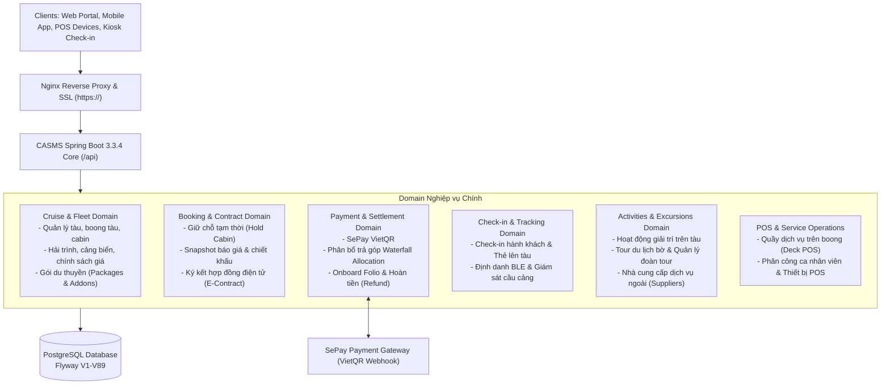
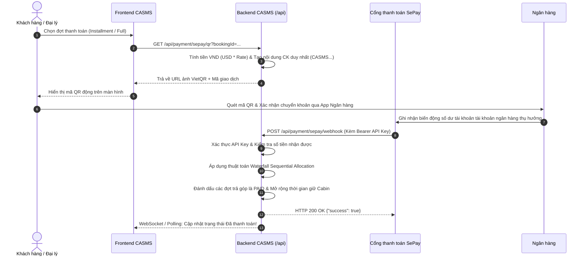
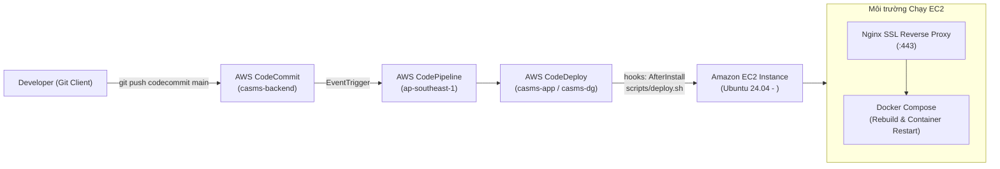

# CASMS Backend - Cruise Activity & Shore Management System

[](https://adoptium.net/)
[](https://spring.io/projects/spring-boot)
[](https://www.postgresql.org/)
[](https://flywaydb.org/)
[]()

> **CASMS Backend** là hệ sinh thái máy chủ dịch vụ (RESTful API & Domain Services) chuyên sâu phục vụ công tác quản lý, điều hành và số hóa toàn diện quy trình du lịch du thuyền: từ quản lý đội tàu, hải trình, chính sách giá vé, đặt chỗ & hợp đồng điện tử, cổng thanh toán tự động SePay VietQR, quy trình làm thủ tục check-in & giám sát hành khách qua sóng BLE tại cầu cảng, cho đến các dịch vụ ẩm thực, vui chơi giải trí trên tàu và tour khám phá trên bờ (Shore Excursions).

---

## 📑 Mục lục
1. [Kiến trúc Tổng thể & Phân rã Domain](#1-kiến-trúc-tổng-thể--phân-rã-domain)
2. [Ngăn xếp Công nghệ (Tech Stack)](#2-ngăn-xếp-công-nghệ-tech-stack)
3. [Cấu trúc Thư mục Dự án](#3-cấu-trúc-thư-mục-dự-án)
4. [Hướng dẫn Cấu hình Môi trường](#4-hướng-dẫn-cấu-hình-môi-trường)
5. [Hướng dẫn Cài đặt & Chạy Local](#5-hướng-dẫn-cài-đặt--chạy-local)
6. [Tích hợp Cổng thanh toán SePay VietQR](#6-tích-hợp-cổng-thanh-toán-sepay-vietqr)
7. [Quy trình CI/CD & Triển khai AWS Production](#7-quy-trình-cicd--triển-khai-aws-production)
8. [Tài liệu API & Swagger UI](#8-tài-liệu-api--swagger-ui)
9. [Cơ chế An toàn & Nghiệp vụ cốt lõi](#9-cơ-chế-an-toàn--nghiệp-vụ-cốt-lõi)

---

## 1. Kiến trúc Tổng thể & Phân rã Domain

Hệ thống được thiết kế theo mô hình **Domain-Driven Modular Architecture**, phân định ranh giới nghiệp vụ độc lập nhưng liên kết chặt chẽ thông qua các Service Contract:



### Các phân hệ chính:
1. **Cruise & Fleet Domain (`ship`, `trip`, `cruisepackage`)**: Quản lý thông số kỹ thuật của đội tàu, sơ đồ các tầng boong (`decks`), danh mục phòng nghỉ (`cabins`), hải trình (`itineraries`), khung giờ cập cảng (`port windows`), gói kỳ nghỉ trọn gói (`cruise packages`) và bảng giá vé theo mùa/hạng phòng.
2. **Booking Domain (`booking`)**: Xử lý toàn bộ vòng đời đặt chỗ: từ khởi tạo booking, giữ cabin tạm thời (Hold), tạo snapshot báo giá đóng băng chi phí, phát hành hợp đồng điện tử xác nhận hành trình, cho đến quản lý danh sách hành khách đi cùng (`manifest`).
3. **Payment Domain (`payment`)**: Tích hợp cổng thanh toán tự động VietQR thông qua SePay, thuật toán phân bổ thanh toán tuần tự (Waterfall Allocation) cho các gói trả góp nhiều đợt, quản lý số dư ký quỹ trên tàu (`Onboard Folio`), và xử lý yêu cầu hoàn tiền (`Refunds`).
4. **Check-in & Security Domain (`checkin`, `identity`)**: Quy trình làm thủ tục trước chuyến đi, phát hành thẻ lên tàu có mã QR, gắn vòng đeo tay Bluetooth Low Energy (BLE) định danh hành khách, ghi nhận trạng thái lên/xuống tàu tại cổng kiểm soát (`Gangway Tracking`).
5. **Activity & Shore Excursion Domain (`activity`, `servicepackage`)**: Quản lý lịch trình các sự kiện giải trí trên tàu, các tour tham quan trên bờ tại từng điểm dừng cảng, sắp xếp hành khách vào từng đoàn xe/hướng dẫn viên (`Tour Groups`).
6. **POS & Onboard Operations Domain (`pos`)**: Quản lý các điểm bán lẻ, quầy bar, nhà hàng, spa trên tàu; quản lý thiết bị POS cầm tay, phân ca làm việc cho nhân viên phục vụ, và ghi nợ chi tiêu trực tiếp vào tài khoản phòng của hành khách.

---

## 2. Ngăn xếp Công nghệ (Tech Stack)

| Thành phần | Công nghệ sử dụng | Phiên bản / Mô tả |
| :--- | :--- | :--- |
| **Backend Framework** | Spring Boot | `3.3.4` (Java 21) |
| **Security & Auth** | Spring Security & JJWT | `io.jsonwebtoken: 0.12.6` (HMAC-SHA256, Stateless JWT) |
| **ORM / Data Access** | Spring Data JPA / Hibernate | Hỗ trợ ánh xạ kiểu PostgreSQL JSONB qua `hypersistence-utils-hibernate-63` |
| **Cơ sở dữ liệu** | PostgreSQL | Lưu trữ trên máy chủ PostgreSQL (phiên bản 15+) |
| **Database Migration** | Flyway DB | `V1` đến `V89` với cơ chế `LegacyChecksumRealigner` |
| **API Docs** | SpringDoc OpenAPI | `2.6.0` (Swagger UI interactive testing) |
| **Containerization** | Docker & Docker Compose | Multi-stage build tối ưu kích thước image |
| **Hạ tầng Cloud** | Amazon Web Services (AWS) | EC2 Ubuntu 24.04, CodeCommit, CodePipeline, CodeDeploy |
| **Web Server / SSL** | Nginx Reverse Proxy | Chứng chỉ Let's Encrypt SSL tự động gia hạn |
| **Cổng thanh toán** | SePay VietQR | Webhook xử lý giao dịch tự động |

---

## 3. Cấu trúc Thư mục Dự án

```text
CASMS/
├── .github/                         # Cấu hình GitHub workflows (nếu có)
├── scripts/
│   └── deploy.sh                    # Kịch bản triển khai tự động trên máy chủ AWS EC2
├── src/
│   ├── main/
│   │   ├── java/com/casms/
│   │   │   ├── activity/            # Nghiệp vụ Hoạt động trên tàu, Shore Excursion, Tour Group, NCC
│   │   │   ├── audit/               # Ghi nhật ký kiểm toán hệ thống (Audit Logs)
│   │   │   ├── booking/             # Nghiệp vụ Đặt chỗ, Giữ chỗ Cabin, Hợp đồng, Manifest
│   │   │   ├── checkin/             # Nghiệp vụ Check-in, Cấp thẻ lên tàu, Giám sát cầu cảng
│   │   │   ├── common/              # Lớp dùng chung: BaseEntity, Error Codes, Custom Exceptions
│   │   │   ├── config/              # Cấu hình Security, CORS, Swagger, Flyway Checksum Realigner
│   │   │   ├── cruisepackage/       # Nghiệp vụ Gói combo du thuyền, Phụ thu dịch vụ, Cabin mapping
│   │   │   ├── identity/            # Xác thực người dùng, Phân quyền Role, Quản lý tài khoản
│   │   │   ├── integration/         # Tích hợp dịch vụ bên thứ ba (SMS, Email, BLE Gateways)
│   │   │   ├── logging/             # Cấu hình Correlation ID, Interceptor truy vết log
│   │   │   ├── notification/        # Hệ thống gửi thông báo thời gian thực cho hành khách/nhân viên
│   │   │   ├── payment/             # Tích hợp SePay, Xử lý giao dịch, Thuật toán Waterfall, Folio
│   │   │   ├── pos/                 # Quản lý máy POS, Điểm bán lẻ, Phân ca nhân viên boong tàu
│   │   │   ├── scheduler/           # Cron jobs: Tự động giải phóng Cabin hết hạn giữ chỗ (Hold Release)
│   │   │   ├── security/            # Bộ lọc JWT Filter, UserDetailsServiceImpl, Quyền truy cập
│   │   │   ├── servicepackage/      # Dịch vụ tiện ích mở rộng trên tàu
│   │   │   ├── ship/                # Quản lý mô hình tàu, Tầng boong, Cabin, Quy chuẩn an toàn
│   │   │   └── trip/                # Hải trình, Lịch trình chuyến đi, Cảng biển, Chính sách giá
│   │   └── resources/
│   │       ├── db/migration/        # 89+ kịch bản migration SQL của Flyway (V1__ -> V89__)
│   │       ├── application.yml      # Cấu hình trung tâm Spring Boot
│   │       └── application-dev.yml  # Cấu hình môi trường dev cục bộ
│   └── test/                        # Bộ kiểm thử đơn vị & tích hợp (JUnit 5, Mockito)
├── .env.example                     # File mẫu khai báo các biến môi trường
├── appspec.yml                      # File chỉ dẫn triển khai cho AWS CodeDeploy
├── docker-compose.yml               # Định nghĩa dịch vụ Docker cho Backend CASMS
├── Dockerfile                       # File đóng gói ứng dụng Spring Boot thành Docker Image
├── pom.xml                          # Maven Project Object Model (Dependencies & Plugins)
├── README.md                        # Tài liệu hướng dẫn hệ thống
└── start-be.bat                     # Script khởi chạy nhanh Backend trên Windows
```

---

## 4. Hướng dẫn Cấu hình Môi trường

Hệ thống sử dụng các biến môi trường để bảo mật thông tin nhạy cảm. Trước khi khởi chạy, sao chép file `.env.example` thành file `.env.local` (khi chạy local) hoặc `.env` (khi chạy Docker / Server).

### Bảng chi tiết các biến môi trường:

| Tên biến | Bắt buộc | Mô tả chức năng |
| :--- | :---: | :--- |
| `DB_URL` | **Có** | Chuỗi kết nối JDBC PostgreSQL (`jdbc:postgresql://<HOST>:<PORT>/<DATABASE>`). |
| `DB_USERNAME` | **Có** | Tên tài khoản kết nối cơ sở dữ liệu. |
| `DB_PASSWORD` | **Có** | Mật khẩu truy cập cơ sở dữ liệu. |
| `JWT_SECRET` | **Có** | Khóa bí mật dùng để ký và giải mã JSON Web Token (HS256/HS512). |
| `JWT_EXPIRATION_MS` | Không | Thời gian hiệu lực của Access Token (mili-giây). |
| `SEPAY_ENABLED` | Không | Cờ kích hoạt phân hệ tích hợp thanh toán SePay. |
| `SEPAY_API_KEY` | **Có** | Khóa API định danh tài khoản tích hợp cổng thanh toán. |
| `SEPAY_BANK_NAME` | Không | Tên ngân hàng thụ hưởng nhận thanh toán VietQR. |
| `SEPAY_ACCOUNT_NUMBER` | **Có** | Số tài khoản ngân hàng thụ hưởng tiền thanh toán. |
| `SEPAY_ACCOUNT_NAME` | Không | Tên chủ tài khoản thụ hưởng hiển thị trên mã QR. |
| `SEPAY_USD_TO_VND_RATE` | Không | Tỷ giá quy đổi ngoại tệ (USD sang VND) để tạo mã VietQR. |
| `SEPAY_QR_TEMPLATE` | Không | Mẫu hiển thị mã VietQR (`compact`, `compact2`, `qr_only`). |
| `SEPAY_TOLERANCE_PERCENT` | Không | Ngưỡng dung sai chênh lệch thanh toán cho phép. |
| `SPRING_PROFILES_ACTIVE` | Không | Profile môi trường kích hoạt (`dev`, `prod`). |

---

## 5. Hướng dẫn Cài đặt & Chạy Local

### 5.1. Yêu cầu tiên quyết (Prerequisites)
1. **JDK 21**: Cài đặt OpenJDK 21 (khuyến nghị [Eclipse Temurin 21](https://adoptium.net/)). Kiểm tra bằng lệnh:
   ```bash
   java -version
   # Output phải chứa: openjdk version "21.x.x"
   ```
2. **Apache Maven 3.9+**: Kiểm tra bằng lệnh:
   ```bash
   mvn -version
   ```
3. **Cơ sở dữ liệu PostgreSQL**: Máy chủ PostgreSQL 15+ đang chạy cục bộ hoặc trên cloud.

### 5.2. Các bước khởi chạy chi tiết

#### Cách 1: Sử dụng Script tự động `start-be.bat` (Khuyến nghị cho Windows)
Dự án đã tích hợp sẵn script thông minh kiểm tra toàn diện môi trường trước khi chạy:
1. Tạo file `.env.local` tại thư mục gốc của dự án (nội dung lấy từ `.env.example`).
2. Nhấp đúp vào file `start-be.bat` hoặc chạy từ PowerShell/Terminal:
   ```cmd
   .\start-be.bat
   ```
   *Script sẽ tự động:*
   - Kiểm tra phiên bản Java 21 và đường dẫn `JAVA_HOME`.
   - Đọc các biến từ `.env.local` nạp vào phiên làm việc.
   - Thử nghiệm kết nối Socket đến PostgreSQL host/port để đảm bảo DB đang hoạt động.
   - Kiểm tra xem cổng `8080` có bị tiến trình khác chiếm dụng hay không.
   - Biên dịch và khởi chạy Spring Boot.

#### Cách 2: Khởi chạy thủ công bằng lệnh Maven
1. Nạp biến môi trường (Windows PowerShell):
   ```powershell
   Get-Content .env.local | ForEach-Object {
       if ($_ -match '^\s*([A-Za-z_][A-Za-z0-9_]*)\s*=\s*(.*)$') {
           [Environment]::SetEnvironmentVariable($matches[1], $matches[2].Trim(), 'Process')
       }
   }
   ```
2. Biên dịch gói ứng dụng:
   ```bash
   mvn clean package -DskipTests
   ```
3. Khởi chạy file JAR:
   ```bash
   java -jar target/casms-0.0.1-SNAPSHOT.jar
   ```

#### 5.3. Chạy kiểm thử tự động (Unit Tests)
Hệ thống có bộ 38+ bài kiểm thử tự động bao phủ logic giữ chỗ, tính giá báo giá và thuật toán phân bổ thanh toán Waterfall:
```bash
mvn test
```

---

## 6. Tích hợp Cổng thanh toán SePay VietQR

Hệ thống CASMS tích hợp cơ chế thanh toán tự động không chạm thông qua **SePay VietQR Gateway**:



### 6.1. Thuật toán Phân bổ Trả góp Tuần tự (Waterfall Sequential Allocation)
Khi nhận được webhook thanh toán từ SePay, `SepayService` sẽ xử lý thông minh:
- Sắp xếp tất cả các đợt trả góp (`Installments`) chưa hoàn thành theo thứ tự thời hạn thanh toán (`dueDate ASC`).
- Lần lượt gán số tiền thực nhận vào đợt trả góp sớm nhất:
  - Nếu số tiền dư ra, tiếp tục chuyển phần còn lại sang thanh toán tiếp đợt kế tiếp (Waterfall).
  - Tự động cộng dồn số tiền đã thanh toán (`paidAmount`) và so khớp với tổng số tiền của đợt (`amount`).
- Áp dụng dung sai sai số tỷ giá `SEPAY_TOLERANCE_PERCENT` (mặc định 1%) để tránh trường hợp đợt thanh toán bị treo chỉ vì thiếu vài trăm đồng do làm tròn số học.

### 6.2. Cấu hình Webhook trên Cổng thanh toán
1. Đăng nhập trang quản trị cổng thanh toán.
2. Vào mục **Cấu hình Webhook** -> **Tạo mới Webhook**:
   - **URL Webhook**: `https://<YOUR_DOMAIN>/api/payment/sepay/webhook`
   - **Phương thức**: `POST`
   - **Xác thực**: Gửi kèm `Authorization: Bearer <SEPAY_API_KEY>`
3. Khi test local, có thể sử dụng công cụ **ngrok** hoặc **Cloudflare Tunnel** để tạo URL công khai trỏ về cổng `8080`.

---

## 7. Quy trình CI/CD & Triển khai AWS Production

Dự án áp dụng quy trình **GitOps / Push-to-Deploy** tự động hóa 100% qua hệ sinh thái dịch vụ đám mây AWS:



### 7.1. Luồng hoạt động của Script Triển khai (`scripts/deploy.sh`)
Khi CodeDeploy kéo mã nguồn mới nhất về thư mục `/home/ubuntu/casms`:
1. `docker builder prune -f`: Dọn dẹp cache build trung gian để giải phóng dung lượng đĩa của EC2.
2. `docker compose down`: Dừng an toàn container đang chạy.
3. `docker compose up -d --build`: Đóng gói lại Dockerfile thành Image mới và kích hoạt container ngầm.
4. `docker image prune -f`: Xóa các image cũ dạng dangling/untagged để giữ bộ nhớ đĩa luôn tối ưu.

### 7.2. Cấu hình Nginx Reverse Proxy trên Server
Nginx tiếp nhận kết nối bảo mật HTTPS từ người dùng tại domain `https://<YOUR_DOMAIN>` và định tuyến toàn bộ request bắt đầu bằng `/api/` về container Backend tại `localhost:8080`:

```nginx
location /api/ {
    proxy_pass http://127.0.0.1:8080/api/;
    proxy_set_header Host $host;
    proxy_set_header X-Real-IP $remote_addr;
    proxy_set_header X-Forwarded-For $proxy_add_x_forwarded_for;
    proxy_set_header X-Forwarded-Proto $scheme;
    
    # WebSocket support
    proxy_http_version 1.1;
    proxy_set_header Upgrade $http_upgrade;
    proxy_set_header Connection "upgrade";
    
    # Timeout settings for large report / batch payloads
    proxy_connect_timeout 90s;
    proxy_read_timeout 90s;
}
```

---

## 8. Tài liệu API & Swagger UI

Toàn bộ hệ thống REST API đều được tự động tạo tài liệu tương tác chuẩn OpenAPI v3:

- **Môi trường Production**:
  - **Swagger UI**: [https://<YOUR_DOMAIN>/api/swagger-ui/index.html](https://<YOUR_DOMAIN>/api/swagger-ui/index.html)
  - **OpenAPI JSON Spec**: `https://<YOUR_DOMAIN>/api/v3/api-docs`
- **Môi trường Local**:
  - **Swagger UI**: `http://localhost:8080/api/swagger-ui.html`
  - **OpenAPI JSON Spec**: `http://localhost:8080/api/v3/api-docs`

### Hướng dẫn ủy quyền (Authorize) trên Swagger UI:
1. Đăng nhập qua endpoint `POST /api/auth/login` với tài khoản của bạn để lấy chuỗi `accessToken`.
2. Bấm nút **Authorize** (biểu tượng chiếc khóa màu xanh) ở góc trên bên phải trang Swagger.
3. Nhập token vào ô giá trị theo định dạng: `Bearer <your_token_here>`.
4. Bấm **Authorize** -> Tất cả các API có yêu cầu quyền hạn sẽ tự động đính kèm token trong header.

---

## 9. Cơ chế An toàn & Nghiệp vụ cốt lõi

### 9.1. Quản lý Giữ chỗ Cabin & Chống Khóa Ảo (Ghost Cabin Lock Prevention)
- Khi khách hàng khởi tạo đơn đặt chỗ, cabin sẽ được khóa tạm thời trong 15 phút (`holdExpiresAt`).
- Tác vụ nền định kỳ (`scheduler/BookingHoldCleanupScheduler.java`) quét cơ sở dữ liệu để giải phóng các cabin có trạng thái giữ chỗ quá hạn:
  - **Cơ chế phòng hộ**: Tác vụ tuyệt đối KHÔNG hủy bất kỳ booking nào đã có xác nhận thanh toán (`PaymentStatus.PAID` hoặc `PARTIALLY_PAID`) hoặc đã ký hợp đồng điện tử.
  - Bộ đệm ân hạn (`Grace Period`): Khách hàng thanh toán trước thời điểm hủy trong vòng 5 phút sẽ được tự động bảo lưu và gia hạn giữ cabin thêm 24 giờ để hoàn thiện ký kết hợp đồng.
  - Các câu truy vấn kiểm tra trùng lặp phòng (`CabinAssignmentRepository`, `BookingPassengerRepository`) được bảo vệ bằng mệnh đề loại bỏ phòng hết hạn giữ chỗ ngay ở tầng cơ sở dữ liệu (`holdExpiresAt <= CURRENT_TIMESTAMP`).

### 9.2. Cơ chế Điều hòa Checksum Migration (Flyway LegacyChecksumRealigner)
Trong quá trình phát triển nhanh, các tập tin migration SQL lịch sử (`V1` đến `V89`) đôi khi được tinh chỉnh comment hoặc định dạng. Thay vì phải xóa trắng database hoặc chạy lệnh repair thủ công ngoài server:
- Hệ thống tích hợp thành phần `LegacyChecksumRealigner` tự động chạy trước chu kỳ khởi động của Flyway.
- Tự động phát hiện và đồng bộ checksum giữa mã nguồn và bảng `flyway_schema_history`, đảm bảo tiến trình CI/CD luôn diễn ra trơn tru mà không bao giờ làm gián đoạn hệ thống.

---

## 👥 Đội ngũ Phát triển & Liên hệ

Dự án được xây dựng và duy trì bởi Đội ngũ Kỹ sư Phần mềm CASMS - Khóa tốt nghiệp Kỹ thuật Phần mềm (FPT University).

- **Trưởng nhóm Kỹ thuật**: Backend & DevOps Core Team
- **Hệ thống Quản lý**: [CASMS Portal](https://<YOUR_DOMAIN>)
- **Hỗ trợ Kỹ thuật**: Mọi thắc mắc và đóng góp vui lòng tạo Issue trên hệ thống Git hoặc liên hệ ban quản trị.
