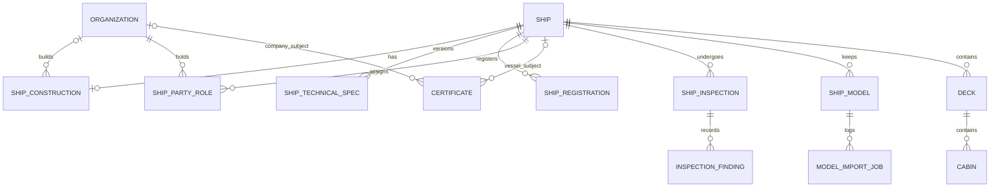

# Audit hồ sơ tàu CASMS

## A. Đồng bộ Git

Nhánh trước và sau: `feature/CASMS-86-3d-ship-model-import`. Sau `git fetch --all`, HEAD, nhánh feature trên origin và `origin/main` đều ở `a629211539d4f2e1641d12c6249ce8dc4862c5ed`. `git merge --no-commit --no-ff origin/main` trả về `Already up to date`. Không có commit mới hoặc xung đột. Các tệp untracked có từ đầu gồm `.github/`, `AGENTS.md`, `artifacts/` và `scripts/__pycache__/`.

Các thay đổi gần đây đã có trên nhánh gồm tạo/cập nhật mô hình theo mã (`a629211`), nhập theo mã và giữ gán dịch vụ khu vực (`c63d410`), kiểm tra trình tự ghé cảng, vai trò terminal và thời gian (`cdd821b`), cập nhật lịch cảng và contract cruise package (`48b615f`, `fa354d3`).

## B. Hiện trạng và luồng dữ liệu

| Lớp | Hiện trạng và điểm cần lưu ý |
|---|---|
| Entity và DB | `Ship` có UUID, mã nội bộ duy nhất, tên, vòng đời, sức chứa, số boong, giới hạn ordinal boong, `manifestModelId`, chiều dài/rộng tính bằng mét, ngày commissioning, thời điểm tạo/cập nhật. V1 đặt nền và FK. V25–27 thêm danh tính mẫu, kích thước, giới hạn ordinal và provenance. V73 thay unique manifest ID bằng index vì mẫu được dùng lại. V74 chuyển trạng thái cũ sang vòng đời `DRAFT`, `READY`, `IN_SERVICE`, `MAINTENANCE`, `SUSPENDED`, `RETIRED`. |
| DTO, validation và mapper | `ShipCreateRequest` dùng `modelKey` hoặc bắt buộc tên/sức chứa/số boong cho tạo thủ công. Tạo có giới hạn tên 100 ký tự, kích thước dương và ngày quá khứ/hiện tại. PATCH nhận các trường khác null, thiếu `@Size(max=100)` cho tên, dùng service kiểm tra ngày và kích thước hữu hạn dương, ngăn hạ sức chứa thấp hơn tổng cabin và số boong thấp hơn số boong nghiệp vụ đã cấu hình. `ShipService.mapToResponse` ánh xạ trực tiếp sang `ShipResponse`. Mô tả DTO đang dùng lẫn commissioning và launch. |
| Repository và service | `ShipRepository` dùng UUID, tra mã và có khóa ghi theo ID. `ShipService` xử lý CRUD, sức chứa, lịch, chuyển trạng thái, xóa tàu chưa sử dụng và readiness. Xóa đã xét cruise, Deck, Cabin, model và BLE. Chuyển sang trạng thái phi vận hành bị chặn khi tàu có cruise đang hoạt động. Readiness hiện kiểm tra trạng thái và số bản ghi Deck/Cabin. Cần phân biệt readiness cấu trúc với phê duyệt pháp lý, lịch khai thác và cabin còn trống. |
| REST và bảo mật | `ShipController` phục vụ `/ships`, chi tiết và PATCH, status, unused-delete, availability, capacity-summary, affected/current cruise, validate/readiness/assessment và areas. Quyền tách theo thao tác `SHIP_*`. Tạo từ mẫu và đăng ký từ catalog có kiểm tra quyền tạo tàu/mô hình. `ShipModelController` quản lý model, import, mapping, publish và assets. Public model có contract riêng. Không tìm thấy mã frontend được Git theo dõi qua `package.json`, JSX, TSX hoặc Vue. |
| Nghiệp vụ liên quan | `ShipRegulation` gán quy định vận hành nội bộ, `OperationalIssue` ghi vấn đề vận hành, không có vòng đời survey/certificate pháp định tương ứng. `CruiseShipAssignmentPolicy` và `CruiseService` dùng trạng thái/sức chứa/cấu hình để xét gán tàu và ảnh hưởng. `TripCatalogController` dùng Deck/Cabin làm nguồn lập kế hoạch. Booking liên kết cruise, cabin và model đang READY; V85 quản lý phiên bản mapping cabin thương mại theo tàu. Deck service assignment và BLE phụ thuộc danh tính vật lý ổn định. |

### Import 3D và dữ liệu cần giữ độc lập

- `Ship` có nhiều `ShipModel`. V7 ràng buộc phiên bản tài sản theo `(ship_id, model_key, asset_version)` với model asset-backed và tối đa một bản asset-backed `READY` mỗi tàu. `ShipModelAssetBlob` ở V8 định danh bằng `(model_key, asset_version, asset_path)` và lưu nội dung qua PostgreSQL large object. Bundle có thể được nhiều tàu dùng chung. Model code có thể cập nhật bundle trên cùng bản ghi model, vì vậy cần phân biệt lịch sử job với snapshot phiên bản bất biến.
- Tạo từ manifest qua `ShipModelAssetService.createShipFromManifest` tạo một `Ship` mới rồi đăng ký model. Manifest ưu tiên hơn giá trị bổ sung nếu có tên, sức chứa, số boong, length, beam hoặc commission date. Đăng ký model và import cấu trúc là các thao tác riêng. Gửi lại yêu cầu **tạo tàu** có thể sinh thêm tàu vật lý. Dùng chung mẫu là hợp lệ, nên cần idempotency key cho retry tạo và đối chiếu danh tính thật khi có số đăng ký/IMO đã xác minh.
- Import vào `shipId` hiện có khóa tàu, đối chiếu revision, đọc manifest và GLB, tái sử dụng danh tính model/đối tượng nghiệp vụ và lưu Deck, Cabin, Facility/area cùng mapping. V66 phân biệt service deck và gán dịch vụ thủ công. Metadata service trong mô hình không tự sinh dịch vụ nghiệp vụ. Đường import theo mã chọn bản `READY` hoặc `DRAFT`, kiểm quyền bổ sung theo nhánh và rollback khi có lỗi đối tượng, trả `422` kèm lỗi. **Cả nhánh đăng ký mới và cập nhật bundle theo mã đều gọi `syncShipFromManifest` trên Ship hiện có**. Import thành công vì vậy có thể ghi đè tên, sức chứa, số boong, kích thước và commissioning theo dữ liệu có trong manifest. Đường import theo ID cho `DRAFT` chỉ nhập cấu trúc từ model đã đăng ký và có cơ chế vòng đời job riêng để lưu lịch sử. V24 lưu job và issue. Import trên `shipId` không tạo tàu mới.
- Deck/Cabin đang phục vụ booking, khu vực và BLE. Giữ các ID, ordinal, mã cabin, trạng thái/sức chứa nghiệp vụ và mapping ổn định khi cập nhật mô hình. Đưa thông số xác minh sang hồ sơ kỹ thuật có provenance. Giữ số liệu manifest làm dữ liệu thiết kế và bootstrap legacy.

Ở tầng DB, sức chứa và số boong của `Ship` là số dương; kích thước và giới hạn ordinal có CHECK dương khi có giá trị. `Deck` và `Cabin` đều có FK tàu, Cabin có FK boong. Định danh nghiệp vụ gồm số boong theo tàu và mã cabin theo tàu. Số lượng cabin cấu hình, số cabin vật lý và số cabin còn bán là ba đại lượng riêng. `shipManufacturerName` ở `ShipModel` có thể đến từ manifest hoặc DTO metadata và cần được xem là mô tả nguồn mô hình khi chưa xác minh.

## C. Đối chiếu hồ sơ thực tế

**C** = critical đối với hồ sơ tàu khai thác hoặc theo điều kiện pháp lý, **I** = important, **O** = optional/phạm vi sau, **D** = có dữ liệu nhưng thiết kế/ngữ nghĩa cần sửa. Bản ghi DRAFT tiếp tục chấp nhận hồ sơ chưa đầy đủ. Điều kiện pháp lý cần xác định theo cờ, loại tàu, GT/kích thước, số người được phép chở, tuyến nội địa/quốc tế, ngày đóng và ngoại lệ áp dụng. [SOLAS](https://www.imo.org/en/about/conventions/pages/international-convention-for-the-safety-of-life-at-sea-%28solas%29%2C-1974.aspx), [Danh mục chứng từ IMO](https://wwwcdn.imo.org/localresources/en/publications/Documents/IMO-Vega/B-FAL.2-Circ.133%20-%20List%20Of%20Certificates%20And%20Documents%20RequiredTo%20Be%20Carried%20On%20Board%20Ships%2C%202022%20%28Secretariat%29.pdf), [Ví dụ theo cờ UK](https://www.gov.uk/guidance/vessel-classification-and-certification).

| Category | Required Information | Current Status | Missing Fields | Priority |
|---|---|---|---|---|
| Nhận dạng | Tên, danh tính ổn định, loại tàu, trạng thái khai thác, dữ liệu radio/registry theo áp dụng | Mã CASMS, tên và `ShipStatus`; mã mẫu 3D có thể dùng lại | Tên trước đây, IMO, MMSI, call sign, cờ, cảng đăng ký, loại tàu, năm đóng | C: loại, cờ, IMO/registry khi áp dụng. I: lịch sử tên và radio theo phạm vi. D: phân biệt danh tính tàu với mẫu. |
| Đóng tàu | Nguồn gốc, đơn vị đóng, các mốc và chứng từ gốc | `commissionDate` lẫn nghĩa hạ thủy. V27 có `ShipModel.shipManufacturerName` và `modelProvider` theo manifest | Shipyard xác minh, quốc gia/địa chỉ, địa điểm đóng, yard number, keel laying/launch/delivery, commissioning riêng, thiết kế/model, naval architect, vật liệu thân, hồ sơ gốc | I: shipyard, quốc gia, yard number, năm, delivery, nguồn. O: chi tiết thiết kế và mốc bổ sung. D: tách ngày và nguồn dữ liệu tàu/mô hình. |
| Kỹ thuật thân tàu và sức chứa | Số đo, giới hạn hành khách đã chứng nhận, cấu hình thực tế | Length/beam, tổng sức chứa, số boong và Cabin | GT/NT, DWT, LOA xác minh, draft/depth, tổng số boong vật lý, số cabin hành khách vật lý, giới hạn khách chứng nhận, sức chứa thuyền viên | C: giới hạn chứng nhận và dữ liệu dùng để xác định áp dụng. I: số đo còn lại. D: tách inventory và sức chứa bán khỏi giới hạn pháp lý. |
| Thiết bị | Động cơ, động lực, tốc độ, nhiên liệu và dung tích | Chưa có trường hồ sơ | Nhà sản xuất động cơ chính, model, kW/động cơ, propulsion, tốc độ tối đa/hành trình, nhiên liệu, dung tích nhiên liệu/nước ngọt/nước thải | I: động lực chính. O: thông số chi tiết và thiết bị thay thế nếu cần. |
| Đăng ký và trách nhiệm | Lịch sử đăng ký, chủ thể chịu trách nhiệm | Chưa có hồ sơ riêng | Registered owner, operator, ship/technical manager, ISM company, beneficial owner nếu có phạm vi; cờ, cảng, số, ngày đăng ký/hết hạn, chứng thư | C: đăng ký và chủ thể chính. I: vai trò quản lý. O: beneficial owner. |
| Chứng từ | Hồ sơ cấp, hiệu lực, bằng chứng, xác minh | Quy định nội bộ và assets 3D là các luồng khác | Loại/số, thẩm quyền và tổ chức cấp, ngày cấp/hết hạn, tình trạng, file, trạng thái xác minh/người/thời điểm, ghi chú, thay thế và endorsement | C theo hồ sơ áp dụng. |
| Kiểm định | Mỗi lần kiểm tra, kết quả và khắc phục | Có issue vận hành, thiếu hồ sơ survey chuyên biệt | Loại, ngày, tổ chức, inspector, địa điểm, phạm vi, kết quả, findings, corrective actions, follow-up, approval, tài liệu | C: kết quả/bằng chứng chính thức và hạn khắc phục nghiêm trọng. I: theo dõi chi tiết. |
| Lịch sử vận hành | Bảo trì, dry dock, sửa lớn, thiết bị, sự cố, hạn chế và lịch sử phục vụ | Lifecycle, cruise và operational issue hỗ trợ một phần | Work history, dry dock, repair/replacement, hồ sơ hạn chế theo hiệu lực, lịch sử dịch vụ và chuyển vai trò | I: hạn chế đang hiệu lực, sự cố liên kết. O: module bảo trì đầy đủ. |

IMO number nếu đã cấp là nhận dạng lâu dài qua đổi tên/cờ. MMSI và call sign cần lịch sử theo cơ quan cấp. Năm đóng phải có định nghĩa và nguồn, không suy từ commissioning. Hồ sơ UK minh họa bill of sale, builder’s certificate và đo dung tích. Shipyard, naval architect và nhà sản xuất động cơ là ba vai trò riêng. [IMO identification schemes](https://www.imo.org/en/ourwork/msas/pages/imo-identification-number-scheme.aspx), [UK Ship Register](https://www.gov.uk/register-a-boat/the-uk-ship-register).

| Hồ sơ | Phạm vi phân loại cho CASMS |
|---|---|
| Certificate of Registry | Do cơ quan đăng ký cấp theo chế độ cờ/registry. Hạn có thể khác nhau. |
| Passenger Ship Safety Certificate, Load Line, Minimum Safe Manning Document | Statutory khi SOLAS/Load Lines hoặc quy định cờ tương ứng áp dụng. Giới hạn chở khách và định biên tối thiểu là hai dữ kiện khác nhau. |
| SMC, DOC | ISM theo phạm vi áp dụng. SMC gắn tàu. DOC gắn ISM company và phạm vi loại tàu, tàu mang bản sao khi áp dụng. |
| ISSC | Chứng thư an ninh tàu theo SOLAS XI-2/ISPS khi áp dụng. Lưu bằng chứng phù hợp và hạn chế quyền truy cập dữ liệu nhạy cảm. |
| IOPP, ISPP, IAPP | MARPOL Annex I, IV, VI tương ứng. Dùng điều kiện riêng của từng Annex. Ví dụ Annex IV sửa đổi áp dụng cho tàu đi quốc tế từ 400 GT hoặc được chứng nhận chở hơn 15 người. |
| Classification Certificate, Insurance/P&I | Chứng thư class và bằng chứng bảo hiểm có issuer/vòng đời riêng. Yêu cầu có thể đến từ cờ, hợp đồng, chuyến đi hoặc công ước trách nhiệm cụ thể. Bổ sung loại tài liệu khác khi có căn cứ. |
| Hồ sơ nội bộ | Checklist pre-operation, kiểm tra kỹ thuật/safety nội bộ và phê duyệt CASMS dùng phân loại riêng. |

Nguồn cho bảng chứng từ: [Danh mục IMO FAL.2/Circ.133](https://wwwcdn.imo.org/localresources/en/publications/Documents/IMO-Vega/B-FAL.2-Circ.133%20-%20List%20Of%20Certificates%20And%20Documents%20RequiredTo%20Be%20Carried%20On%20Board%20Ships%2C%202022%20%28Secretariat%29.pdf), [IMO Annex IV](https://www.imo.org/en/ourwork/environment/pages/sewage-default.aspx), [IMO safe manning](https://www.imo.org/en/ourwork/humanelement/pages/priciplesonsafemanning.aspx).

Đối chiếu văn kiện: [ISM Code](https://www.imo.org/en/ourwork/humanelement/pages/ismcode.aspx), [SOLAS XI-2 và ISPS Code](https://www.imo.org/en/ourwork/security/pages/guidemaritimesecuritydefault.aspx), [MARPOL](https://www.imo.org/en/ourwork/environment/pages/pollution-prevention.aspx), [Load Lines](https://www.imo.org/en/about/conventions/pages/international-convention-on-load-lines.aspx).

Theo dõi loại survey initial, annual, intermediate, periodical và renewal theo từng instrument. Phân loại riêng PSC, flag inspection, class survey, safety/technical/pre-operation nội bộ. Kết quả đề xuất `PASS`, `FAIL`, `CONDITIONAL`, `ACTION_REQUIRED`, giữ nguyên kết luận và mã finding nguồn, tách approval nội bộ khỏi kết luận cơ quan kiểm tra. Cơ quan cờ có thể ủy quyền cho tổ chức được công nhận theo phạm vi. MPA Singapore minh họa vai trò của ABS, Bureau Veritas, DNV và Lloyd’s Register. [IMO HSSC 2025](https://www.imo.org/en/ourwork/iiis/pages/harmonized%20system%20of%20survey%20and%20certification%20%28hssc%29.aspx), [IMO PSC 2025 A.1206(34)](https://www.imo.org/en/knowledgecentre/indexofimoresolutions/pages/a-2025-27.aspx), [MPA Singapore](https://www.mpa.gov.sg/singapore-registry-of-ships/flag-state-control/survey-application-and-certification), [DNV rules](https://rules.dnv.com/servicedocuments/dnvpm), [Lloyd’s Register](https://www.lr.org/en/services/statutory-compliance/), [Bureau Veritas](https://marine-offshore.bureauveritas.com/marine/statutory-certification).

## D. Kiến trúc đề xuất

| Entity | Cột và ràng buộc chính |
|---|---|
| `Ship` | Giữ UUID, mã, tên, vòng đời và trường legacy. Bổ sung `ship_type`, `imo_number` nullable, định dạng theo phiên bản scheme và unique có điều kiện sau đối chiếu dữ liệu. Tên cũ và danh tính radio lưu theo hiệu lực khi cần tra lịch sử. |
| `ShipConstruction` | FK `ship_id` unique, FK builder và designer tùy chọn tới danh mục tổ chức, địa điểm đóng, yard number, năm đóng và nguồn, keel/launch/delivery/commission dates riêng, design/model, hull material, liên kết hồ sơ gốc. Giữ snapshot tên/quốc gia/địa chỉ builder từ chứng từ khi cần lịch sử. Dùng một danh mục tổ chức có vai trò trước khi cần một bảng Shipyard chuyên biệt. |
| `ShipTechnicalSpecification` | FK `ship_id`, `revision`, `basis` (`DESIGN`, `AS_BUILT`, `VERIFIED_IN_SERVICE`), effective dates và nguồn. LOA/beam/draft/depth theo m, DWT theo tấn mét, GT/NT là chỉ số dung tích không đơn vị, power kW, tốc độ knot, dung tích m³, số người/boong/cabin là số nguyên. Ghi điều kiện đo draft và công suất theo từng động cơ khi cần. Nhiều động cơ có thể thành bảng con với hãng, model, serial và kW. Chặn giá trị âm/vô lý và hai revision hiện hành cùng basis. |
| `ShipRegistration` | FK `ship_id`, mã cơ quan/cờ, cảng đăng ký, registration number dạng text, ngày đăng ký, hết hạn nullable, hiệu lực từ/đến và liên kết certificate. Duy nhất theo registry và số trong phạm vi hiệu lực thích hợp. MMSI/call sign có thể dùng lịch sử radio riêng nếu hiệu lực khác registry. Cảng đăng ký có thể dùng tên chuẩn hóa và FK tùy chọn nếu trùng danh mục cảng khai thác. |
| `ShipPartyRole` | FK ship/tổ chức, role, ngày hiệu lực, bằng chứng. Registered owner, commercial operator, technical/ship manager và ISM company là các role riêng. Cho phép đồng sở hữu khi áp dụng. Beneficial owner cần thiết kế quyền truy cập và phạm vi riêng. |
| `Certificate` | `ship_id` hoặc `organization_id` theo loại, CHECK đúng một subject và DOC theo company. Lưu loại/khuôn khổ, phạm vi, số, issuing authority, issuing organization, ngày cấp/hết hạn, trạng thái và lý do, xác minh bởi ai/lúc nào, ghi chú, số phiên bản/`supersedes_id`, endorsement. Phân biệt hết hạn tính theo ngày với đình chỉ/thu hồi. Liên kết đăng ký, survey và DOC khi có căn cứ. |
| `ShipInspection`, `InspectionFinding` | FK ship, loại/nguồn, tổ chức và inspector, ngày/địa điểm/phạm vi, kết luận và approval độc lập, báo cáo. Finding có độ nghiêm trọng, corrective action, hạn, lần follow-up, ngày đóng và bằng chứng. Chỉ dùng loại hoặc trạng thái enum cho tập giá trị ổn định. |
| `DocumentAsset` và bảng liên kết | Metadata, storage key riêng tư, MIME/size/hash, uploader, thời điểm, trạng thái quét và audit truy cập. Link có FK tới construction, certificate hoặc inspection. Tải qua endpoint có quyền hoặc URL ký ngắn hạn. Không chia sẻ qua luồng public model. |
| Module sau | `ShipMaintenanceRecord` hoặc tích hợp CMMS cho dry dock/repair/service/replacement. Tái sử dụng `OperationalIssue` cho sự cố phù hợp. Hạn chế khai thác có thể lưu theo hiệu lực, nguồn và phạm vi. |

FK hồ sơ lịch sử ưu tiên `RESTRICT`, index theo ship và thời gian, index theo hạn chứng nhận và trạng thái xác minh. Kiểm tra thứ tự ngày khi cả hai giá trị có nguồn, ghi audit actor/timestamp và dùng khóa phiên bản cho cập nhật đồng thời. Catalog loại hồ sơ cần hỗ trợ mã cờ/instrument ngoài bộ loại cốt lõi. Phân biệt chưa biết, không áp dụng và đã xác minh trong đánh giá hồ sơ.

Nguồn cho ngữ nghĩa đo lường và tách trạng thái class/statutory: [IMO Tonnage Convention](https://www.imo.org/en/about/conventions/pages/international-convention-on-tonnage-measurement-of-ships.aspx), [ABS Record](https://ww2.eagle.org/en/rules-and-resources/abs-vessel-information.html).

## E. Kế hoạch triển khai và tương thích

1. Xác nhận loại tàu, cờ, phạm vi tuyến, điều kiện áp dụng và chủ sở hữu dữ liệu. Rà soát dữ liệu hiện có và mẫu manifest. Chốt nghĩa `totalCapacity`, `totalDecks`, `deckNumberLimit` trước khi thêm giới hạn chứng nhận.
2. Migration Flyway tăng dần sau version cao nhất lúc triển khai. Đợt đầu thêm các bảng construction/technical/registration/roles, cột nhận dạng nullable, FK/index. Đợt sau thêm certificate/inspection và tài liệu. Giữ migration đã áp dụng. Backfill có thể chạy lại, ghi provenance `LEGACY_UNVERIFIED` cho số đo cũ có dữ liệu. Không suy cờ/IMO từ manifest và không backfill launch từ commissioning. Làm sạch trùng lặp trước khi bật unique. Kiểm tra fresh, production locations và upgrade từ bản sao cô lập.
3. Các file dự kiến dưới `src/main/java/com/casms/ship/`: mở rộng `entity/Ship.java`, thêm entity/repository/DTO cho hồ sơ, service chuyên trách và controller riêng. API bổ sung `GET/PATCH /ships/{shipId}/profile`, đăng ký, specs, certificates, inspections và tải tài liệu theo RBAC. Giữ shape và semantics của `ShipCreateRequest`, `ShipUpdateRequest` và `ShipResponse`; không yêu cầu hồ sơ mới khi tạo DRAFT. Bổ sung audit và quyền theo chức năng, cập nhật `docs/sequence-diagrams/API-INVENTORY.md` cùng mọi diagram bị ảnh hưởng và chạy `python scripts/sequence_docs.py --check`. Chưa có entity nào cần xóa.
4. Sửa validation tên PATCH và wording commissioning theo một thay đổi nhỏ có kiểm thử riêng. Khi đổi đường bootstrap từ manifest, rà `ShipService`, `ShipModelAssetService`, `ShipModelImportService`, `ShipController`, `ShipModelController`; bảo vệ hồ sơ đã xác minh khỏi dữ liệu mô hình. Chốt idempotency khi tạo vật lý và thêm fixture retry, nhiều tàu dùng chung mẫu, thay phiên bản, rollback và giữ mapping. Nếu cần audit cấu hình 3D tái dựng được, lưu bundle version/revision trên job thay vì dựa vào model mutable.
5. Thêm cảnh báo hồ sơ thiếu/hết hạn dưới đánh giá riêng, rồi quyết định policy bắt buộc theo ngữ cảnh. Trước khi đổi gate, kiểm thử `CruiseShipAssignmentPolicy`, `CruiseService`, trip/itinerary, booking, mapping package, Deck/Cabin/BLE và public model. Tránh thay đổi tự động hành vi đặt chỗ hoặc chuyển trạng thái với dữ liệu legacy chưa đối chiếu. Cập nhật giao diện theo contract mới ở repository frontend khi xác định được.

## F. Kiểm thử

`python scripts/sequence_docs.py --check` đạt 601 route, kiểm tra inventory, độ phủ file và cấu trúc Mermaid. Đây là kiểm tra cấu trúc tài liệu. Đợt này chỉ thêm báo cáo, vì vậy không phát sinh thay đổi API cần cập nhật diagram.

- **Build** đạt với `mvn -B -Dmaven.test.skip=true package`, tạo JAR Spring Boot bằng Java 21. Build tại workspace gặp JAR đang bị khóa ở bước `clean`, nên dùng bản xuất riêng của đúng commit. Lượt `clean verify` riêng chạy cùng PostgreSQL 16 tạm, với fixture Zaandam v10 lấy từ thư mục `model-assets` local vì Git không theo dõi bundle này.
- **Flyway** áp dụng và validate 90 migration đến V92 trên DB mới. Bộ `FlywayMigrationPostgresIntegrationTest` có 9 kịch bản, 5 qua, 3 fail do assertion vẫn kỳ vọng version 90 ở fresh, production locations và legacy checksum upgrade, 1 skip do thiếu nguồn clone. `MigrationChecksumLockTest` báo V91/V92 thiếu trong `flyway/migration-checksums.properties`. `V41NativeMigrationTest` skip do không bật `OCVVIET_V4_TEST`, vốn cần PostgreSQL dành riêng trên cổng 15436. Chưa chạy trên bản sao DB triển khai thực tế.
- **Booking** `BookingPostgresIntegrationTest` 6/6, `BookingServiceTest` 13/13, `UxQuoteSnapshotTest` 3/3.
- **Ship API, tạo tàu và validation** `ShipServiceTest` 8/8, `ShipReadinessAssessmentTest` 2/2, `ShipRegulationServiceTest` 6/6, `ShipAreaServiceTest` 3/3 và `PublicShipModelTest` 3/3. Các ca MockMvc trong bộ import kiểm tra tạo tàu từ model đã upload, giá trị bổ sung khi manifest thiếu, quyền tạo/đọc/readiness và phân quyền cập nhật mô hình. Giới hạn độ dài tên PATCH được phát hiện bằng đọc code và schema, chưa có ca API riêng cho biên đó.
- **Import 3D và quan hệ DB** `ShipModelImportPostgresIntegrationTest` 27/27. Bao gồm import/retry Zaandam, model code cập nhật READY và giữ area assignment, nhiều tàu dùng chung bundle, lưu Deck/Cabin/service deck/area, rollback khi lỗi, đồng thời và giữ dữ liệu cabin nghiệp vụ. Hibernate khởi tạo với `ddl-auto: validate` trên schema đã migrate. `DeckModelFieldsImmutableTest` 3/3 và `CabinModelFieldsImmutableTest` 1/1. Riêng Deck Service Assignment, unit 5/5 nhưng API PostgreSQL 9/19 do 10 ca trả 403 thay cho các status kỳ vọng.
- **Itinerary, Cruise và Trip** `ItineraryChangeHistoryPostgresIntegrationTest` 6/6, `PassengerItineraryServiceTest` 2/2, `ScheduleMaterializationServiceTest` 14/14, `TripPlanningPostgresIntegrationTest` 10/10. `ItineraryServiceTest` có 3 assertion fail và 1 lỗi null departure. Cruise change/draft/timezone và operational program mapping có lỗi Hibernate `Trip` proxy `no Session` hoặc lỗi dữ liệu nguồn/lịch. Các bộ Cruise readiness, pricing, sale/handoff, TripPlanningEnhancement và TripScheduleVersion cũng có lỗi. Chưa đạt tiêu chí regression toàn module.
- **Lỗi baseline đã xác nhận** `ShoreExcursionServiceTest.list_withoutFilters_returnsAllExcursions` kỳ vọng exception khi gọi không filter nhưng service trả về bình thường. `PermissionConstraintInitializerTest` đang so tập permission enum với allowlist V70. Các lỗi phát sinh trên bản xuất sạch của commit chung với `origin/main`.

Tổng `mvn -B clean verify` ghi nhận 740 ca, 590 qua, 64 assertion failures, 67 errors và 19 skipped. POS, Service Package và Cruise RBAC cũng có sai lệch mã HTTP hoặc loại exception ở các bộ test hiện có. Kết quả chứng minh đóng gói và các luồng Import 3D/Booking đã kiểm thử chạy được trên DB cô lập, còn regression toàn backend đang đỏ. Chưa có kiểm thử UI frontend, triển khai thực tế hoặc chứng từ pháp lý của một tàu cụ thể.

## G. Kết luận

`Ship` hiện đủ làm bản ghi liên kết cho cấu hình tàu, lịch cruise và cabin, nhưng thiếu dữ liệu để quản lý hồ sơ tàu đang khai thác. Ưu tiên loại tàu, danh tính đăng ký và cờ, chủ thể chịu trách nhiệm, hồ sơ đóng tàu có nguồn, thông số xác minh phục vụ vận hành, giới hạn khách và chứng nhận/kiểm định áp dụng. Yêu cầu hoàn chỉnh theo từng ngữ cảnh vận hành sau khi xác minh chính sách cờ và tuyến.

Tách construction, technical specifications, registration/roles, certificates và inspections theo vòng đời dữ liệu. Giữ khóa `shipId` và cấu trúc đang phục vụ Booking/Itinerary. Rủi ro chính là dữ liệu manifest có thể thay giá trị legacy, việc retry tạo tàu sinh bản ghi mới và việc đổi ý nghĩa sức chứa/trạng thái ảnh hưởng gán cruise hoặc mở bán. Triển khai theo đợt, trước tiên thêm hồ sơ có nguồn và cảnh báo. Dành bảo trì đầy đủ và automation nghiệp vụ đăng kiểm cho giai đoạn có nhu cầu cụ thể.
