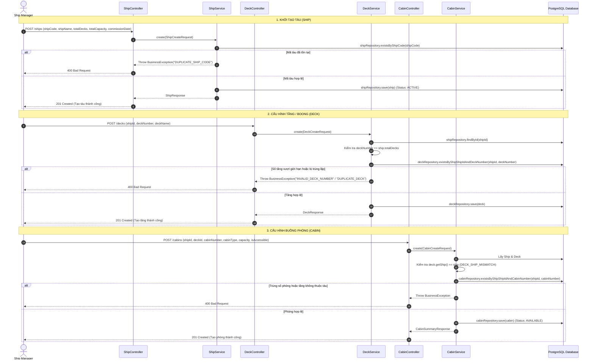
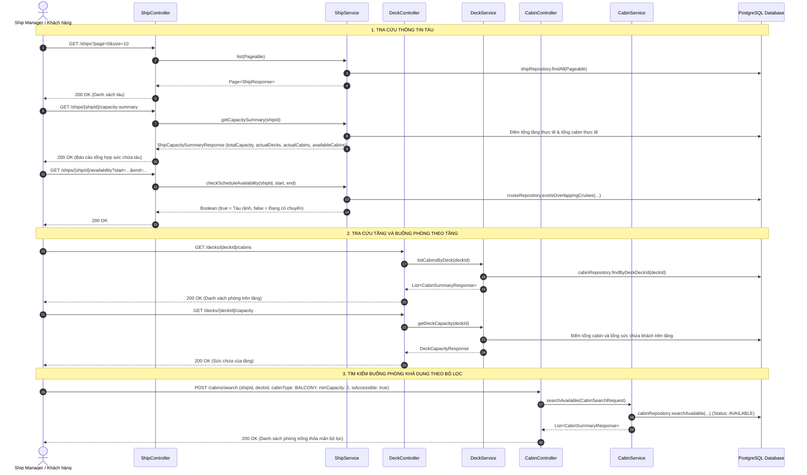
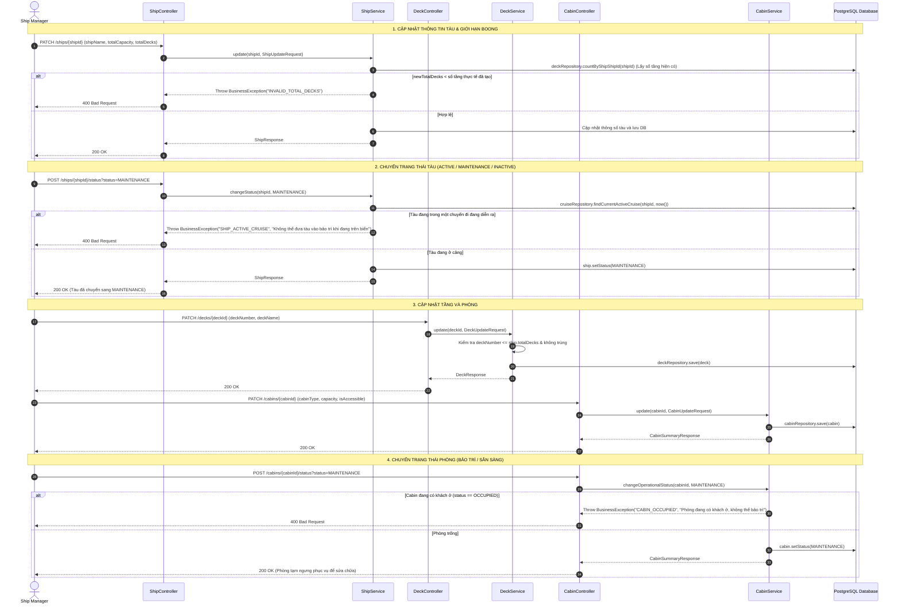
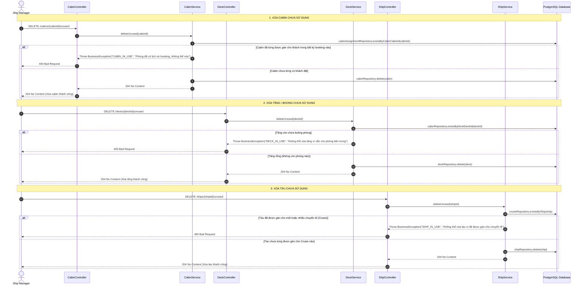
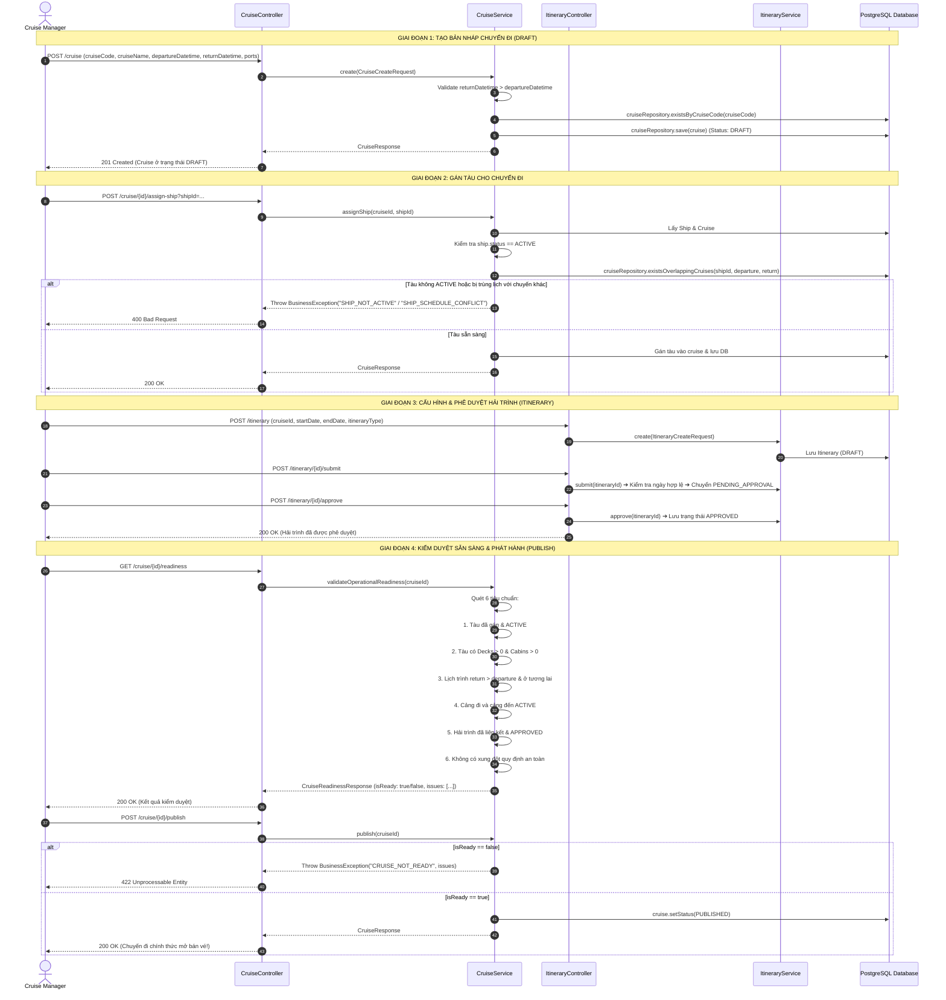
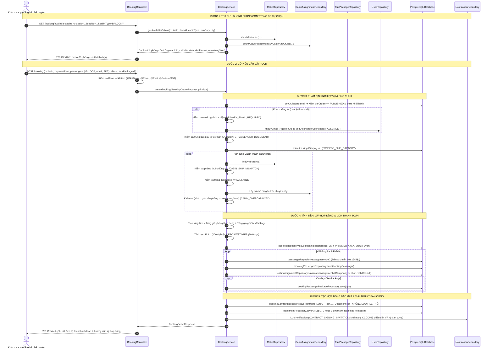
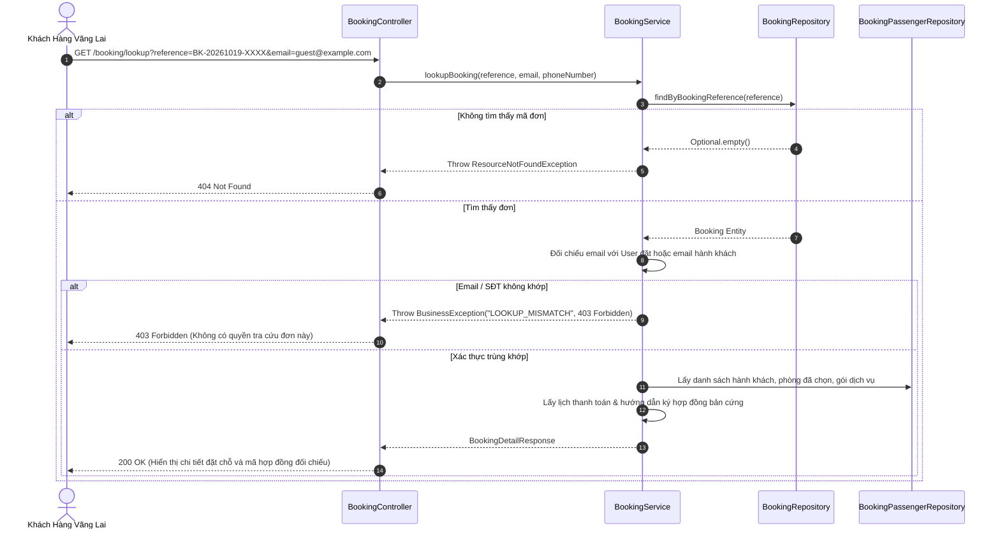
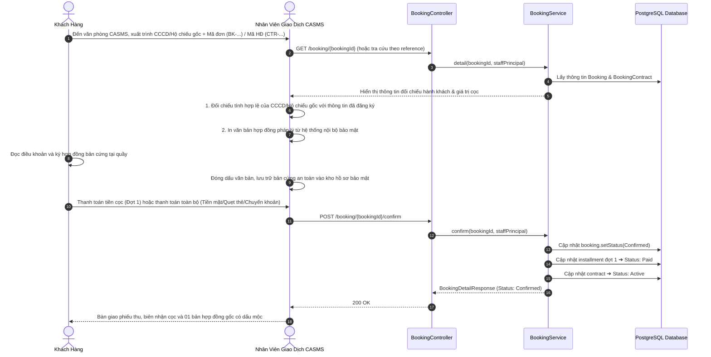
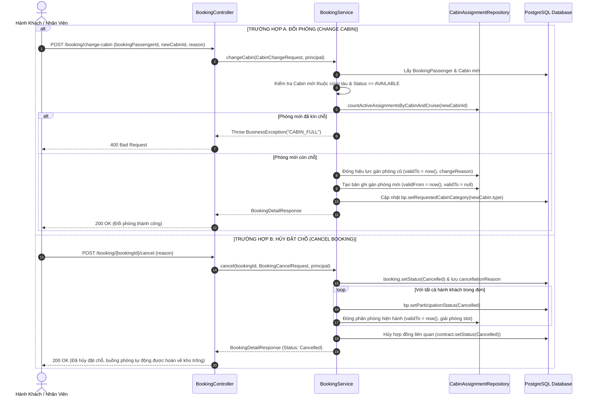
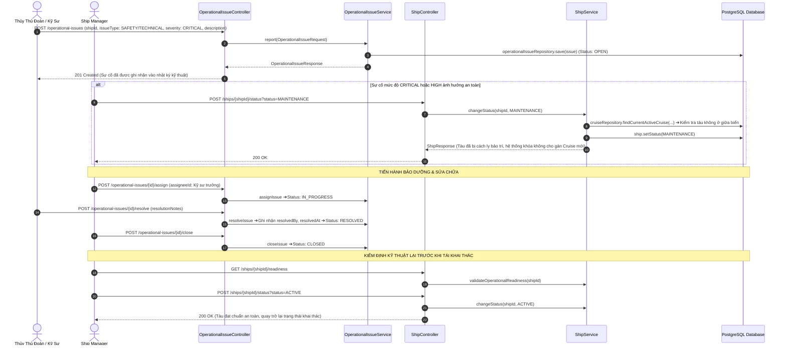

# TỔNG HỢP CÁC BIỂU ĐỒ TRÌNH TỰ NGHIỆP VỤ (SEQUENCE DIAGRAMS) - HỆ THỐNG CASMS

Tài liệu này mô hình hóa toàn diện các luồng nghiệp vụ cốt lõi trong hệ thống quản lý du thuyền **CASMS** (Cruise Activity Scheduling and Management System), từ khâu thiết lập đội tàu, khởi tạo chuyến đi, quy trình đặt tour tự chọn phòng, bảo mật hợp đồng, cho đến vận hành và xử lý sự cố.

---

## 1. Thiết lập Đội tàu: Phân rã theo CRUD (Fleet Management CRUD)

Khâu quản trị đội tàu được phân quyền cho `SHIP_MANAGER` (hoặc `ADMIN`), bao gồm 4 nhóm thao tác tác động lên chuỗi thực thể phân cấp: **Ship (Tàu) ➔ Deck (Tầng/Boong) ➔ Cabin (Phòng)**.

---

### 1.1. Fleet CREATE: Khởi tạo Tàu, Tầng và Buồng phòng mới

Quy trình tuần tự đăng ký một con tàu mới vào hệ thống, sau đó chia boong tầng và thiết lập từng buồng phòng theo chuẩn thiết kế.

---

### 1.2. Fleet READ: Truy vấn Danh sách, Chi tiết & Tìm kiếm Phòng trống

Quy trình tra cứu thông tin đội tàu, cấu trúc các tầng và tìm kiếm buồng phòng phục vụ vận hành và đặt vé.

---

### 1.3. Fleet UPDATE: Cập nhật Thông số & Chuyển đổi Trạng thái Vận hành

Quy trình điều chỉnh thông số kỹ thuật của Tàu, Tầng, Cabin và cơ chế kiểm tra an toàn khi đưa Tàu/Phòng vào trạng thái bảo trì (`MAINTENANCE`).

---

### 1.4. Fleet DELETE: Xóa An toàn Tàu, Tầng, Cabin Chưa Sử dụng

Quy trình bảo toàn toàn vẹn dữ liệu: Hệ thống nghiêm cấm xóa các thực thể đã phát sinh dữ liệu liên quan (chuyến đi hoặc booking của khách). Việc xóa chỉ cho phép theo thứ tự ngược: **Cabin ➔ Deck ➔ Ship**.

---

## 2. Biểu đồ: Lập Kế hoạch Chuyến đi, Thẩm định & Phát hành (Cruise Planning & Publishing)

Quy trình người quản lý chuyến đi (`CRUISE_MANAGER`) khởi tạo chuyến đi dạng nháp (`DRAFT`), gán tàu rảnh lịch, thiết lập hải trình (`Itinerary`), kiểm tra 6 tiêu chuẩn sẵn sàng vận hành (`Operational Readiness`) và phát hành (`PUBLISHED`) để mở bán vé.

---

## 3. Biểu đồ: Đặt Tour & Khách Tự Chọn Phòng (Booking & Self-Cabin Selection)

Quy trình hành khách (kể cả khách vãng lai chưa đăng nhập) xem sơ đồ buồng phòng trống, tự chọn cabin cụ thể, chọn gói dịch vụ (Basic/Plus/Premium), lựa chọn phương thức thanh toán (Full/Cọc 30%/3 giai đoạn) và nhận mã đối chiếu ký hợp đồng bản cứng bảo mật.

---

## 4. Biểu đồ: Tra Cứu Đơn Đặt Chỗ Cho Khách Vãng Lai (Guest Booking Lookup)

Quy trình khách hàng chưa đăng nhập tra cứu lại thông tin đơn đặt chỗ, lộ trình thanh toán và mã hợp đồng đối chiếu.

---

## 5. Biểu đồ: Ký Hợp Đồng Trực Tiếp & Xác Nhận Đơn (In-person Signing & Confirmation)

Quy trình giải quyết bảo mật thông tin định danh: khách hàng mang giấy tờ tùy thân gốc tới văn phòng CASMS để đối chiếu, ký hợp đồng bản cứng và thanh toán.

---

## 6. Biểu đồ: Đổi Phòng & Hủy Đặt Chỗ (Cabin Change & Booking Cancellation)

Quy trình xử lý biến động buồng phòng: chuyển đổi phòng cho khách hoặc hủy tour để giải phóng chỗ trống cho hành khách khác.

---

## 7. Biểu đồ: Quản Lý Sự Cố Vận Hành & An Toàn Tàu (Operational Issue & Maintenance)

Quy trình tiếp nhận báo cáo kỹ thuật, cách ly tàu hư hỏng khỏi lịch trình xuất bến và hoàn tất bảo trì kỹ thuật an toàn.

