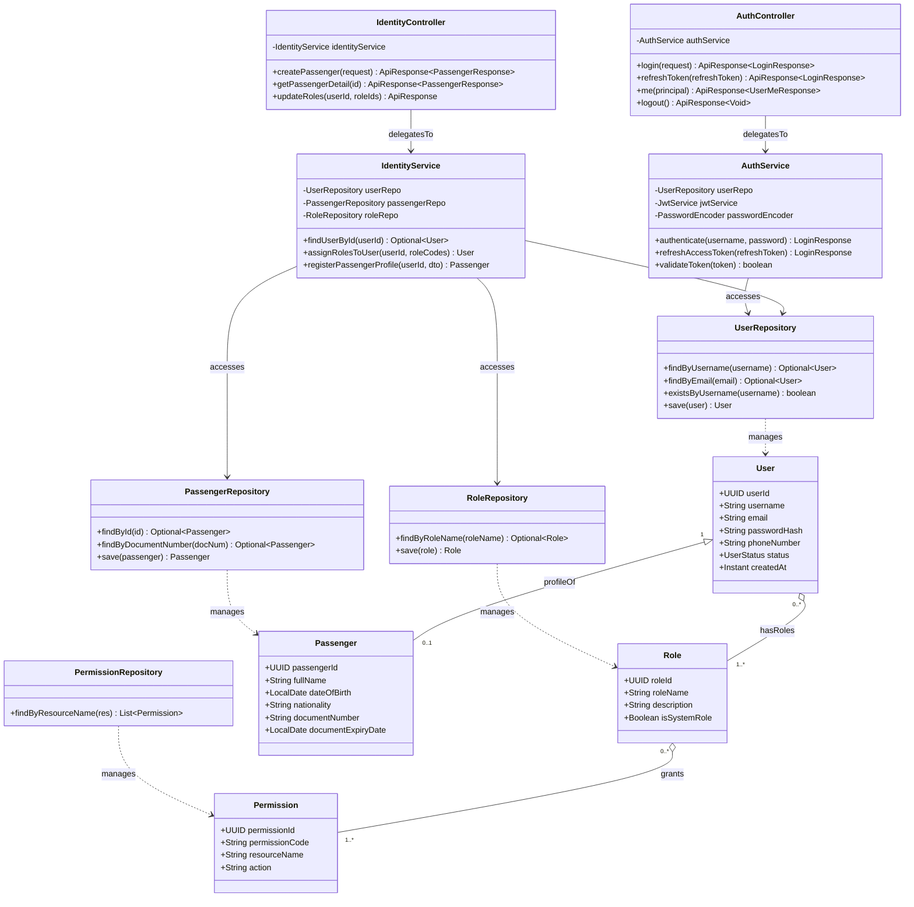

# Sơ Đồ Lớp Thiết Kế Chi Tiết: Phân Hệ Xác Thực & Phân Quyền (Identity & IAM Design Class Diagram)

Mô hình hóa chi tiết đầy đủ 4 tầng kiến trúc: **Controller ➔ Service ➔ Repository ➔ Entity** cho quản lý tài khoản người dùng, đăng nhập JWT, ma trận phân quyền RBAC và hồ sơ hành khách.

## Mã Mermaid UML (Tối ưu chuẩn Draw.io không bị đè dòng)

