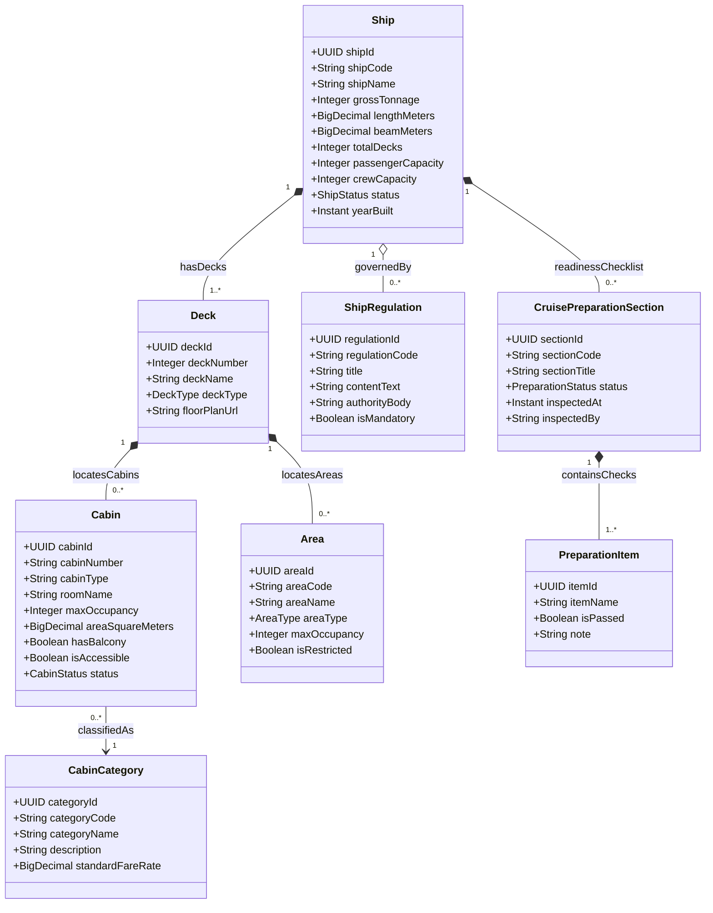

# Phân Hệ Hạ Tầng Kỹ Thuật Tàu, Boong & Buồng Phòng (Ship Infrastructure)

Quản lý thực thể vật lý du thuyền (`Ship`), các tầng boong (`Deck`), buồng phòng (`Cabin`), phân loại hạng phòng (`CabinCategory`), khu chức năng công cộng (`Area`) và checklist nghiệm thu kỹ thuật an toàn trước hải trình (`CruisePreparationSection`).

## Mã Mermaid UML

## Giải Thích Quan Hệ & Ràng Buộc
- **Ship - Deck**: Quan hệ Composition (`1 *-- 1..*`), một con tàu bắt buộc phải có ít nhất 1 boong tàu. Khi xóa tàu, các boong tàu thuộc về tàu đó sẽ bị xóa theo.
- **Deck - Cabin / Area**: Boong tàu là không gian vật lý chứa các buồng phòng lưu trú (`Cabin`) và các khu chức năng công cộng (`Area` như nhà hàng, nhà hát, hồ bơi).
- **Cabin - CabinCategory**: Mỗi buồng phòng thuộc một hạng phòng cụ thể (Interior, Ocean View, Balcony, Suite) với định mức giá vé chuẩn.
- **Ship - CruisePreparationSection - PreparationItem**: Checklist kiểm định kỹ thuật (máy chính, phao cứu sinh, hệ thống PCCC) trước khi tàu đủ điều kiện xuất bến.

