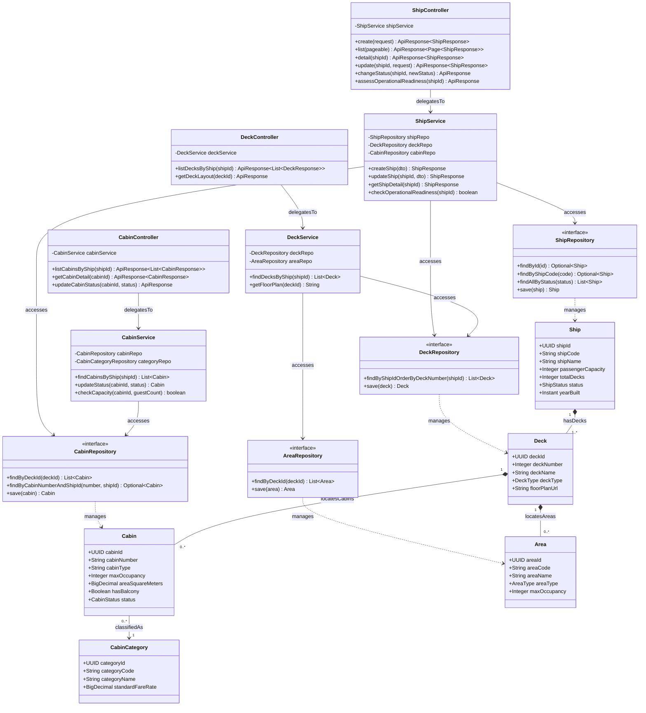

# Sơ Đồ Lớp Thiết Kế Chi Tiết: Phân Hệ Hạ Tầng Tàu & Buồng Phòng (Ship Infrastructure Design Class Diagram)

Mô hình hóa chi tiết đầy đủ 4 tầng kiến trúc: **Controller ➔ Service ➔ Repository ➔ Entity** cho quản lý thông số kỹ thuật tàu, các tầng boong, buồng phòng và khu vực công cộng.

## Mã Mermaid UML (Full-Stack 4 Tầng)

