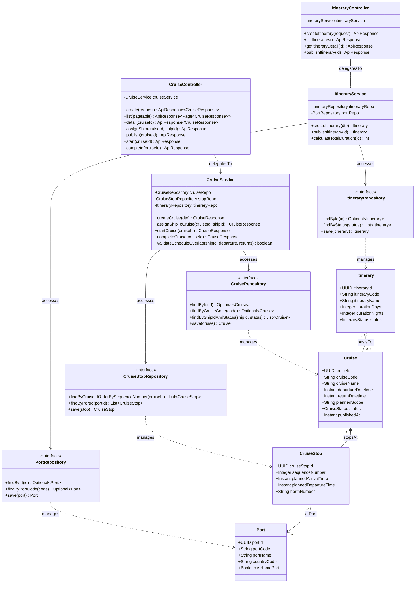

# Sơ Đồ Lớp Thiết Kế Chi Tiết: Phân Hệ Hải Trình & Cảng Biển (Itinerary & Port Design Class Diagram)

Mô hình hóa chi tiết đầy đủ 4 tầng kiến trúc: **Controller ➔ Service ➔ Repository ➔ Entity** cho lập kế hoạch lộ trình đường biển, các chặng dừng tại cảng và lịch trình chi tiết theo từng ngày của chuyến đi.

## Mã Mermaid UML (Full-Stack 4 Tầng)

