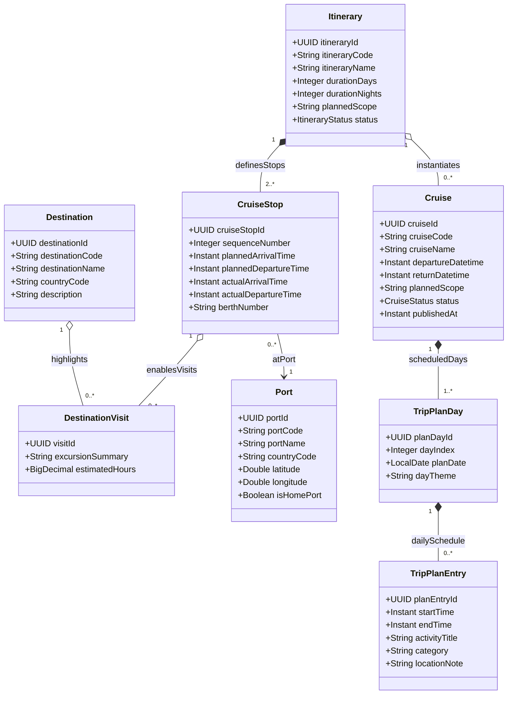

# Phân Hệ Lập Kế Hoạch Hải Trình & Cảng Biển (Itinerary & Port Planning)

Quản lý lộ trình đường biển (`Itinerary`), danh mục các cảng đón trả khách (`Port`), điểm đến tham quan (`Destination`), chuyến đi được lên lịch (`Cruise`), các điểm cập cảng (`CruiseStop`) và kế hoạch phân bổ theo ngày (`TripPlanDay`).

## Mã Mermaid UML

## Giải Thích Quan Hệ & Ràng Buộc
- **Itinerary - CruiseStop**: Hải trình mẫu bao gồm danh sách các điểm dừng (`CruiseStop`) theo thứ tự (`sequenceNumber`), mỗi điểm dừng gắn liền với một Cảng biển (`Port`). Một hải trình tiêu chuẩn cần ít nhất 2 điểm dừng (cảng đi và cảng đến).
- **Itinerary - Cruise**: Một hải trình (`Itinerary`) có thể được dùng để khởi tạo nhiều chuyến tàu cụ thể (`Cruise`) với các mốc thời gian khởi hành (`departureDatetime`) khác nhau.
- **Cruise - TripPlanDay - TripPlanEntry**: Mỗi chuyến đi được chia thành từng ngày (`TripPlanDay`), mỗi ngày có danh sách các mốc hoạt động chi tiết (`TripPlanEntry`).
- **CruiseStop - DestinationVisit - Destination**: Khi tàu cập một cảng, hành khách có thể tham gia các chuyến tham quan điểm đến địa phương liên kết (`Destination`).

