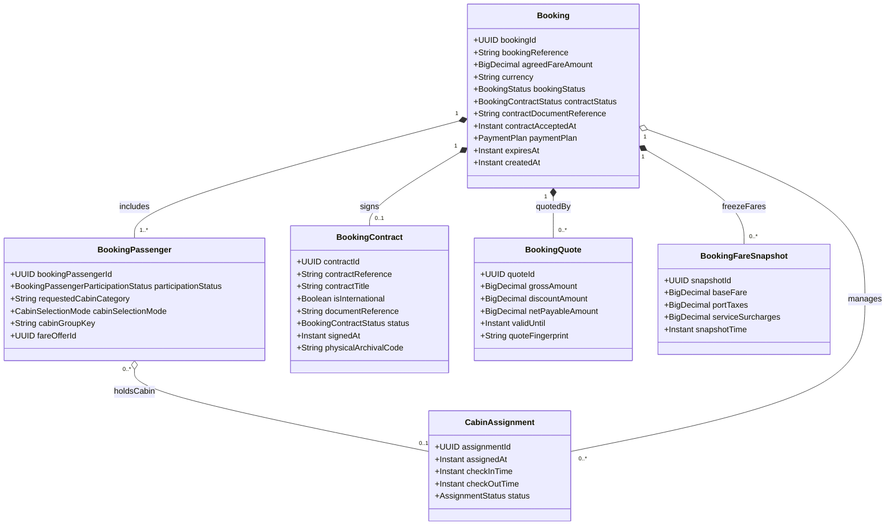

# Phân Hệ Đặt Chỗ, Giữ Chỗ & Hợp Đồng Hải Trình (Booking & Contract Lifecycle)

Vòng đời đơn đặt chỗ (`Booking`), danh sách thành viên đi cùng (`BookingPassenger`), phân bổ phòng (`CabinAssignment`), báo giá giữ chỗ (`BookingQuote`) và văn bản hợp đồng vận chuyển hành khách (`BookingContract`).

## Mã Mermaid UML

## Giải Thích Quan Hệ & Ràng Buộc
- **Booking - BookingPassenger**: Một đơn đặt chỗ có ít nhất 1 hoặc nhiều hành khách tham gia (`1 *-- 1..*`).
- **Booking - BookingContract**: Hợp đồng vận tải du lịch điện tử ký kết giữa khách hàng và hãng tàu. Thuộc tính `isInternational` phân biệt hợp đồng nội địa (Tuân thủ Bộ luật Hàng hải Việt Nam, Luật Du lịch 2017) với hợp đồng quốc tế (Công ước Athens 1974, quy định xuất nhập cảnh và thị thực).
- **BookingPassenger - CabinAssignment**: Phân bổ buồng phòng cụ thể cho hành khách dựa trên hạng phòng và nhóm cabin (`cabinGroupKey`).
- **BookingFareSnapshot**: Lưu lại ảnh chụp giá vé tại thời điểm đặt phòng nhằm tránh biến động tỷ giá và bảo vệ quyền lợi người tiêu dùng.

