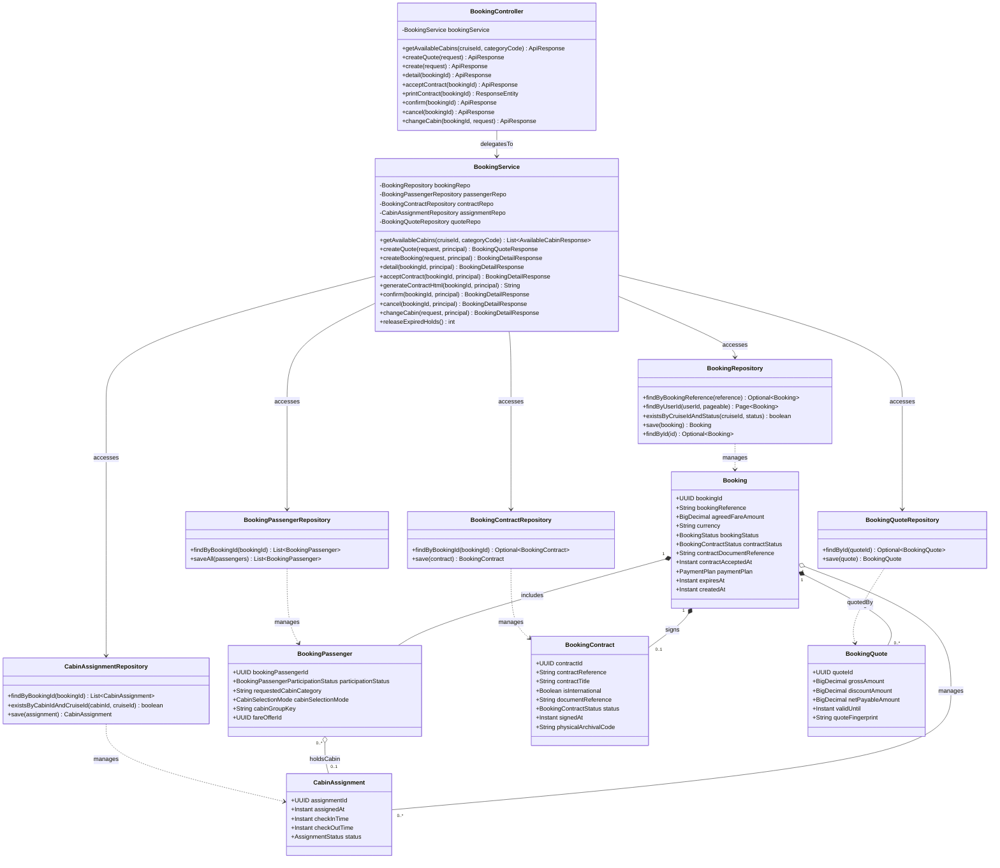

# Sơ Đồ Lớp Thiết Kế Chi Tiết: Phân Hệ Đặt Chỗ & Hợp Đồng (Booking & Contract Design Class Diagram)

Mô hình hóa chi tiết đầy đủ 4 tầng kiến trúc: **Controller ➔ Service ➔ Repository ➔ Entity** cho vòng đời đơn đặt chỗ, báo giá giữ phòng, phân bổ buồng phòng và ký hợp đồng vận tải điện tử.

## Mã Mermaid UML (Tối ưu chuẩn Draw.io không bị đè dòng)

