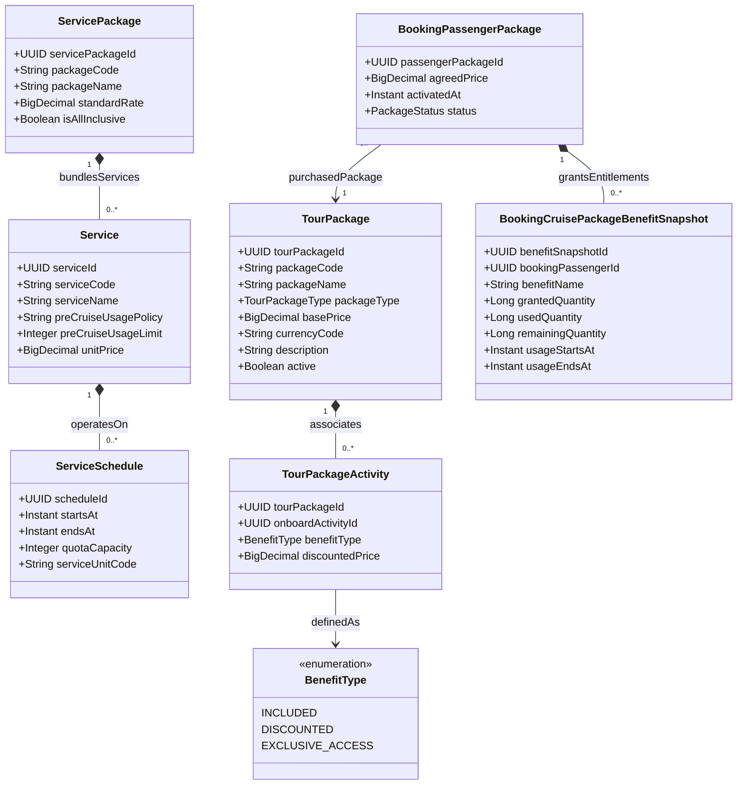

# Phân Hệ Gói Du Thuyền, Dịch Vụ & Quyền Lợi (Fare & Service Package)

Quản lý danh mục gói tham quan (`TourPackage`), gói dịch vụ tiện ích trên tàu (`ServicePackage`), các hoạt động đi kèm gói (`TourPackageActivity`), chính sách sử dụng (`ServiceUsagePolicy`) và phân bổ cho khách (`BookingPassengerPackage`).

## Mã Mermaid UML

## Giải Thích Quan Hệ & Ràng Buộc
- **TourPackage - TourPackageActivity**: Một gói tour liên kết với các hoạt động giải trí trên tàu hoặc tour trên bờ kèm theo loại quyền lợi (`BenefitType`: miễn phí `INCLUDED`, giảm giá `DISCOUNTED`, hoặc quyền vào độc quyền `EXCLUSIVE_ACCESS`).
- **ServicePackage - Service**: Đóng gói các dịch vụ đơn lẻ (Spa, quầy bar cao cấp, internet vệ tinh Starlink) thành các gói All-Inclusive hoặc Add-on tiện ích.
- **BookingCruisePackageBenefitSnapshot**: Bản ghi chụp định mức quyền lợi khả dụng của hành khách (`grantedQuantity`, `usedQuantity`, `remainingQuantity`), hỗ trợ việc kiểm tra và trừ quota tiêu dùng kể cả khi tàu hoạt động ngoại tuyến ngoài khơi.

