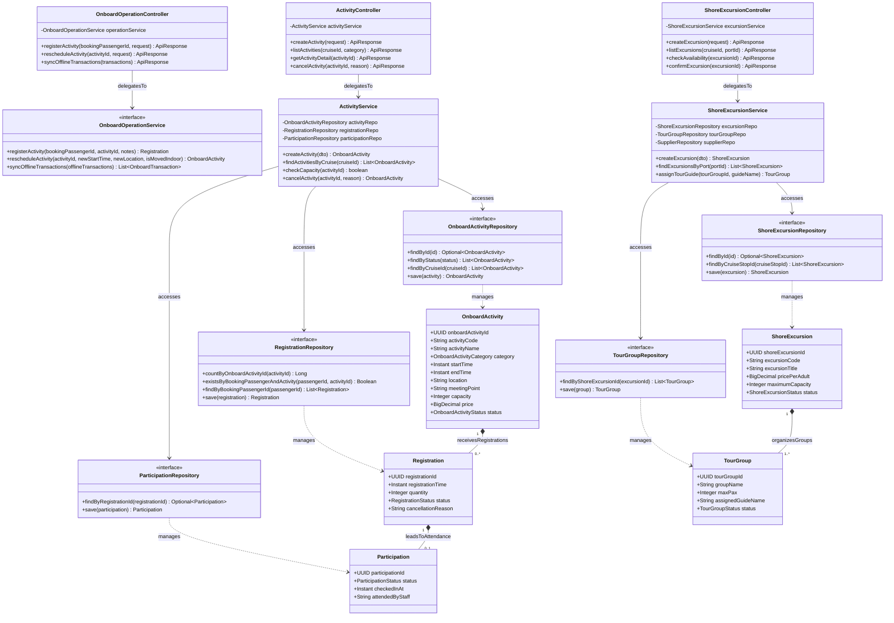

# Sơ Đồ Lớp Thiết Kế Chi Tiết: Phân Hệ Hoạt Động Giải Trí & Tour Bờ (Activity & Excursion Design Class Diagram)

Mô hình hóa chi tiết đầy đủ 4 tầng kiến trúc: **Controller ➔ Service ➔ Repository ➔ Entity** cho các hoạt động biểu diễn nghệ thuật, thể thao trên tàu, tour tham quan bờ biển và vận hành linh hoạt thời tiết (Dynamic Rescheduling).

## Mã Mermaid UML (Full-Stack 4 Tầng)

