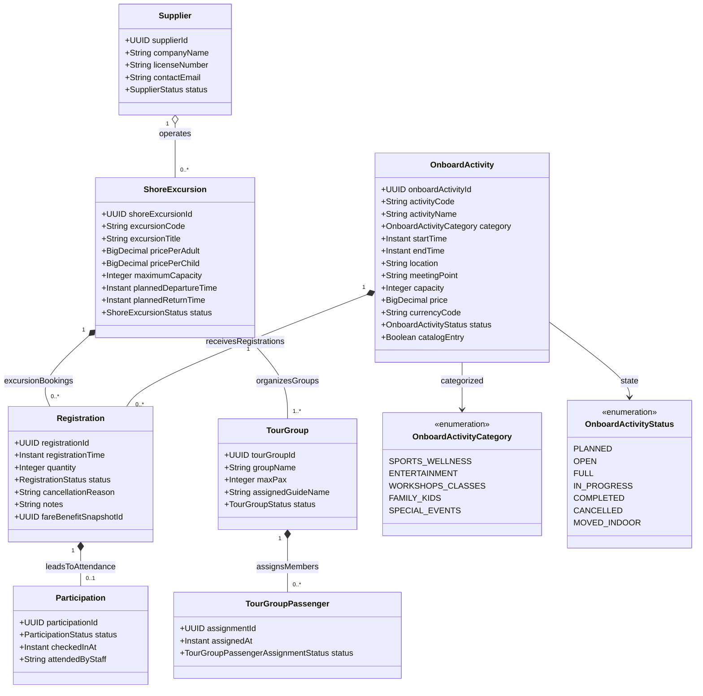

# Phân Hệ Hoạt Động Giải Trí Trên Tàu & Tour Tham Quan Bờ (Onboard Activities & Excursions)

Mô hình hóa hoạt động giải trí (`OnboardActivity`), đăng ký ghế ngồi (`Registration`), điểm danh (`Participation`), tour khám phá bờ biển (`ShoreExcursion`) và đơn vị cung cấp đối tác địa phương (`Supplier`).

## Mã Mermaid UML

## Giải Thích Quan Hệ & Ràng Buộc
- **OnboardActivity - Registration - Participation**: Luồng đăng ký từ lúc giữ slot (`Registration`) đến khi có mặt thực tế quét mã tại cửa phòng/sân khấu (`Participation`).
- **Dynamic Rescheduling**: Thuộc tính `status` của `OnboardActivity` hỗ trợ trạng thái `MOVED_INDOOR` và `CANCELLED` khi thời tiết trên biển xấu, cho phép dời lịch hoặc đổi địa điểm mà vẫn giữ nguyên danh sách đăng ký.
- **ShoreExcursion - TourGroup - TourGroupPassenger**: Tour tham quan cảng được chia thành các nhóm nhỏ (`TourGroup`) do hướng dẫn viên (`assignedGuideName`) phụ trách để đảm bảo an toàn và số lượng tối đa (`maxPax`).
- **Supplier**: Nhà cung ứng dịch vụ tại điểm đến địa phương (xe đưa đón, cano cao tốc, nhà hàng đối tác).

