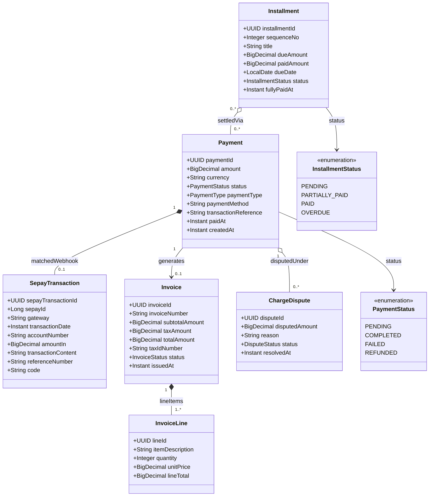

# Phân Hệ Cổng Thanh Toán Trực Tuyến & Lịch Trả Góp (Payment & Installments)

Giao dịch thanh toán (`Payment`), tích hợp cổng VietQR/SePay (`SepayTransaction`), lộ trình trả góp chia đợt (`Installment`), hóa đơn (`Invoice`) và dòng chi tiết hóa đơn (`InvoiceLine`).

## Mã Mermaid UML

## Giải Thích Quan Hệ & Ràng Buộc
- **Payment - SepayTransaction**: Xử lý Webhook tự động từ SePay/VietQR. Khi khách chuyển khoản quét mã VietQR có nội dung khớp mã thanh toán, `SepayTransaction` đối soát tự động chuyển trạng thái `Payment` từ `PENDING` sang `COMPLETED`.
- **Installment**: Hỗ trợ chia nhỏ số tiền cọc và thanh toán nhiều đợt trước ngày khởi hành (ví dụ: Đợt 1 cọc 30%, Đợt 2 thanh toán 40% trước 30 ngày, Đợt 3 thanh toán 30% trước 7 ngày).
- **Invoice - InvoiceLine**: Xuất hóa đơn VAT điện tử cho cơ quan thuế và khách hàng.
- **ChargeDispute**: Cơ chế giải quyết khiếu nại sai lệch cước phí hoặc giao dịch trùng lặp.

