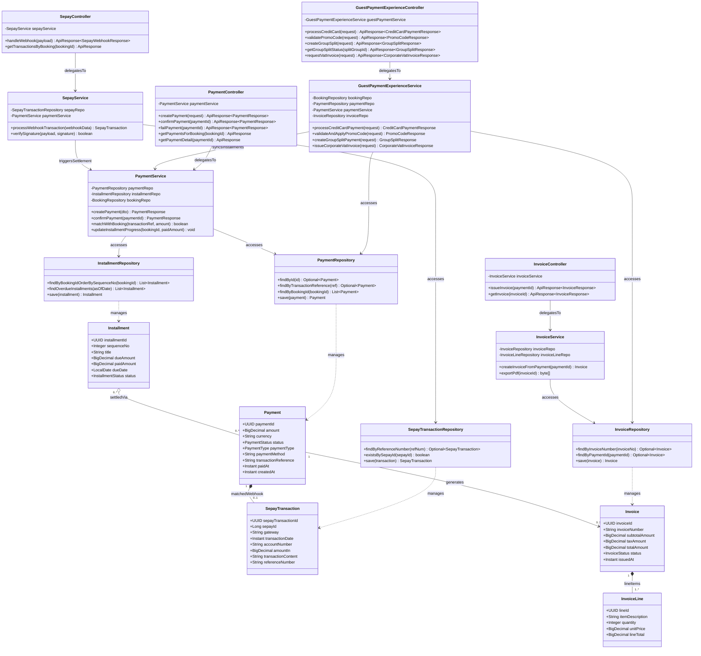

# Sơ Đồ Lớp Thiết Kế Chi Tiết: Phân Hệ Thanh Toán & Trả Góp (Payment & Installments Design Class Diagram)

Mô hình hóa chi tiết đầy đủ 4 tầng kiến trúc: **Controller ➔ Service ➔ Repository ➔ Entity** cho việc tích hợp cổng thanh toán trực tuyến, xử lý Webhook ngân hàng VietQR/SePay, chia đợt trả góp và xuất hóa đơn điện tử.

## Mã Mermaid UML (Tối ưu chuẩn Draw.io không bị đè dòng)

