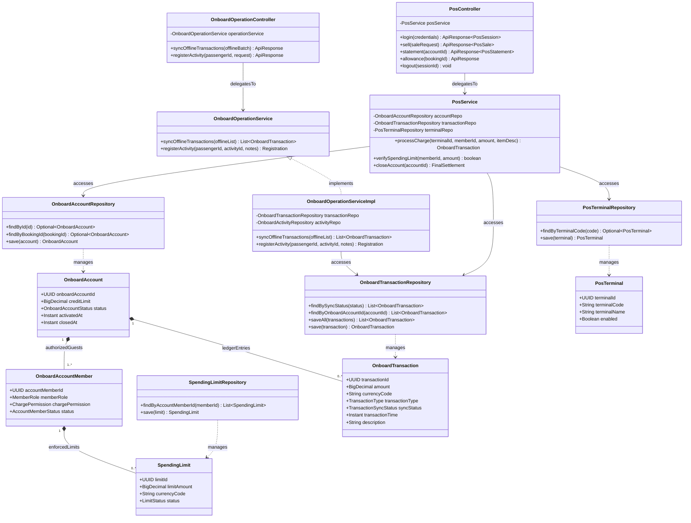

# Sơ Đồ Lớp Thiết Kế Chi Tiết: Phân Hệ Tài Khoản Phòng & POS (Cashless Folio & POS Design Class Diagram)

Mô hình hóa chi tiết đầy đủ 4 tầng kiến trúc: **Controller ➔ Service ➔ Repository ➔ Entity** cho tài khoản tiêu dùng không tiền mặt trên tàu, thiết bị máy POS quầy bar/nhà hàng, định mức chi tiêu trẻ em và cơ chế đồng bộ ngoại tuyến (Offline Edge Sync).

## Mã Mermaid UML (Tối ưu chuẩn Draw.io không bị đè dòng)

