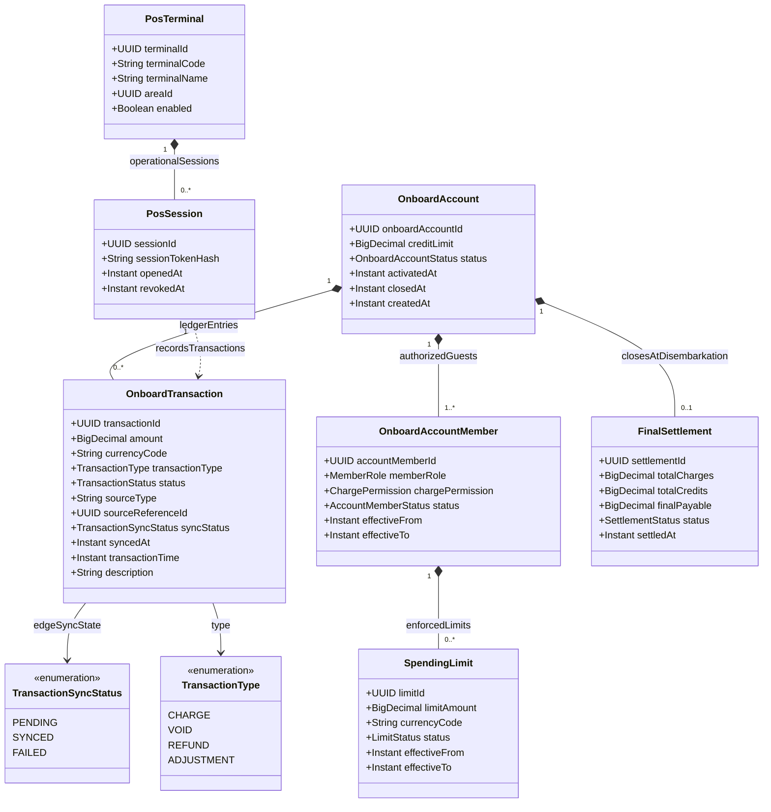

# Phân Hệ Tài Khoản Phòng Không Tiền Mặt & Điểm Bán Hàng (Cashless Folio & POS)

Mô hình tài khoản tiêu dùng buồng phòng (`OnboardAccount`), ủy quyền thành viên phòng (`OnboardAccountMember`), nhật ký chi tiêu (`OnboardTransaction`), định mức chi tiêu cá nhân (`SpendingLimit`) và thiết bị máy POS quầy bar/nhà hàng (`PosTerminal`).

## Mã Mermaid UML

## Giải Thích Quan Hệ & Ràng Buộc
- **Cashless Folio (Tài khoản phòng)**: Hành khách trên tàu không cần mang tiền mặt. Mọi chi phí ăn uống, giải trí tại quầy bar hay spa được quẹt thẻ và hạch toán trực tiếp vào `OnboardAccount` của buồng phòng.
- **Hybrid Edge-to-Cloud Sync**: Cột `syncStatus` (`PENDING`, `SYNCED`, `FAILED`) trên `OnboardTransaction` cho phép máy POS hoạt động ngoại tuyến khi mất sóng biển, sau đó tự động đồng bộ lên máy chủ đám mây khi tàu kết nối lại vệ tinh hoặc cập cảng mà không gây gián đoạn phục vụ.
- **SpendingLimit**: Giới hạn chi tiêu theo ngày hoặc theo chuyến dành cho trẻ em/người phụ thuộc trong phòng nhằm tránh phát sinh nợ ngoài dự kiến.
- **FinalSettlement**: Quyết toán tổng thể số dư chi tiêu tại quầy lễ tân trước khi hành khách rời tàu (Disembarkation).

