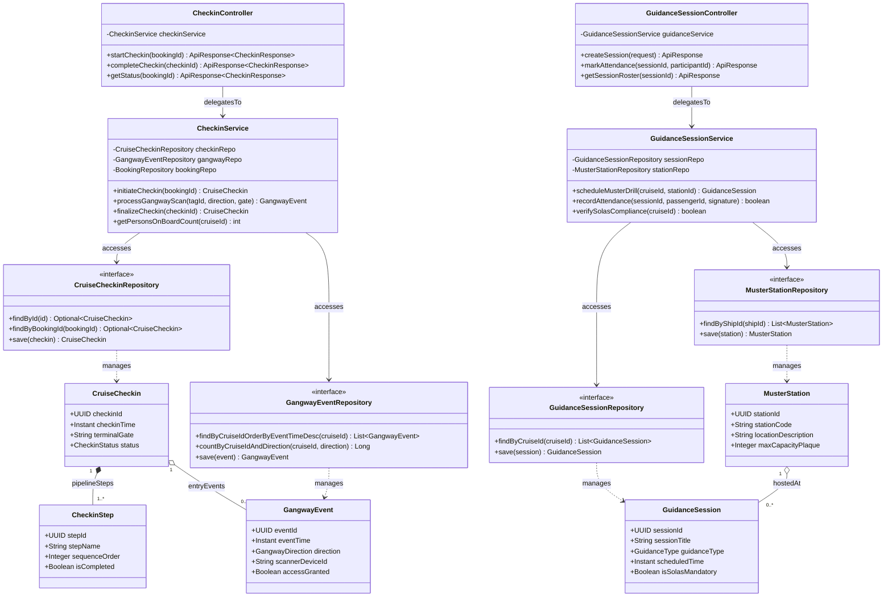

# Sơ Đồ Lớp Thiết Kế Chi Tiết: Phân Hệ Cầu Tàu & An Toàn SOLAS (Check-in & Safety Design Class Diagram)

Mô hình hóa chi tiết đầy đủ 4 tầng kiến trúc: **Controller ➔ Service ➔ Repository ➔ Entity** cho thủ tục check-in tại nhà ga cảng, kiểm soát qua cầu tàu Gangway bằng NFC/RFID và điểm danh diễn tập an toàn bắt buộc SOLAS (Muster Drill).

## Mã Mermaid UML (Full-Stack 4 Tầng)

