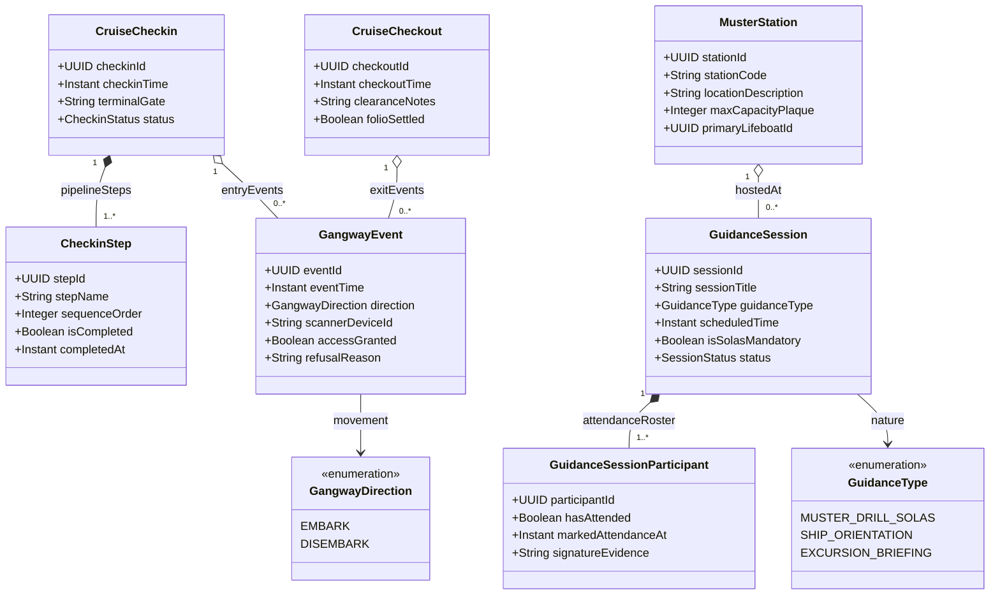

# Phân Hệ Cầu Tàu, Điểm Danh An Toàn SOLAS & Thẻ Từ RFID (Gangway Check-in & Safety)

Kiểm soát khách qua cửa cầu cảng (`CruiseCheckin`, `CruiseCheckout`), sự kiện quẹt thẻ từ NFC/RFID tại cửa Gangway (`GangwayEvent`), trạm tập kết cứu sinh (`MusterStation`) và buổi diễn tập an toàn bắt buộc SOLAS (`GuidanceSession`).

## Mã Mermaid UML

## Giải Thích Quan Hệ & Ràng Buộc
- **GangwayEvent (Kiểm soát cầu tàu)**: Ghi nhận thời gian thực mỗi lần hành khách lên (`EMBARK`) hoặc rời tàu (`DISEMBARK`) khi tàu cập cảng, đảm bảo danh sách số lượng người trên tàu (Onboard POB - Persons On Board) luôn chính xác 100% theo luật hàng hải.
- **MusterStation & GuidanceSession (Quy định an toàn SOLAS)**: Công ước SOLAS quốc tế bắt buộc 100% hành khách phải tham gia diễn tập cứu sinh tại Trạm tập trung khẩn cấp (`MusterStation`) trước khi tàu nhổ neo hoặc trong vòng 24 giờ sau khi xuất bến. Thuộc tính `hasAttended` và `signatureEvidence` đóng vai trò là bằng chứng pháp lý điện tử.
- **CruiseCheckout**: Xác nhận hành khách đã hoàn tất quyết toán tài khoản phòng (`folioSettled = true`) trước khi được cấp phép rời tàu cuối hành trình.
