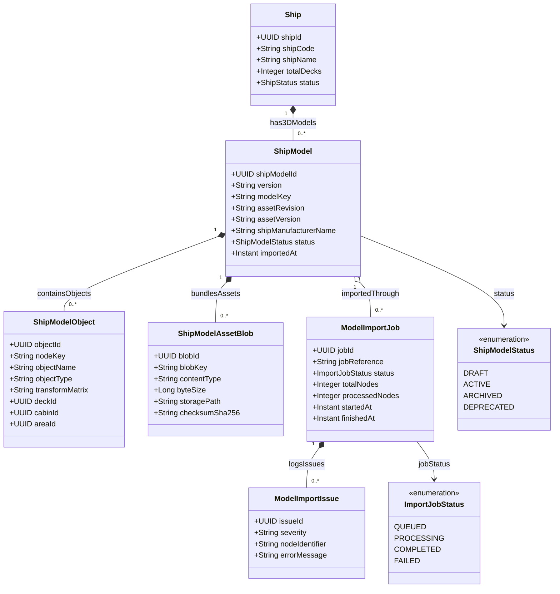

# Phân Hệ Mô Hình 3D Digital Twin Tàu & CAD/BIM (Ship 3D Model & Assets)

Lưu trữ mô hình 3D đa giác, cây phân cấp đối tượng không gian (Spatial Object Hierarchy), ánh xạ buồng phòng/boong tàu với các đối tượng 3D, và quy trình nhập file CAD/BIM/Asset bundle từ nhà sản xuất tàu.

## Mã Mermaid UML

## Giải Thích Quan Hệ & Ràng Buộc
- **Ship - ShipModel**: Một con tàu có thể có nhiều phiên bản mô hình 3D (`ShipModel`) theo thời gian (khi nâng cấp, sửa chữa, cải tạo boong tàu).
- **ShipModel - ShipModelObject**: Cây đối tượng 3D chi tiết ánh xạ trực tiếp đến các thực thể logic như `Deck`, `Cabin`, `Area` thông qua thuộc tính `nodeKey` và ma trận chuyển đổi không gian 3 chiều (`transformMatrix`).
- **ShipModelAssetBlob**: Lưu trữ nhị phân các file định dạng GLTF/GLB/Textures với mã băm bảo mật `checksumSha256`.
- **ModelImportJob & ModelImportIssue**: Tiến trình nhập dữ liệu CAD/BIM bất đồng bộ, ghi nhận các lỗi sai lệch tọa độ hoặc thiếu vật liệu đồ họa khi import.
