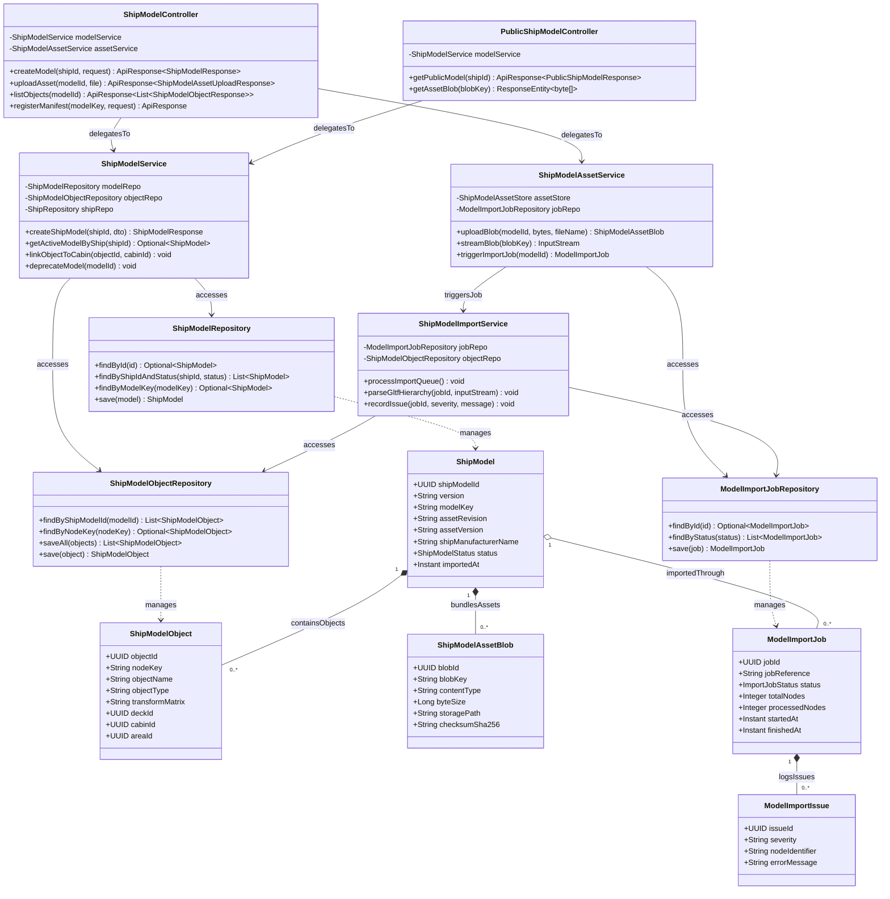

# Sơ Đồ Lớp Thiết Kế Chi Tiết: Mô Hình 3D Digital Twin Tàu & CAD/BIM (Ship 3D Model & Assets Design Class Diagram)

Mô hình hóa chi tiết đầy đủ 4 tầng kiến trúc: **Controller ➔ Service ➔ Repository ➔ Entity** cho quy trình quản lý file mô hình 3D đa giác, cây phân cấp đối tượng không gian (Spatial Object Nodes) và tiến trình nhập file CAD/BIM bất đồng bộ.

## Mã Mermaid UML (Tối ưu chuẩn Draw.io không bị đè dòng)

