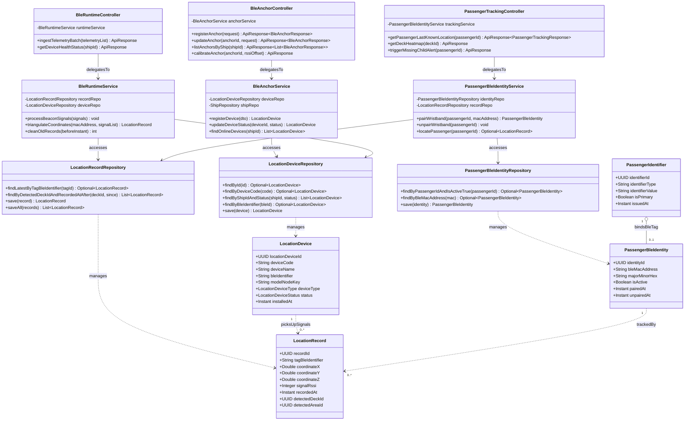

# Sơ Đồ Lớp Thiết Kế Chi Tiết: Định Vị Trong Nhà Thời Gian Thực IoT BLE (Indoor Location & BLE Tracking Design Class Diagram)

Mô hình hóa chi tiết đầy đủ 4 tầng kiến trúc: **Controller ➔ Service ➔ Repository ➔ Entity** cho quản lý trạm phát sóng Anchor Beacon, dòng dữ liệu tọa độ thời gian thực (Real-time telemetry) và giám sát vị trí hành khách mang thẻ/vòng tay BLE.

## Mã Mermaid UML (Tối ưu chuẩn Draw.io không bị đè dòng)

