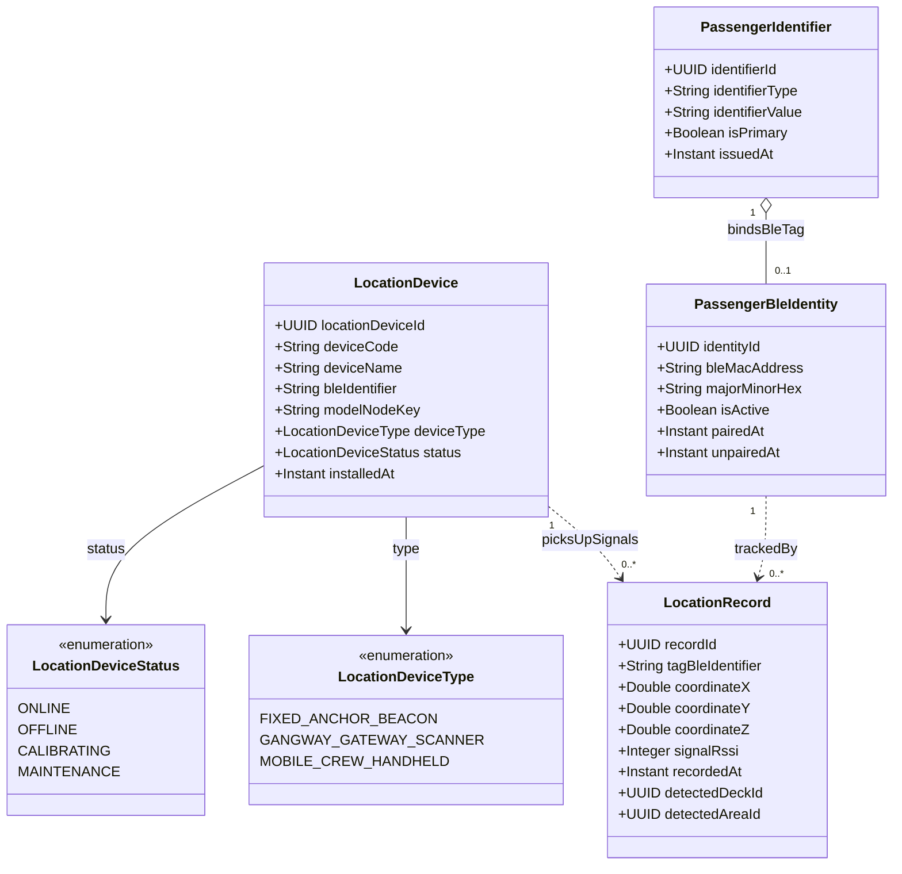

# Phân Hệ Định Vị Trong Nhà Thời Gian Thực IoT BLE & Theo Dõi Hành Khách (Indoor Location & BLE Tracking)

Quản lý hạ tầng thiết bị định vị (Beacon, Scanner BLE), nhật ký tín hiệu di chuyển thời gian thực, và liên kết mã định danh BLE với hành khách trên du thuyền.

## Mã Mermaid UML

## Giải Thích Quan Hệ & Ràng Buộc
- **LocationDevice**: Các trạm thu phát sóng Bluetooth Low Energy (BLE) cố định tại các góc boong tàu, hành lang, nhà hàng, hồ bơi.
- **LocationRecord**: Dòng dữ liệu time-series lưu trữ tọa độ tính toán (X, Y, Z) và cường độ sóng (`signalRssi`) của vòng đeo tay thông minh.
- **PassengerBleIdentity & PassengerIdentifier**: Liên kết vòng tay RFID/BLE với hồ sơ hành khách (`Passenger`), cho phép xác định vị trí hành khách trong các tình huống khẩn cấp (diễn tập cứu hộ, tìm trẻ em đi lạc, cảnh báo khu vực cấm).
