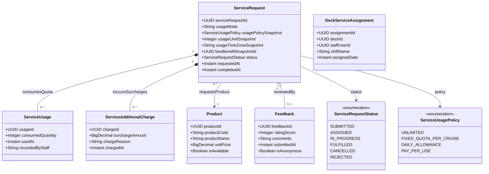

# Phân Hệ Yêu Cầu Phục Vụ Buồng Phòng, Dịch Vụ Tiện Ích & Đánh Giá (Service Request & Guest Feedback)

Quản lý các yêu cầu phục vụ phòng (Room Service, Housekeeping, Butler), theo dõi hạn mức tiêu dùng trong gói hoặc phụ thu phát sinh, và hệ thống khảo sát đánh giá độ hài lòng của khách.

## Mã Mermaid UML

## Giải Thích Quan Hệ & Ràng Buộc
- **ServiceRequest - ServiceUsage**: Khi khách order dịch vụ ăn uống tại phòng hoặc giặt ủi, hệ thống kiểm tra chính sách (`usagePolicySnapshot`). Nếu khách thuộc gói All-Inclusive có hạn mức, số lượng tiêu thụ sẽ được trừ vào `ServiceUsage`. Nếu vượt hạn mức, hệ thống tự động sinh `ServiceAdditionalCharge` hạch toán vào tài khoản phòng Folio.
- **DeckServiceAssignment**: Phân công nhân viên phục vụ phòng (`staffUserId`) chịu trách nhiệm theo từng tầng boong (`deckId`) và ca trực (`shiftName`).
- **Feedback**: Đánh giá chất lượng dịch vụ từ 1 đến 5 sao kèm nhận xét chi tiết sau khi yêu cầu được hoàn thành (`FULFILLED`).
