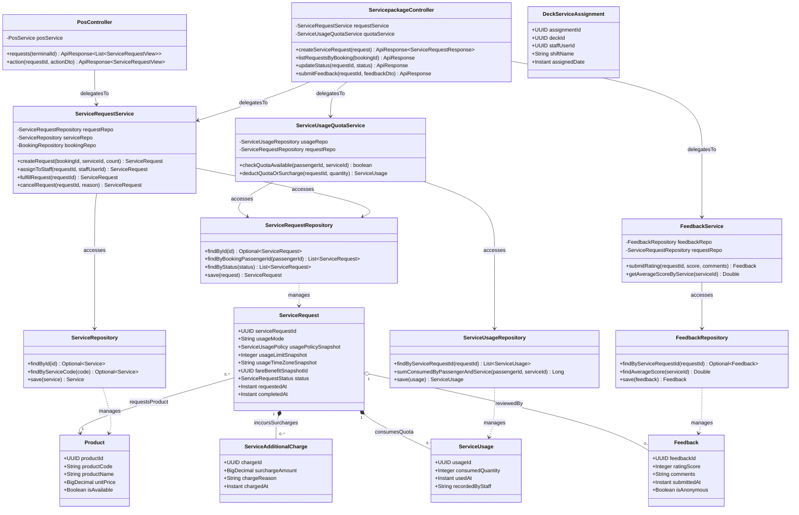

# Sơ Đồ Lớp Thiết Kế Chi Tiết: Phục Vụ Buồng Phòng & Đánh Giá (Service Request & Feedback Design Class Diagram)

Mô hình hóa chi tiết đầy đủ 4 tầng kiến trúc: **Controller ➔ Service ➔ Repository ➔ Entity** cho các yêu cầu phục vụ phòng (Room Service, Housekeeping), kiểm soát định mức quyền lợi All-Inclusive và hệ thống thu thập đánh giá độ hài lòng.

## Mã Mermaid UML (Tối ưu chuẩn Draw.io không bị đè dòng)

