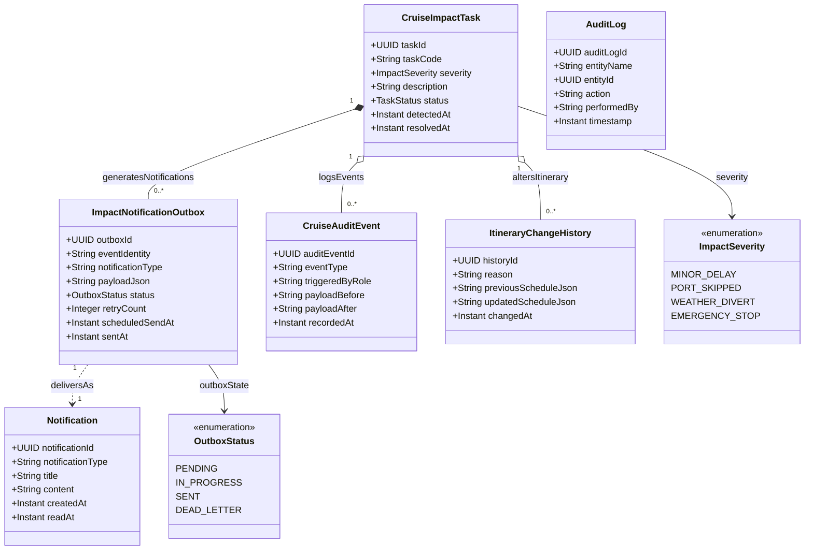

# Phân Hệ Biến Động Hải Trình, Outbox Thông Báo & Kiểm Toán Hệ Thống (Impact Tasks, Outbox & Audit)

Quản lý các tác vụ xử lý sự cố hải trình (thời tiết biển xấu, tàu trễ giờ cập cảng), mô hình giao vận bất đồng bộ Outbox Pattern để gửi thông báo đẩy đến khách hàng, và nhật ký kiểm toán hệ thống.

## Mã Mermaid UML

## Giải Thích Quan Hệ & Ràng Buộc
- **Transactional Outbox Pattern**: Khi có sự cố dời giờ tàu, hệ thống lưu task sự cố và thông điệp vào bảng `ImpactNotificationOutbox` trong cùng một Database Transaction. Background worker sẽ đọc từ Outbox và gửi tin nhắn đẩy/email/SMS đến khách, đảm bảo tính bền vững (Guaranteed At-Least-Once Delivery) ngay cả khi mất kết nối mạng ngoài khơi.
- **AuditLog & CruiseAuditEvent**: Cơ chế ghi lại vết thay đổi (Audit Trail) của toàn bộ dữ liệu quan trọng, phục vụ công tác thanh tra hàng hải và kiểm soát gian lận.

