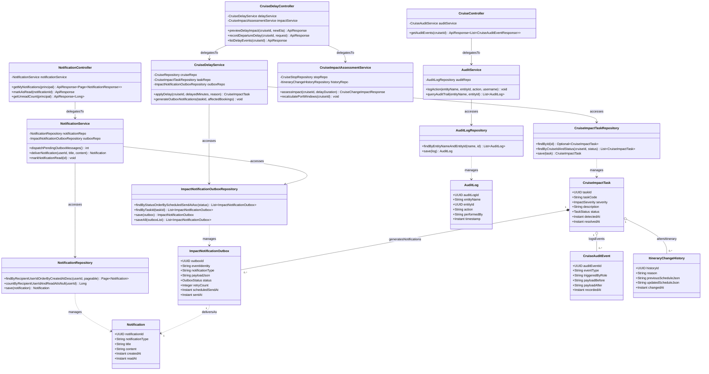

# Sơ Đồ Lớp Thiết Kế Chi Tiết: Biến Động Hải Trình, Outbox & Kiểm Toán (Impact, Outbox & Audit Design Class Diagram)

Mô hình hóa chi tiết đầy đủ 4 tầng kiến trúc: **Controller ➔ Service ➔ Repository ➔ Entity** cho xử lý sự cố trễ tàu, mô hình giao vận bảo đảm Transactional Outbox Pattern và nhật ký kiểm toán hệ thống.

## Mã Mermaid UML (Tối ưu chuẩn Draw.io không bị đè dòng)

