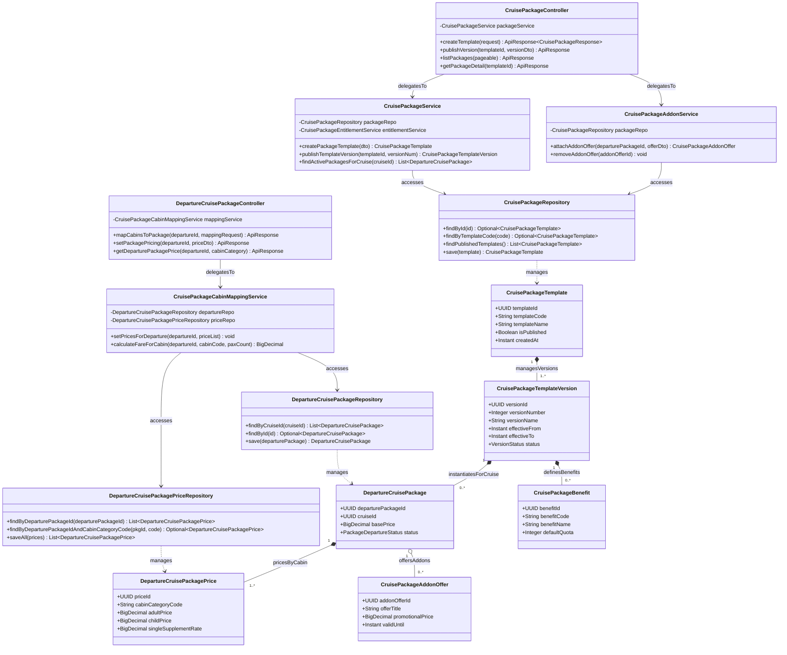

# Sơ Đồ Lớp Thiết Kế Chi Tiết: Động Cơ Định Giá & Phiên Bản Gói (Pricing & Package Engine Design Class Diagram)

Mô hình hóa chi tiết đầy đủ 4 tầng kiến trúc: **Controller ➔ Service ➔ Repository ➔ Entity** cho quản lý mẫu gói tour du thuyền, vòng đời phiên bản biểu giá (Versioning) và ma trận định giá theo từng hạng phòng cho mỗi đợt khởi hành.

## Mã Mermaid UML (Tối ưu chuẩn Draw.io không bị đè dòng)

