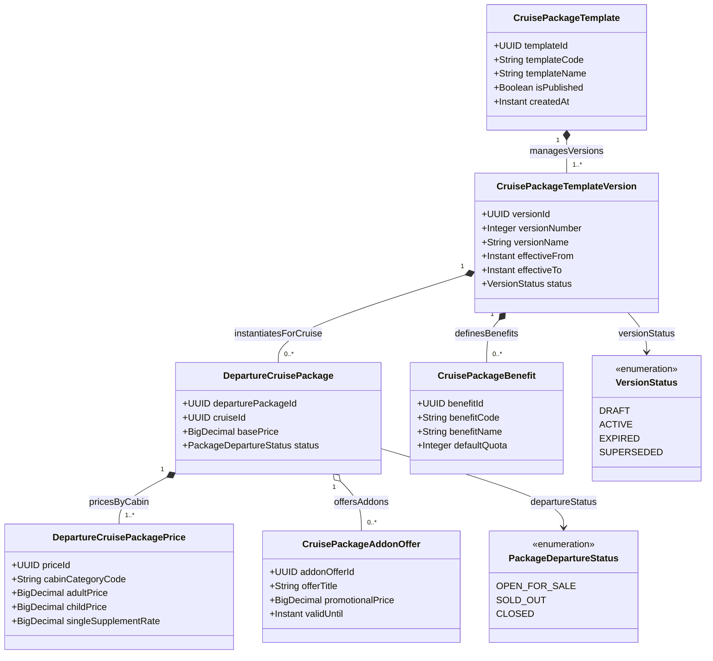

# Phân Hệ Động Cơ Định Giá & Phiên Bản Gói Du Thuyền (Cruise Pricing & Package Engine)

Quản lý cây mẫu gói du thuyền (`CruisePackageTemplate`), các phiên bản hiệu lực theo thời gian (`CruisePackageTemplateVersion`), phân bổ giá vé linh hoạt theo hạng phòng và đợt khởi hành (`DepartureCruisePackagePrice`), cùng các ưu đãi dịch vụ đi kèm (`CruisePackageAddonOffer`).

## Mã Mermaid UML

## Giải Thích Quan Hệ & Ràng Buộc
- **Quản lý phiên bản gói (Versioning)**: Gói du thuyền mẫu được tách thành nhiều phiên bản (`CruisePackageTemplateVersion`). Điều này đảm bảo khi điều chỉnh giá hoặc chính sách quyền lợi cho các mùa sau, dữ liệu các hợp đồng và vé đã bán của các mùa trước vẫn được bảo toàn nguyên vẹn.
- **Biểu giá động theo hạng phòng**: Mỗi đợt xuất phát (`DepartureCruisePackage`) có bảng giá chi tiết cho người lớn (`adultPrice`), trẻ em (`childPrice`) và phụ thu phòng đơn (`singleSupplementRate`) ứng với từng hạng phòng cụ thể.

