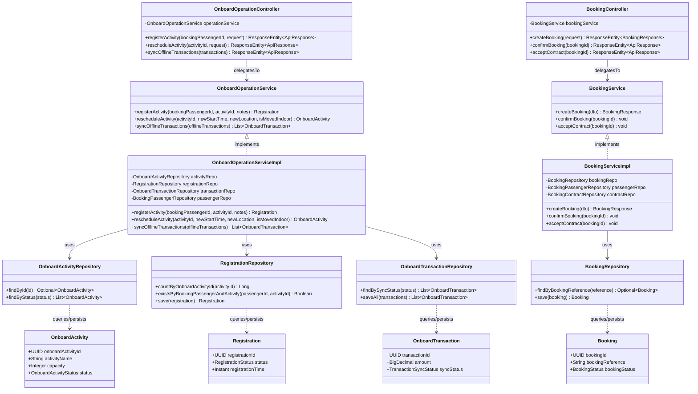

# Sơ Đồ Lớp Thiết Kế Tầng Kiến Trúc Phần Mềm (Layered Architecture Class Diagram)

Mô hình hóa chi tiết cấu trúc triển khai mã nguồn thực tế trong Spring Boot theo kiến trúc phân tầng: **Controller Layer ➔ Service Layer ➔ Repository Layer ➔ Entity / Database**, minh họa qua phân hệ Vận hành trên tàu (`OnboardOperation`) và Đặt chỗ (`Booking`).

## Mã Mermaid UML (Tối ưu chuẩn Draw.io không bị đè dòng)

