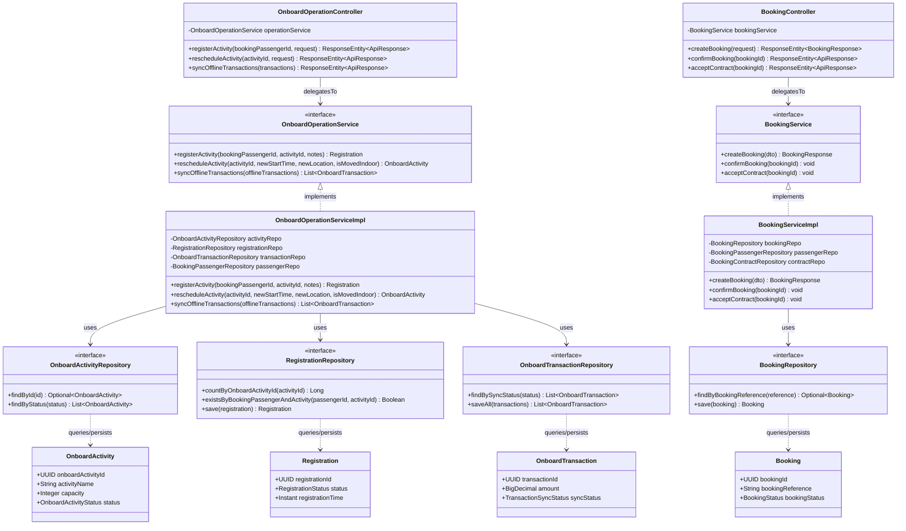

# Sơ Đồ Lớp Thiết Kế Tầng Kiến Trúc Phần Mềm (Layered Architecture Class Diagram)

Mô hình hóa chi tiết cấu trúc triển khai mã nguồn thực tế trong Spring Boot theo kiến trúc phân tầng: **Controller Layer ➔ Service Layer ➔ Repository Layer ➔ Entity / Database**, minh họa qua phân hệ Vận hành trên tàu (`OnboardOperation`) và Đặt chỗ (`Booking`).

## Mã Mermaid UML

## Giải Thích Nguyên Lý Kiến Trúc
- **Controller Layer (Tầng Giao tiếp)**: Tiếp nhận HTTP REST request từ Client (Web/Mobile), thực hiện kiểm tra tính hợp lệ của DTO (`@Valid`), ánh xạ mã trạng thái HTTP chuẩn (`200 OK`, `201 Created`, `400 Bad Request`).
- **Service Layer (Tầng Nghiệp vụ)**: Tách biệt Interface (`OnboardOperationService`) và Implementation (`OnboardOperationServiceImpl`) theo nguyên lý **Inversion of Control (IoC)** và **Dependency Injection (DI)** của Spring Framework, bọc giao dịch bằng `@Transactional`.
- **Repository Layer (Tầng Truy xuất Dữ liệu)**: Mở rộng `JpaRepository<T, ID>` tận dụng các truy vấn tối ưu và Hibernate Caching của Spring Data JPA.
- **Entity Layer (Tầng Thực thể Miền)**: Định nghĩa cấu trúc bảng CSDL, quan hệ khóa ngoại và các ràng buộc toàn vẹn dữ liệu.
