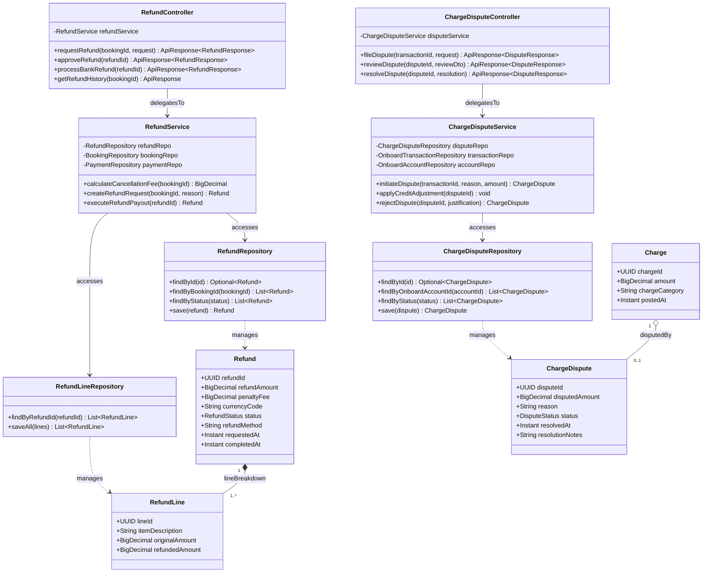

# Sơ Đồ Lớp Thiết Kế Chi Tiết: Hoàn Tiền & Khiếu Nại Chi Phí (Refund & Charge Dispute Design Class Diagram)

Mô hình hóa chi tiết đầy đủ 4 tầng kiến trúc: **Controller ➔ Service ➔ Repository ➔ Entity** cho quy trình xử lý hoàn tiền khi khách hủy vé (Cancellation Policy) và xử lý khiếu nại cước phí sai lệch tại quầy lễ tân (Charge Dispute).

## Mã Mermaid UML (Tối ưu chuẩn Draw.io không bị đè dòng)

