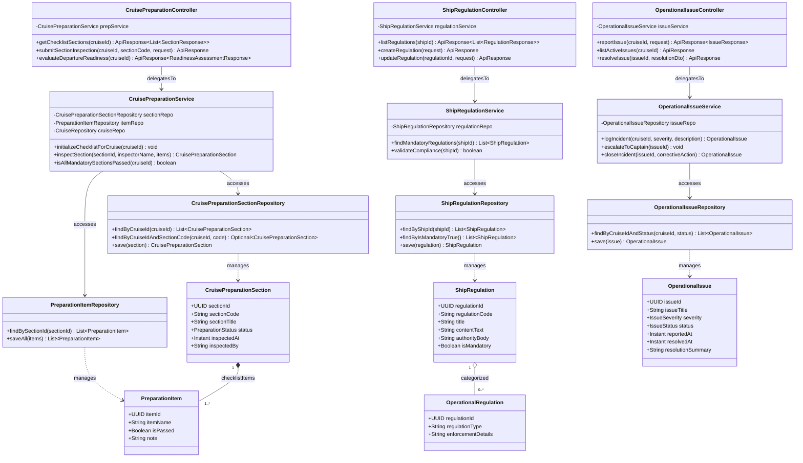

# Sơ Đồ Lớp Thiết Kế Chi Tiết: Nghiệm Thu Kỹ Thuật Trước Chuyến & Quy Định Hàng Hải (Safety Preparation & Maritime Regulations Design Class Diagram)

Mô hình hóa chi tiết đầy đủ 4 tầng kiến trúc: **Controller ➔ Service ➔ Repository ➔ Entity** cho danh mục kiểm tra kỹ thuật an toàn trước khi xuất bến (Pre-Departure Readiness Checklist), quy định hàng hải bắt buộc và quản lý sự cố vận hành cơ khí/hàng hải trên tàu.

## Mã Mermaid UML (Tối ưu chuẩn Draw.io không bị đè dòng)

