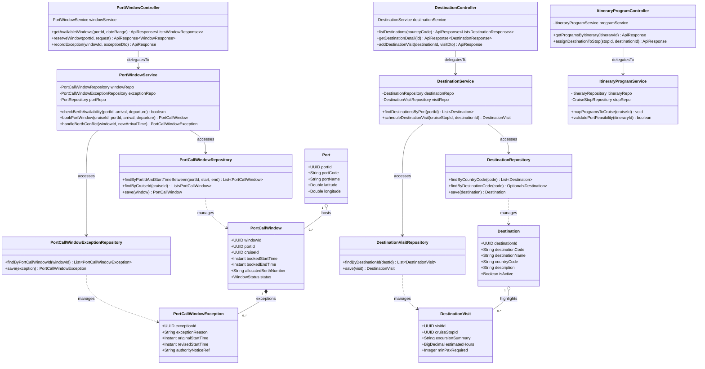

# Sơ Đồ Lớp Thiết Kế Chi Tiết: Khung Giờ Cập Cảng & Điểm Đến Du Lịch (Port Windows & Destination Planning Design Class Diagram)

Mô hình hóa chi tiết đầy đủ 4 tầng kiến trúc: **Controller ➔ Service ➔ Repository ➔ Entity** cho việc đăng ký và quản lý khung giờ cập bến (Berth Call Windows) tại các cảng biển và điều phối các chuyến tham quan khám phá điểm đến địa phương (Destination Visits).

## Mã Mermaid UML (Tối ưu chuẩn Draw.io không bị đè dòng)

