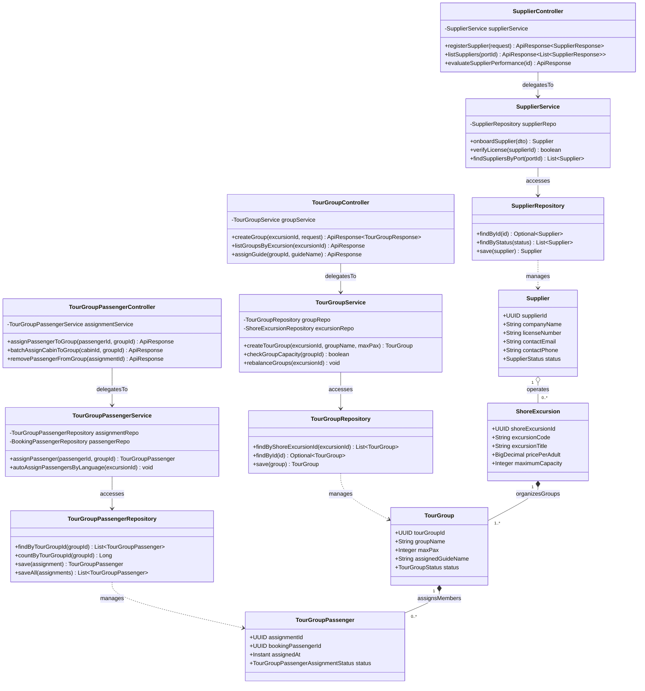

# Sơ Đồ Lớp Thiết Kế Chi Tiết: Đối Tác Cung Ứng & Phân Bổ Nhóm Tour Bờ (Suppliers & Tour Groups Design Class Diagram)

Mô hình hóa chi tiết đầy đủ 4 tầng kiến trúc: **Controller ➔ Service ➔ Repository ➔ Entity** cho quản lý nhà cung cấp dịch vụ địa phương (Supplier) và chia nhóm du khách tham quan trên bờ (Tour Group & Passenger Assignments).

## Mã Mermaid UML (Tối ưu chuẩn Draw.io không bị đè dòng)

