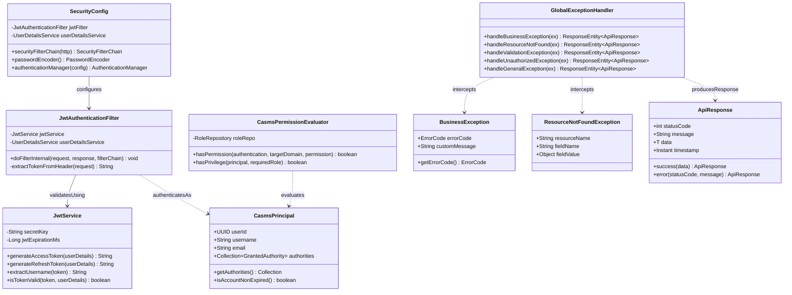

# Sơ Đồ Lớp Thiết Kế Chi Tiết: Bảo Mật JWT & Xử Lý Ngoại Lệ Toàn Cục (Security & Global Exception Architecture)

Mô hình hóa chi tiết chuỗi lọc bảo mật Spring Security (`SecurityFilterChain`), xác thực Token JWT bất đối xứng, kiểm tra quyền hạn chi tiết (`CasmsPermissionEvaluator`), và bộ bắt ngoại lệ tập trung toàn hệ thống (`GlobalExceptionHandler`).

## Mã Mermaid UML (Tối ưu chuẩn Draw.io không bị đè dòng)

