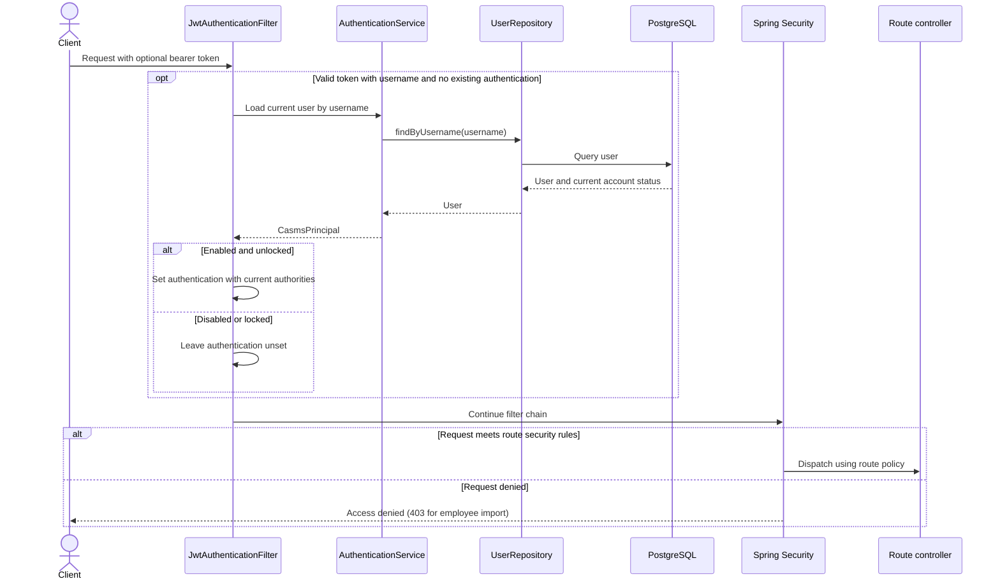

# Bearer authentication

This flow precedes route authorization for the mappings in the [API inventory](API-INVENTORY.md).

The filter does not write account state. Public routes retain their own security and application rules.
