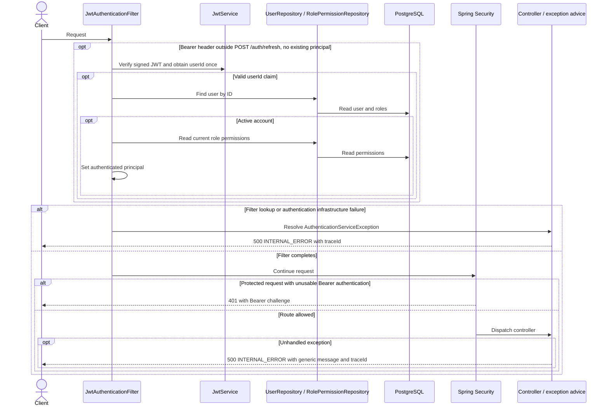

# Shared security and error flow

This flow applies to the mappings in the [API inventory](API-INVENTORY.md).

The JWT filter runs before controller dispatch, including on public routes. `POST /auth/refresh` validates its own token. Per-route authorization and CSRF rules still apply.

An unusable bearer token leaves the request anonymous. Public controllers can still handle the request. Protected routes keep the existing behavior for requests without a Bearer header, CSRF failures, and authenticated callers with insufficient permissions. Malformed JSON returns the existing `400 INVALID_REQUEST_BODY` envelope and the parser message is omitted from the log.
