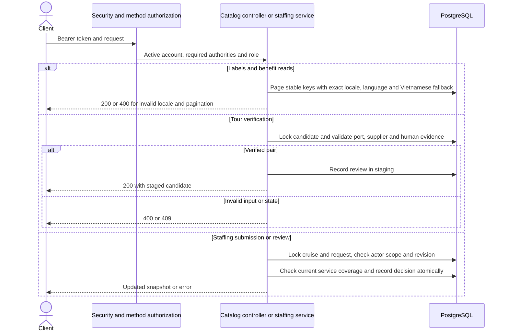

# CASMS-75 catalog and staffing flows

Catalog labels and benefit data require staff access. Draft quotas are proposals. Verification records the actor and evidence and rechecks an active Vietnamese port and verified active supplier. The staged verification and view never write live shore excursions.

Staffing advances from the assigned planner to HR, the assigned ship manager, the planner and OPS. HR controls staffing and duty writes. Database constraints and employee locks enforce active duty uniqueness and overlapping cruise windows. POS service grants and operations check the active service duty. Staffing changes invalidate approval and crew preparation. Readiness and the Ready fingerprint use the staffing request status and revision.
