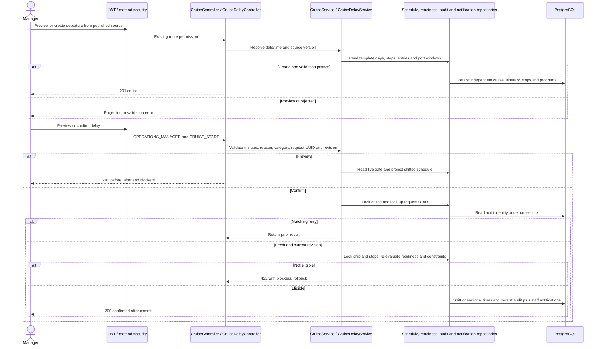

# Lịch khởi hành và delay

Mẫu `TripScheduleVersion` lưu số ngày và giờ địa phương. Lịch chuyến `Cruise` lưu thời điểm thực, cùng các bản ghi vận hành riêng. Preview và tạo chuyến tính cùng độ lệch từ giờ xuất phát của ngày 1 đến thời điểm được chọn, dùng giờ tàu Asia/Ho_Chi_Minh và giờ địa phương cho mục tại cảng. Nguồn legacy thiếu giờ mốc tiếp tục dùng cách chiếu cũ. Trình kiểm tra cửa sổ cảng đánh giá thời điểm đã dịch.



Xác nhận yêu cầu `PUBLISHED`, Departure Gate đạt, chưa đến giờ dự kiến, chưa ghi nhận rời cảng, không có sự cố chuyến chưa xử lý, không trùng tàu/nhân sự và lịch dịch chuyển qua kiểm tra cửa sổ cảng. Khung dịch vụ hoặc buổi hướng dẫn đã xếp giờ cần xử lý riêng trước khi delay. Nếu lịch dịch chuyển không còn khớp các ngày đã materialize, preview trả blocker để tránh sửa vai trò ngày hoặc mất sự kiện. Xác nhận kiểm tra lại dưới khóa, dùng `Cruise.revision` để trả 409 cho lịch đã đổi. Các thao tác start và ghi actual departure sử dụng khóa trên bản ghi tương ứng.

Lịch sử dùng `CruiseAuditEvent` với snapshot trước/sau và dữ liệu có cấu trúc trong evidence. Retry đúng dữ liệu và actor trả sự kiện cũ. Retry đổi dữ liệu trả 409. Các thông báo cho nhân sự đã gán được ghi trong cùng transaction. Lịch mẫu, actual timestamps, booking và hoàn tiền được quản lý bởi các luồng hiện có.

Tích hợp UI dùng `GET /cruises/{cruiseId}/departure-readiness`, `GET /cruises/{cruiseId}/schedule`, `GET /cruises/{cruiseId}/delays` và preview trước khi hiển thị xác nhận. Các đường dẫn tính từ context `/api`.

```json
{
  "delayMinutes": 90,
  "reason": "Chờ xác nhận điều kiện thời tiết",
  "category": "WEATHER_CONDITION",
  "requestId": "20044b80-33ed-4ce5-b251-58334d69fd30",
  "expectedRevision": 7
}
```
