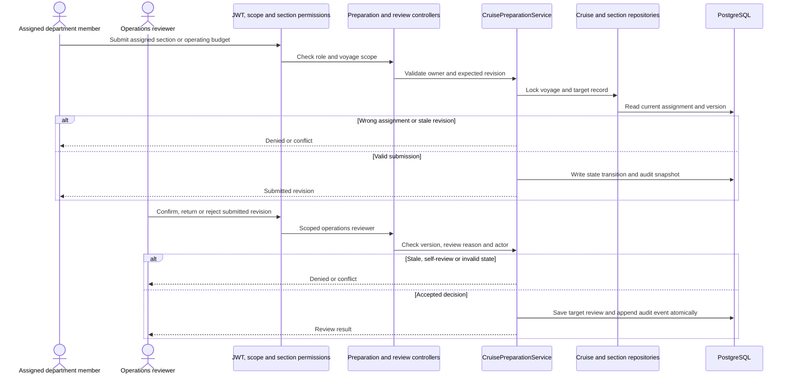

# Cruise preparation and operations review

Budget remains one manually entered VND total. The budget endpoints expose submission and review, and the coordinator can revise and resubmit after a negative review. Section submission uses the existing four-section matrix and verifies ownership of the selected section. The CRM bulk operation submits CRM-owned sections. Department handoffs remain independent for ASM and SHIP and append event history. Review events expose snapshots and dependency changes can mark affected submitted or confirmed sections stale.
