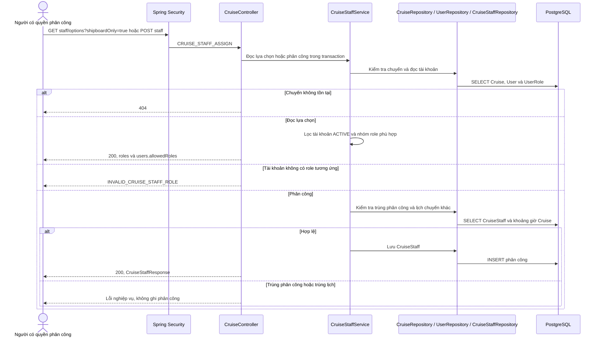
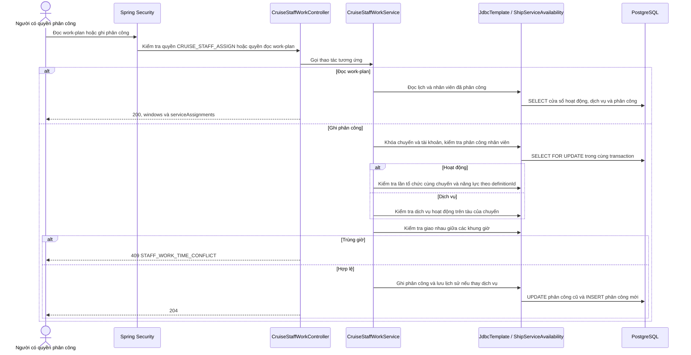

# CASMS-75: staged itinerary programs — reviewed change paths

Reviewed against controllers, ItineraryProgramService/Policy, ItineraryService, CruiseMainflowService, CruisePreparationService, legacy Activity/ShoreExcursion services, POS assignment services and V90/V92/V95 constraints. This review covers the CASMS-75 delta and shared callers below; unrelated generated route branches retain their previous review status. Runtime context path is `/api`.

## Draft, assignment and completion

Draft creation retains current itinerary/calendar validation and requires no program catalog coverage. Departmental preparation submission retains coordinator, actual CRM principal, permission, evidence, section revision and audit checks; it does not invoke global program completeness. Operations dossier submission is the separate completeness boundary.

```mermaid
sequenceDiagram
    actor CRM
    participant Security as Spring Security
    participant Controller as ItineraryProgramController
    participant Service as ItineraryProgramService
    participant Plans as CruiseMainflowService
    participant Policy as ItineraryProgramPolicy
    participant Repository as JdbcTemplate (bound SQL)
    participant DB as PostgreSQL
    CRM->>Security: Assign selected definitions / PUT schedule / DELETE occurrence
    Security->>Security: CRUISE_MANAGER and CRUISE_UPDATE_DRAFT
    alt Authentication or authorization fails
        Security-->>CRM: 401 / 403
    else Authorized request
        Security->>Controller: Validate UUIDs, If-Match and request fields
        Controller->>Service: assign / scheduleActivity / scheduleExcursion / remove
        Service->>Plans: assertEditable(cruiseId)
        Plans->>DB: Lock Cruise; verify editable review status
        Service->>Repository: Lock Itinerary; compare Cruise revision; require DRAFT
        Repository->>DB: SELECT FOR UPDATE with bound IDs
        alt Stale revision or frozen plan/itinerary
            Service-->>CRM: 409; rollback; no revision change
        else Assign selected definitions
            Service->>Repository: Lock source definitions FOR SHARE; verify source PLANNED
            opt Shore selection
                Service->>DB: Lock exact itinerary port call
                Service->>Policy: Active planned destination at this exact stop; match source port/destination
            end
            Service->>DB: INSERT copies with source IDs and no fabricated schedule
            Note over Service,DB: Additive batch; if any item fails, roll back all copies and Cruise revision
        else Complete onboard occurrence
            Service->>DB: Lock occurrence scoped to Cruise; require PLANNED
            Service->>Policy: Ordered times inside cruise; same-ship dedicated ACTIVITY_SPACE
            Policy->>DB: Lock area; require FACILITY, matching physical deck, no cabin/enabled services
            Service->>DB: Check allocated quantity; UPDATE schedule, area, capacity, explicit USD price
            Note over Service,DB: Same area and time may be shared; no exclusive venue guard
        else Complete shore occurrence
            Service->>DB: Lock occurrence and exact stop; require PLANNED
            Service->>Policy: Planned destination; cruise/call/tender/all-aboard bounds
            Service->>DB: Check allocated quantity/minimum; UPDATE schedule, meeting point, location, capacity, USD price
        else Remove draft occurrence
            Service->>DB: Lock scoped PLANNED occurrence; require no active registrations
            Service->>DB: Set CANCELLED; preserve identity/source/history
        end
        alt Invalid scope, window, area, destination, details or capacity
            Service-->>CRM: 404 or 422 business error; rollback
        else Successful mutation
            Service->>DB: Increment Cruise.revision in same transaction
            Service-->>Controller: New revision (and new IDs for assignment)
            Controller-->>CRM: ApiResponse; assign 201, other mutations 200
        end
    end
```

`GET /itineraries/{itineraryId}/programs` requires ITINERARY_READ or CRUISE_READ, loads itinerary scope, returns Cruise revision, all assigned occurrences (including CANCELLED history), text status, and current per-record completeness issues. A read does not change revisions or source definitions. Missing itinerary returns 404. Request constraints reject empty selection, null selection elements, excessive list length, missing fields, nonpositive capacity, negative/overprecision price and long location fields with 400. Service business validation returns 422.

## Operations gate and legacy callers

```mermaid
sequenceDiagram
    actor Staff
    participant Security as Existing route security
    participant Controller as Itinerary / Mainflow / Preparation controller
    participant Service as Transition service
    participant Policy as ItineraryProgramPolicy
    participant Repository as JDBC / JPA repositories
    participant DB as PostgreSQL
    Staff->>Security: Submit itinerary or operations plan; approve; publish; ready
    Security->>Controller: Existing role/authority/principal checks
    Controller->>Service: Existing transition request and expected revision where defined
    Service->>DB: Lock Cruise (then Itinerary on direct itinerary transitions)
    Service->>Service: Existing state, maker-checker, revision and evidence rules
    Service->>Policy: Require complete / collect planBlockers
    Policy->>Repository: Read Cruise, active activities, active stops and excursions
    Repository->>DB: Bound queries for times, area usage, services, destinations and supplier
    Policy->>Policy: Validate all selected noncancelled occurrences; ordered arrival/departure
    Note over Policy,DB: Onboard within cruise; shore within cruise and exact call with tender and strict return deadline
    Note over Policy,DB: Destination explicitly planned for stop; supplier ACTIVE/VERIFIED; positive capacity, explicit price/USD, location/meeting point
    alt Program or call incomplete/invalid
        Policy-->>Service: Per-record issues / distinct blocker codes
        Service-->>Staff: 422 ITINERARY_PROGRAMS_INCOMPLETE or existing PLAN_INCOMPLETE; no state change
    else Program completeness passes
        Service->>Service: Other readiness/pricing/preparation checks remain required
        Service->>Repository: Persist transition, snapshot/audit and existing dossier actions
        Repository->>DB: Commit transaction
        Service-->>Staff: Existing ApiResponse / mainflow View
    end
    opt Independent departmental submission
        Staff->>Controller: Submit technical/hotel/entertainment/personnel section
        Controller->>Service: Existing section request
        Service->>DB: Lock Cruise and section; validate coordinator, revision, evidence; audit
        Note over Service,Policy: Global program-completeness gate is not called for a single section
        Service-->>Staff: Existing section response; unrelated incomplete activities do not block
    end
```

The mainflow View's `planBlockers` and `readyBlockers` now include these program-policy codes. Shared `get()` responses after windows and transitions therefore expose them too. Mainflow submit/review/ready recheck current data; existing snapshot fingerprints include occurrence rows and preserve approval invalidation. Direct itinerary submit, approve and publish take Cruise→Itinerary locks before reading transition state. Draft creation, update and feasibility validation retain calendar/day rules (ship timezone), without requiring every catalog definition.

ActivityService create/update/catalog-schedule/validation callers retain ordered-time, pricing, venue, capacity and lifecycle rules but no longer reject an otherwise valid activity solely because another activity uses the same location/time. `scheduleConflicts` checks existence and returns zero for this removed exclusive-venue rule. Cruise-scoped time repair retains permission, editable plan, If-Match, commitment and trip bounds but removes only that venue-overlap rejection. ShoreExcursionService create/update/validation callers similarly remove the same-stop overlap prohibition while preserving port window/tender/return, supplier and capacity validations. Passenger availability and registration capacity are not relaxed. Legacy complete occurrences still need dedicated area/planned destination completeness before operations approval.

## Area classification and persistence guards

```mermaid
sequenceDiagram
    actor Manager
    participant Security as Spring Security
    participant Controller as ShipAreaUsageController / existing POS controller
    participant Service as Inline JDBC or POS assignment service
    participant Repository as JdbcTemplate
    participant DB as PostgreSQL + V95 triggers
    Manager->>Security: PUT area usage or enabled service/activity assignment
    Security->>Controller: Usage: SHIP_MODEL_OBJECT_UPDATE (default Admin); POS: existing POS_MANAGE/account checks
    Controller->>Service: Validate input and physical ship/area scope
    Service->>Repository: Lock physical area; retain existing model/deck/resource checks
    Repository->>DB: UPDATE usage / INSERT or UPDATE enabled assignment
    DB->>DB: Lock shared area row in assignment trigger
    alt Service assigned to ACTIVITY_SPACE or activity assigned elsewhere
        DB-->>Service: 23514 integrity violation; rollback
        Service-->>Manager: Existing integrity handler: conflict response
    else Classification conflicts with active programs or enabled assignments
        DB-->>Service: 23514 integrity violation; rollback
        Service-->>Manager: Existing integrity handler: conflict response
    else Valid compatible classification/assignment
        DB-->>Service: Commit
        Service-->>Manager: Existing ApiResponse
    end
```

`GET /ships/{shipId}/areas/usages` permits SHIP_CONFIGURATION_READ or CRM+CRUISE_UPDATE_DRAFT and returns physical FACILITY usage/model status and whether enabled services exist; it does not mutate configuration. Usage PUT locks the exact ship's FACILITY (404 otherwise), explicitly rejects enabled services before ACTIVITY_SPACE with 422 AREA_HAS_SERVICES, then DB guards enforce reverse/reclassification conflicts. Usage does not make an archived/unbound model a schedulable venue.

V95 backfills SERVICE for enabled service assignments, then ACTIVITY_SPACE for enabled activity assignments only where no service exists; remaining unknown areas stay OTHER. It does not delete legacy assignments or guess from names. Catalog definitions remain unscheduled; PLANNED/CANCELLED occurrences may be incomplete, but operational states require time/capacity at DB level. Existing positivity and chronological CHECK constraints remain. No migration is applied to shared systems by this change.

## Validation boundary

PostgreSQL tests exercise real Flyway and guards, request authorization/validation, scope/revision, additive scheduling, cancellation and rollback. See [QA evidence](../../specs/CASMS-75-staged-itinerary-programs/qa.md). `sequence_docs.py --check` checks route and file coverage plus Mermaid block structure; it does not establish semantic correctness or validate unchanged generated branches.

Draft availability: shore occurrences with unknown capacity are treated as unavailable (zero availability) using the existing unavailable business exception; the availability route does not unbox null capacity. This does not open drafts for registration.
## Danh sách và phân công nhân viên trên chuyến



Chế độ `shipboardOnly=true` trả `SHIP_MANAGER`, `ONBOARD_STAFF`, `FINANCE_OFFICER`. Khi bỏ tham số, API trả danh sách vai trò phân công đầy đủ. Phân công ghi vai trò trên chuyến và không cấp role tài khoản.

### Một chuyến đang hiệu lực cho mỗi nhân viên

```mermaid
sequenceDiagram
    actor HR
    participant Security as Spring Security
    participant Controller as CruiseController / EmployeeAccountController
    participant Service as CruiseStaffService
    participant Repository as CruiseStaffRepository / NotificationRepository / AuditRepository
    participant DB as PostgreSQL
    HR->>Security: Gán, gỡ hoặc vô hiệu hóa nhân viên
    Security->>Controller: Quyền nghiệp vụ tương ứng
    Controller->>Service: Kiểm tra principal và khóa Cruise, User
    Service->>DB: SELECT FOR UPDATE trong giao dịch
    alt Phân công
        Service->>Repository: Kiểm tra account, chuyên môn, trùng lịch và ACTIVE toàn hệ thống
        alt Đã có chuyến chưa kết thúc
            Controller-->>HR: Lỗi nghiệp vụ, không ghi phân công
        else Hợp lệ
            Repository->>DB: INSERT ACTIVE và outbox email cùng giao dịch
            Note over DB: V100 unique index theo user_id cho ACTIVE
            Controller-->>HR: 200 CruiseStaffResponse
        end
    else Gỡ cùng assignment đã REMOVED
        Controller-->>HR: 204, không tạo thêm thông báo
    else Gỡ trước khởi hành
        Service->>Repository: Ghi REMOVED, endedAt, endedBy, removalReason
        Repository->>DB: UPDATE phân công, INSERT audit và Notification cùng giao dịch
        alt Ghi lỗi
            DB-->>Controller: Rollback phân công, audit và thông báo
        else Commit
            Controller-->>HR: 204; Notification hiển thị trong danh sách cá nhân
        end
    else Gỡ khi đã khởi hành, đã kết thúc hoặc lifecycle mâu thuẫn
        Controller-->>HR: 409 CRUISE_STAFF_REMOVAL_NOT_ALLOWED
    end
    Note over DB: UPDATE Cruise sang COMPLETED / CANCELLED đóng ACTIVE cùng giao dịch
```

- `DELETE /cruise/{cruiseId}/staff/{userId}` nhận query `assignmentId` và `reason` (tối đa 500 ký tự). Truyền ID để retry an toàn sau khi có phân công mới. Nếu đã có lịch sử REMOVED cùng chuyến và đang có phân công mới, yêu cầu thiếu ID trả `409 CRUISE_STAFF_ASSIGNMENT_ID_REQUIRED`.
- `GET .../staff/options` lọc nhân viên đã có phân công ACTIVE trên bất kỳ chuyến nào. `GET .../staff` trả lịch sử và thông tin người gỡ, thời điểm và lý do. HR không thấy tài khoản Admin qua danh sách này.
- Thông báo `EMPLOYEE_REPLACEMENT_REQUIRED` dùng `GET /notification` hiện có. HR thao tác nhận thông báo trực tiếp. Với thao tác hợp lệ của bộ phận khác, các HR đang hoạt động nhận thông báo.
- V100 giữ các bản ghi lịch sử. Draft đã có lịch sử phân công trả `409 CRUISE_HAS_STAFF_HISTORY` khi xóa. Nếu còn một nhân viên có nhiều phân công ACTIVE ở các chuyến chưa kết thúc, migration báo xung đột và rollback.

## Dịch vụ và ca hoạt động



- `/staff/{userId}/activity-qualifications` quản lý năng lực theo `ONBOARD` hoặc `SHORE`. Khi gán ca, dùng `resourceId` của lần tổ chức từ work-plan. Khi khai báo năng lực, dùng `definitionId`.
- Phân công dịch vụ dùng `PUT /cruise/{cruiseId}/staff/{userId}/service` với `serviceId`. Phân công hoạt động dùng `PUT /cruise/{cruiseId}/staff/{userId}/activity-shifts/{kind}/{occurrenceId}`. Các thao tác `DELETE` tương ứng ghi thời điểm và người gỡ. Mỗi nhân viên có tối đa một dịch vụ đang phân công trên chuyến. Dịch vụ chưa có khung giờ vẫn xuất hiện trong `serviceAssignments`.
- Hai ca tiếp giáp được phép. Trigger V101 kiểm tra lại khi sửa khung giờ hoạt động trên tàu, dưới cảng hoặc khung phục vụ. Khi có xung đột, API sửa lịch trả `409 STAFF_WORK_TIME_CONFLICT` và giao dịch rollback. Quyền POS vẫn do cơ chế phân quyền POS hiện tại quản lý.

## Email phân công nhân viên

```mermaid
sequenceDiagram
    actor Operator as Người có quyền phân công
    participant Auth as Spring Security
    participant Controller as CruiseController / StaffAssignmentEmailController
    participant Service as CruiseStaffService / StaffAssignmentEmailService
    participant Repo as CruiseStaffRepository / JdbcTemplate
    participant DB as PostgreSQL
    participant Worker as StaffAssignmentEmailDispatcher
    participant SMTP as SMTP
    Operator->>Auth: Tạo phân công hoặc quản lý email
    Auth->>Controller: CRUISE_STAFF_ASSIGN
    alt POST phân công hợp lệ
        Controller->>Service: Ghi phân công và xếp email
        Service->>Repo: Flush CruiseStaff và đọc mẫu hiện hành
        Repo->>DB: INSERT phân công và INSERT outbox trong cùng transaction
        Note over DB: UNIQUE assignment_id. Rollback không để lại thư chờ.
        Service-->>Controller: CruiseStaffResponse kèm assignmentEmailStatus
        Controller-->>Operator: 200 QUEUED hoặc MISSING_EMAIL
    else Quản lý mẫu
        Controller->>Service: Đọc, xem trước hoặc phát hành
        Service->>Service: Kiểm tra URL HTTPS, tiêu đề và cặp trường nút bấm
        opt Phát hành
            Service->>Repo: Ghi phiên bản mới và actor
            Repo->>DB: INSERT phiên bản
        end
        Controller-->>Operator: 200 phiên bản hoặc bản xem trước; 400/422 dữ liệu sai
    else Đọc hoặc gửi lại email
        Controller->>Service: Tìm outbox theo cruiseId và assignmentId
        Service->>Repo: Đọc trạng thái hoặc khóa và xếp lại thư đủ điều kiện
        Repo->>DB: SELECT hoặc UPDATE outbox
        Controller-->>Operator: 200 trạng thái hoặc 404
    end
    opt Worker đã bật
        Worker->>DB: Lấy thư đã commit, chưa gửi và còn lượt thử bằng SKIP LOCKED
        Worker->>SMTP: Gửi MIME gồm văn bản thuần và HTML
        alt SMTP chấp nhận
            Worker->>DB: Ghi sent_at
        else SMTP lỗi
            Worker->>DB: Tăng attempts và hẹn sau 5 phút
        end
    end
```

- `GET/PUT /staff/assignment-email-template` đọc và phát hành mẫu. `POST /staff/assignment-email-template/preview` kết xuất từ dữ liệu mẫu. Payload gồm `subject`, `heading`, `introduction`, `imageUrl`, `buttonLabel`, `buttonUrl`. Ảnh dùng HTTPS. Nút cần cả nhãn và URL HTTPS. Phần tàu, chuyến, giờ, nhiệm vụ và ghi chú lấy từ phân công.
- `GET /cruise/{cruiseId}/staff/assignments/{assignmentId}/email` đọc trạng thái. `POST` cùng đường dẫn thêm `/retry` xếp lại thư đã hết lượt thử, thư vừa có địa chỉ hợp lệ hoặc thư cần cập nhật địa chỉ nhận. Thư đã gửi, đang chờ hoặc đã hủy giữ nguyên trạng thái. Phiên bản mẫu và nội dung đã kết xuất được giữ qua mỗi lần retry.
- Bật worker bằng `casms.staff-assignment-email.enabled=true` cùng cấu hình SMTP. Worker dùng `casms.staff-assignment-email.from` hoặc địa chỉ gửi Booking hiện có. Có thể đặt `casms.staff-assignment-email.portal-url` bằng URL HTTPS để thêm nút vào mẫu mặc định. Email đã gửi không được xếp lại. Nếu SMTP chấp nhận thư ngay trước khi giao dịch đánh dấu gửi bị lỗi, lần xử lý sau có thể gửi lại.

## Tài khoản nhân viên và nhập Excel

Xem [luồng xác thực bearer](BEARER-AUTHENTICATION.md) dùng chung trước bước kiểm tra quyền HR.

```mermaid
sequenceDiagram
    actor HR as Admin / HR
    actor Employee as Nhân viên mới
    participant Auth as Spring Security
    participant API as EmployeeAccountController / EmployeeImportController
    participant S as EmployeeAccountService / EmployeeImportService
    participant R as JPA repositories / JdbcTemplate
    participant DB as PostgreSQL
    participant W as EmployeeActivationEmailDispatcher
    HR->>Auth: Tạo tài khoản hoặc tải mẫu / upload / confirm XLSX
    Auth->>API: Admin hoặc HR có quyền theo thao tác
    API->>S: Validate request và quyền cấp role
    alt Upload XLSX
        alt Thiếu file, file rỗng, quá 2 MiB hoặc không đọc được
            API-->>HR: 400 EMPLOYEE_XLSX_INVALID
        else File hợp lệ
            S->>R: Lưu batch, lỗi từng dòng và dữ liệu chờ xác nhận
            R->>DB: INSERT batch, rows và audit
            API-->>HR: 201 Preview
        end
    else Tạo thủ công hoặc Confirm
        opt Confirm
            S->>R: Kiểm tra chủ batch, khóa và xác thực lại từng dòng
            Note over S,DB: Mỗi dòng dùng transaction REQUIRES_NEW
        end
        S->>R: Ghi User DISABLED, Employee, outbox và audit
        R->>DB: FK và unique bảo vệ code, email, quan hệ và kết quả
        alt Dòng hợp lệ
            S-->>API: Commit và trả kết quả
        else Dòng lỗi
            S->>DB: Rollback dòng; ghi mã lỗi ở transaction riêng nếu import
        end
        API-->>HR: Employee hoặc kết quả theo dòng
    end
    W->>DB: Đọc outbox đã commit, còn hạn và chưa gửi
    W-->>Employee: Email HTML có nút và liên kết ký HMAC
    Employee->>Auth: POST /auth/employee-account/activate
    Auth->>S: Kiểm tra chữ ký, thời hạn và chưa sử dụng
    S->>R: Đặt mật khẩu, kích hoạt User / Employee và đánh dấu token đã dùng
    R->>DB: Commit một lần hoặc rollback
```

- Admin cấp mọi role, HR cấp năm role nghiệp vụ được duyệt. HR xem/sửa hồ sơ ngoài nhóm Admin. Thay đổi hồ sơ và vô hiệu hóa ghi audit cùng giao dịch.
- `/employees/imports` hỗ trợ XLSX thực, giới hạn 500 dòng và 2 MB. Confirm lặp không tạo thêm Employee hay Account. XLSX kết quả chỉ có số dòng, mã nhân viên, trạng thái và mã lỗi.
- `POST /employees/{employeeId}/inactivate` khóa Employee/Account và kiểm tra lifecycle chuyến đang phân công. Nếu chuyến đang hoạt động, trả `409 EMPLOYEE_ON_ACTIVE_CRUISE`. Với chuyến chưa khởi hành, kết thúc assignment qua luồng CruiseStaff, giữ lịch sử và tạo thông báo cần người thay thế cho HR.
- Worker kích hoạt dùng `casms.employee-activation-email.enabled`, SMTP, `casms.employee-activation-email.portal-url` HTTPS và `casms.employee-activation-email.token-key` Base64 có ít nhất 32 byte sau giải mã. Token hoàn chỉnh chỉ được dựng khi gửi. Database giữ ID, hạn dùng và thời điểm tiêu thụ.
