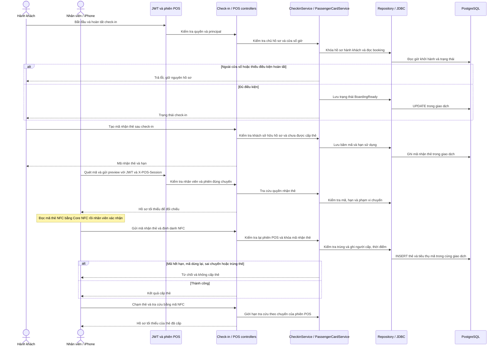

# Check-in online và cấp thẻ NFC

Khách dùng phiên đăng nhập hiện có. Check-in online mở từ đúng 3 giờ trước giờ khởi hành dự kiến và đóng khi đến giờ khởi hành. Luồng booking tiếp tục tra cứu theo mã booking cùng email hoặc số điện thoại. Dịch vụ email xác nhận vẫn xử lý gửi chi tiết thanh toán.

