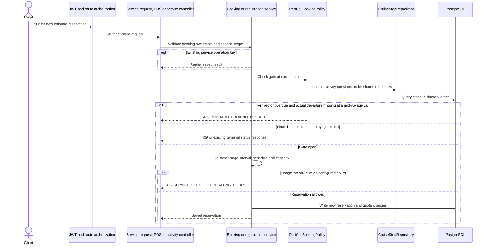

# Port calls, activity scheduling and onboard bookings

The existing activity, itinerary-program, service request and POS controllers keep their authorization and record scope. Activity catalog definitions have no occurrence time. New occurrences and rescheduling use the cruise end or applicable port call cutoff. Shore programs keep the existing exact port, return, tender and disembarkation checks.

At a middle call, planned arrival triggers ARRIVAL_PENDING when actual arrival is missing. Actual arrival puts the call IN_PORT. Planned departure with missing actual departure keeps the gate closed. Actual departure opens it again. Final disembarkation closes new requests when its scheduled interval ends, with cruise end as the overall cutoff. Existing bookings and previous idempotent results are preserved.

Actual arrival and departure writes lock the stop and reject future or reversed timestamps. Stop responses include the computed port call state. A scheduled job inserts a deduplicated in-app alert for active Operations Managers after an unresolved planned middle-call timestamp, with at most one notification per stop, phase and recipient. The polling interval is configurable with `casms.port-call-alert.poll-millis`.

Service catalog mutations optionally set `operatingPeriods`. Deployment configuration controls the three local-time boundaries with `casms.services.hours.daytime`, `evening`, and `nighttime`. Restricted periods apply to the whole scheduled usage interval, or the current instant for immediate requests. An unscheduled pre-cruise request for a restricted service needs a schedule. Existing services with empty periods retain unrestricted hours. Port schedules use the port timezone and onboard schedules use the ship calendar zone.

An activity or tour with a newly set occurrence time must exceed 60 minutes, have at least two hours left before cutoff and finish before the combined 30-minute checkout and 30-minute preparation intervals. Existing authorized ports and itinerary edit paths retain their own resource locking and overlap checks.
