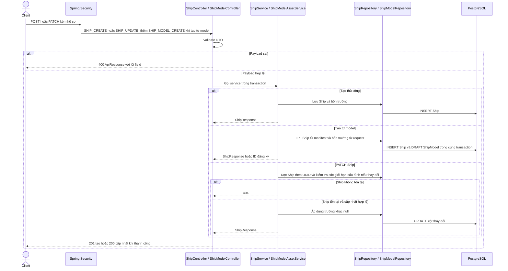

# Hồ sơ cơ bản của Ship

`manufacturerName`, `origin`, `productionYear` và `engineType` tùy chọn. Giới hạn chuỗi lần lượt là 150, 100 và 100 ký tự. Năm là số nguyên từ 1 đến 9999. V93 thêm bốn cột nullable trên Ship và CHECK cho năm. Các trường không tham gia đồng bộ manifest.

Danh sách và chi tiết yêu cầu SHIP_READ, đọc qua ShipRepository trong transaction chỉ đọc và ánh xạ sang ShipResponse. Thay đổi trạng thái yêu cầu SHIP_STATUS_CHANGE, chặn trạng thái phi vận hành khi có chuyến đang hoạt động, và ánh xạ cùng ShipResponse. Hibernate chỉ ghi cột thay đổi khi UPDATE Ship để các đường cập nhật trạng thái hay model không ghi lại bốn cột hồ sơ từ bản đọc cũ. Các mã lỗi, quyền và điều kiện nghiệp vụ hiện có tiếp tục áp dụng.
