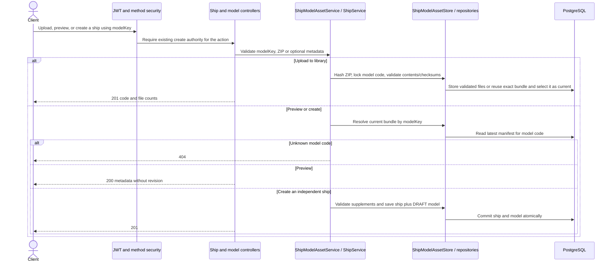
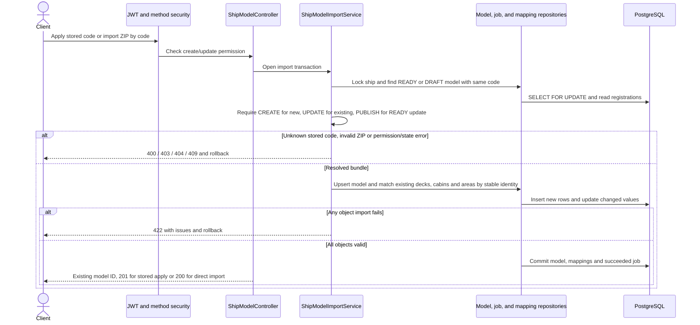

# Ship model create and update by code

Khi tạo tàu từ model, payload có thể cung cấp bốn trường hồ sơ riêng của tàu. Các trường này không lấy từ manifest và không được đổi khi import lại. Xem [hồ sơ Ship](SHIP-BASIC-PROFILE.md).

Endpoints are relative to /api. The client selects a model with modelKey. Storage identity and optional manifest revision are managed by the server.

| Method | Route | Input and behavior |
| --- | --- | --- |
| POST | /ship-model-assets | modelKey + ZIP. Store or select the uploaded bundle as current for the code. |
| GET | /ship-model-assets | One row per modelKey with the most recent upload time. |
| GET | /ship-model-assets/{modelKey}/preview | Preview the current bundle without creating a ship. |
| POST | /ship-model-assets/{modelKey}/register | Create an independent ship from the current bundle, with optional metadata supplements. |
| POST | /ships | Create manually or use JSON modelKey and optional missing metadata. |
| POST | /ships/{shipId}/models | JSON modelKey. Apply the current stored bundle to the ship and update a matching model in place. |
| POST | /ships/{shipId}/models/imports | modelKey + ZIP. Store and apply to the ship in a single transaction. |
| POST | /ships/{shipId}/models/metadata | Create a draft external-file reference with file metadata. The server assigns its identifier. |
| PUT | /ships/{shipId}/models/{modelId} | Edit a draft external-file reference by modelId. Use model-code import for stored ZIP models. |

The previous preview and register URLs containing assetVersion are retired. Model DTOs expose modelKey rather than model or asset version. The 3D configuration cache token is separate from the model identity. Preview and public manifest projections omit revision. A raw archive asset remains byte-identical to the uploaded file.

Applying the same model code keeps its model ID, stable node IDs and existing links. The code's current bundle is chosen once in the transaction. Uploading a bundle alone changes the library selection; already attached ships continue serving their current bundle until an apply/import succeeds. Download streams resolve the stored bundle once so content and Content-Length match if another update commits.
