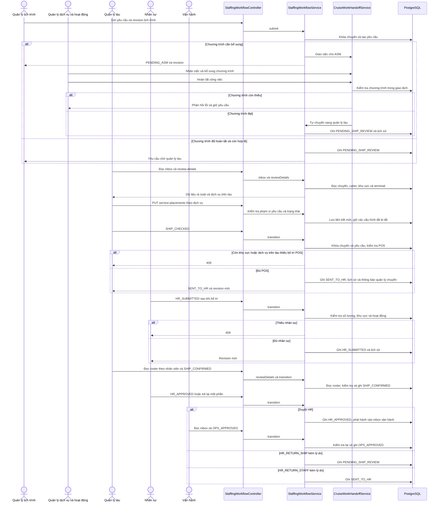

# Bàn giao chương trình, kiểm tra tàu và bố trí nhân sự

Các URL dưới đây tính từ context path của API. Dùng [xác thực Bearer](BEARER-AUTHENTICATION.md) và principal hiện hành để xác định vai trò và phạm vi chuyến. Gửi `expectedRevision` từ yêu cầu vừa đọc khi xác nhận hoặc trả lại.

Khi bị trả lại, đọc revision mới và thực hiện tiếp từ phần được chọn. Các thao tác đang xử lý cùng lúc hoặc dùng revision đã cũ bị kiểm tra trước khi ghi. Lịch sử lưu người thao tác và lý do.

## Điều kiện kiểm tra và trường hợp phải làm lại

- Quản lý lịch trình phải là quản lý chuyến phụ trách. Quản lý tàu phải là người quản lý tàu theo hồ sơ tàu hoặc được phân công quản lý tàu cho chuyến. Dùng API cabin theo quyền hiện hành. Đọc thông báo bằng API thông báo cá nhân.
- Kiểm tra tàu yêu cầu tàu có trạng thái READY hoặc IN_SERVICE, có cabin AVAILABLE hoặc OCCUPIED và có mô hình READY hiện hành. Mỗi khu vực phục vụ trong mô hình cần ít nhất một POS đang bật và liên kết đang bật. Lần xác nhận lưu cấu hình POS đã kiểm tra. Nếu mô hình, khu vực hoặc liên kết thay đổi, các bước duyệt tiếp theo yêu cầu quản lý tàu kiểm tra lại. HR có thể trả về phần tàu từ hàng chờ HR hoặc sau khi rà soát và có thể mở lại kết quả đã duyệt nếu cấu hình tàu đã thay đổi.
- HR dùng API phân công theo khu vực và ca hoạt động. Khi gửi, hệ thống kiểm tra định mức dịch vụ, ít nhất một bố trí khu vực còn hiệu lực cho mỗi khu vực phục vụ và ít nhất một người đang hoạt động cho mỗi hoạt động đã lên lịch. Nhân viên có thể có nhiều nhiệm vụ hoặc chưa được gắn khu vực.
- Bố trí khu vực thay đổi sau lần gửi HR có thể đưa yêu cầu về SENT_TO_HR và vô hiệu hóa kết quả kiểm tra SAFETY_CREW. Các API chuẩn bị, mở bán và khởi hành sử dụng lại điều kiện nhân sự đã được vận hành duyệt.
- Yêu cầu đã tồn tại trước migration tiếp tục theo nhánh có PLANNER_CONFIRMED. Yêu cầu mới có shipReviewWorkflow và sử dụng bước HR_APPROVED trước vận hành.

## Điểm tích hợp giao diện

1. Quản lý lịch trình dùng POST /cruises/{cruiseId}/staffing-requests. Trong giai đoạn PENDING_ASM, mở hàng chờ của ASM bằng GET /cruise-work/inbox.
2. ASM dùng PUT /cruise-work/{cruiseId}/ASM với ACCEPT và phiên bản công việc. Bổ sung ca phục vụ, hoạt động trên tàu và tour bờ trong nhóm API /cruise-plans/{cruiseId}. Gửi COMPLETE kèm phiên bản hiện hành và nội dung hoàn tất để tự bàn giao.
3. Quản lý tàu dùng GET /cruises/staffing-requests/inbox và mở review-details. Gửi PUT area-pos với terminalId và expectedRevision hoặc PUT service-placements với areaId, terminalId và expectedRevision. Dùng revision trả về từ lần thay đổi gần nhất khi xác nhận SHIP_CHECKED.
4. Sau khi kiểm tra độ phủ POS theo khu vực và dịch vụ, hệ thống ghi SENT_TO_HR và thông báo cá nhân cho quản lý chuyến. Điều kiện bố trí dịch vụ được kiểm tra lại trong các bước duyệt nhân sự.
