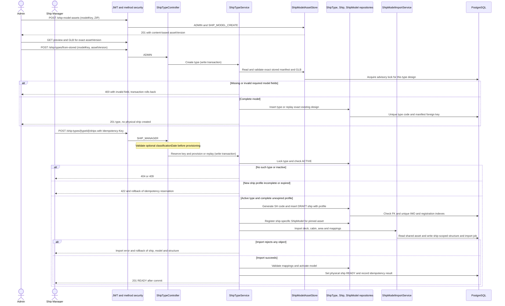
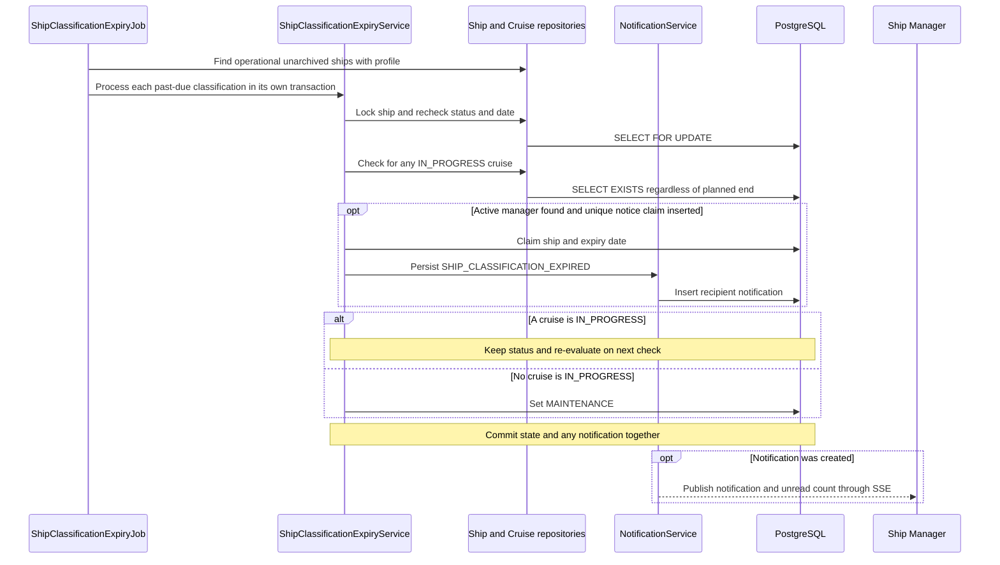
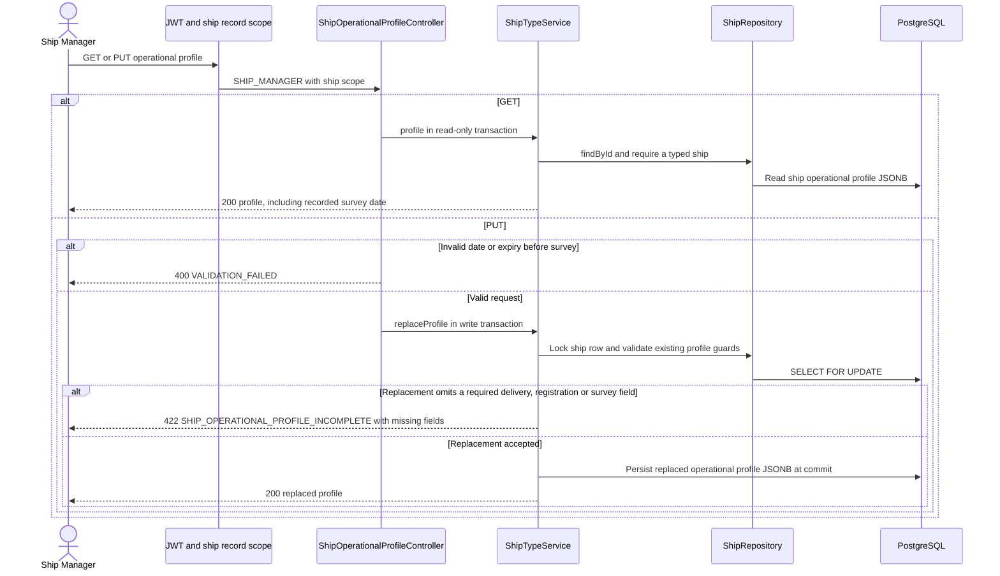

# Ship type, physical ship and operational profile

The routes use the existing bearer authentication flow. The type write endpoints require `ADMIN`, the physical ship creation and profile endpoints require `SHIP_MANAGER`, and the existing ship operations retain their permission annotations. The record-scope interceptor allows a Ship Manager who created a ship or has an active assignment to that ship to use ship-scoped endpoints, subject to the route permission.

- See the [WebAdmin contract](../ship-redesign/CASMS_SHIP_BE_HANDOFF_FOR_FE.md) for the read-only provisioning result route, response fields, and scope. Multipart create and replacement remain available. The staged flow confirms the uploaded version without a second ZIP upload.\n- Type manifest fields include `modelId`, `name`, `shipManufacturerName`, `engineType`, `passengerCapacity`, `deckCount`, `length` and `beam`. The supplied model key identifies the uploaded bundle and becomes the initial type code.
- Admin list and detail include inactive types. Ship Manager list and detail resolve active types only. Admin model replacement and status or delete run in write transactions and take the type lock. Replacing the type model updates the selection for subsequently created ships. Existing ship model rows retain their registered asset version. Deleting a referenced type returns 409.
- Per-ship `ShipModel` and object rows hold the mappings and model lifecycle. Physical ships reuse the binary assets through the existing model-key and asset-version reference. Ship-specific operations retain manager-entered vessel names when they register or re-import a model from the same manifest identity.
- The operational profile accepts references to certification, warranty, maintenance and repair records. The profile payload includes the manufacturer's vessel code, IMO, shipyard, build and registration fields. The ship's existing `shipCode` remains the distinct server-generated business code and `shipId` remains its database primary key.
- `PUT /ships/{shipId}/operational-profile` replaces the profile for a typed ship in a write transaction. The ship row is locked to serialize replacement against a status change. PostgreSQL checks uniqueness of normalized IMO and country/registration-number pairs. The API returns the saved profile. The scoped GET on the same endpoint returns the ship profile, including an empty result when it has yet to be entered.
- `POST /ships/{shipId}/status` locks the ship. A same-state request returns the current ship. For a typed ship with missing certification, warranty or maintenance data, it returns 422 with `missingGroups`. For a complete profile it continues the existing active-cruise guard and saves the new status. Legacy ships retain their existing lifecycle.
- The authenticated ship list and detail expose the type ID for typed ships. Managers can see the ships they created as well as active assignments. The two former direct-creation endpoints return 410 and guide authorized callers to the type APIs. Existing ships keep their IDs and may continue legacy operations.
- Ship managers can [delete unused draft ship models](ship/delete-ships-shipid-models-modelid-unused.md) for ships they created or manage through an active cruise assignment. Object mappings and import history block deletion. The operation leaves the ship type and shared binary assets available.

## Automatic maintenance for classification expiry

The scheduled check runs once a minute by default. It evaluates ships in READY or IN_SERVICE that are unarchived and have a classification expiry before the current Vietnam date. Expiry on the current date remains valid. A ship with an IN_PROGRESS cruise keeps its status even when that cruise has passed its scheduled return. When no cruise is IN_PROGRESS, the expiry check moves the expired ship to MAINTENANCE. Profile renewal leaves the ship's status for the existing manual status flow.

Starting a cruise sets its locked ship to IN_SERVICE in the start transaction. Completing a cruise takes the same ship lock and checks for other IN_PROGRESS cruises, excluding the one being completed. The last completion returns an operational ship to READY unless its known expiry has passed, in which case the completion transaction invokes the same expiry notice and MAINTENANCE flow. Archived and nonoperational ship states are preserved. Direct cancellation locks the cruise and rejects a cruise that has already started.

The recipient is one active Ship Manager. The ship's creator takes priority when still active and in that role. Otherwise an active Ship Manager assigned to a nonterminal cruise for the ship is selected by user ID. A ship without an eligible recipient can still move to MAINTENANCE. V145 gives the notice a unique `(ship_id, expiry_date)` claim. The claim, persisted notification and any status change share a transaction. The existing notification service emits SSE after commit.

## Last classification survey date

`classificationDate` is the optional date of the latest completed classification survey in requests and responses. Migration V144 renames the stored legacy date key, and provisioning keeps its original fingerprint representation for safe retries. The date must be on or before the current date, and expiry must be on or after the survey date when both are supplied.

Provisioning stores the date in the ship's existing operational profile JSONB within its creation transaction. The standard provisioning response remains a ship summary. GET operational profile reads the stored date when available. PUT requires the complete delivery, registration and survey fields for every ship status. The three reference lists remain optional on PUT. Omitting the date on provisioning preserves the serialized profile shape used for existing provisioning request fingerprints.

