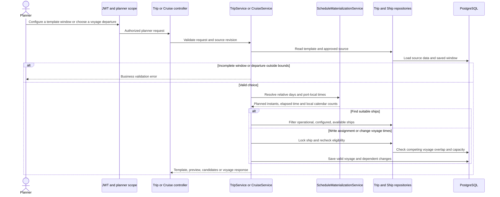

# Departure window, duration and fleet eligibility

Template dates remain relative. An optional pair of inclusive earliest/latest planned departure instants supports existing templates. Window values are included in source fingerprinting and checked on preview and planned updates; arrival and departure instants keep their port timezone. Voyage elapsed seconds are separate from local days and midnights in the departure-port timezone.

New voyages require a positive passenger count. Both passenger field names are accepted. A voyage can be created before ship assignment. Search and assignment exclude unconfigured ships; mutating paths lock the ship and recheck availability, including date changes with the same ship.
